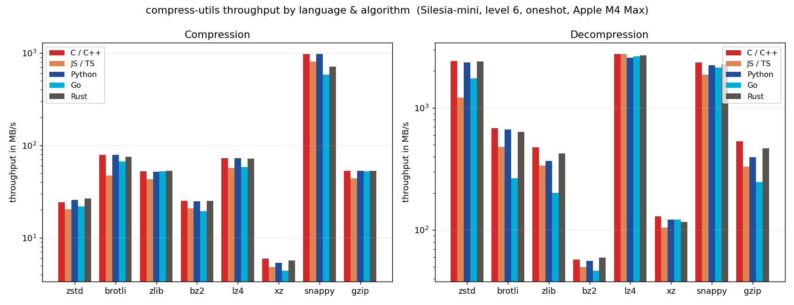

# compress-utils

<p align="center">
  
  
  
</p>
<p align="center">
  
  
  
</p>

A unified, high-performance interface for eight compression algorithms — **Zstandard, Brotli, zlib, bzip2, LZ4, XZ/LZMA, Snappy, gzip** — exposed identically across multiple languages.

```
           ┌──────────────────────────────────────────┐
Your app → │  C / C++ / Go / JS / Python / TS / Rust  │
           └────────────────────┬─────────────────────┘
                                │
                      ┌─────────▼──────────┐
                      │   compress-utils   │
                      └─────────┬──────────┘
                                │
    ┌───────┬───────┬───────┬───┴───┬───────┬───────┬───────┐
  zstd   brotli   zlib    gzip     bz2     lz4     xz    snappy
```

## Supported languages

| Language | Install                                              | Docs                                          |
|----------|------------------------------------------------------|-----------------------------------------------|
| **C**    | Build from source | [C Docs](include/compress_utils.h) |
| **C++**  | Build from source | [C++ Docs](bindings/cpp/README.md) |
| **Go** | `go get github.com/dupontcyborg/compress-utils/bindings/go` | [Go Docs](bindings/go/README.md) |
| **JavaScript** | `npm install compress-utils` | [JS Docs](bindings/wasm/README.md) |
| **Python** | `pip install compress-utils` | [Python Docs](bindings/python/README.md) |
| **Rust** | `cargo add compress-utils` | [Rust Docs](bindings/rust/README.md) |
| **TypeScript** | `npm install compress-utils` | [TS Docs](bindings/wasm/README.md) |
| Swift, Java | _Planned_ |  |

## Supported algorithms

| Algorithm                                          | Strength               | Wire format produced            |
|----------------------------------------------------|------------------------|---------------------------------|
| [Zstandard](https://github.com/facebook/zstd)      | High speed, high ratio | ZSTD frame with content size    |
| [Brotli](https://github.com/google/brotli)         | Web-optimized          | Raw Brotli stream               |
| [zlib](https://github.com/madler/zlib)             | Ubiquitous             | zlib wrapper (RFC 1950)         |
| [gzip](https://www.gnu.org/software/gzip/)         | Ubiquitous (.gz files) | gzip stream (RFC 1952)          |
| [bzip2](https://sourceware.org/bzip2)              | High ratio             | bzip2 stream                    |
| [LZ4](https://github.com/lz4/lz4)                  | Highest speed          | LZ4 frame (interoperable with `lz4` CLI / `.lz4` files) |
| [XZ / LZMA](https://github.com/tukaani-project/xz) | Highest ratio          | XZ stream with CRC64            |
| [Snappy](https://github.com/google/snappy)         | Very high speed, low ratio | Raw Snappy block (interoperable with reference snappy / python-snappy) |

For reading data from other tools, three raw block formats are also available: raw DEFLATE (`deflate`, RFC 1951), raw LZ4 blocks (`lz4_raw`, one-shot compression and incremental decompression) and raw LZO1X blocks (`lzo`, decompression only). Raw blocks don't record their decompressed size, so every binding's `decompress` accepts an output capacity, which `lz4_raw` requires. Code from each codec is credited in [`ACKNOWLEDGMENTS.md`](ACKNOWLEDGMENTS.md), and the license texts are in [`THIRD_PARTY_NOTICES.md`](THIRD_PARTY_NOTICES.md).

All algorithms expose the same API surface and the same level scale (`1` fastest → `10` smallest). The library maps each user level to the algorithm's native range so you don't need to remember that ZSTD goes 1–22 and zlib goes 1–9.

## Benchmarks



All eight codecs across the C, JS/TS, Python, Go, and Rust bindings, measured back-to-back in one interleaved run. Every binding drives the same C core, so compression ratio is byte-identical across languages — only throughput differs, and C, Rust, and Python land on top of each other.

Full methodology, per-corpus Pareto plots, and how to reproduce are in [benchmarks/README.md](benchmarks/README.md).

## Building from source

Prerequisites, build flags, and the test suites are documented in [DEVELOPMENT.md](DEVELOPMENT.md). The short version:

```sh
git clone https://github.com/dupontcyborg/compress-utils.git
cd compress-utils
./build.sh                  # Linux / macOS  (powershell -File build.ps1 on Windows)
```

## AI disclosure

This project was built with substantial use of large language models. Specifically:

- Architecture and design: human (me, [@dupontcyborg](https://nico.codes), a senior software engineer).
- Implementation: basically entirely LLM-driven. Most of the C core, all of the C++/Python/WASM bindings, and the test suites were drafted by Mr. Claude
- Review: me again.

Bugs and typos are most likely my own.

## License

MIT — see [LICENSE](LICENSE).

## Acknowledgments

This project wraps seven battle-tested upstream compression libraries. See [ACKNOWLEDGMENTS.md](ACKNOWLEDGMENTS.md).

Built by [Nico Dupont](https://nico.codes).

Raw LZ4 and LZO1X decompression streams use the shared native incremental decoder.
They emit during writes, retain 64 KiB of history plus the undrained part of the
current input chunk, and validate exactly one block at finish. Streaming needs no
output-capacity hint; the configured output limit is captured at creation.
Raw LZ4 encoding remains one-shot and LZO remains decoder-only.
