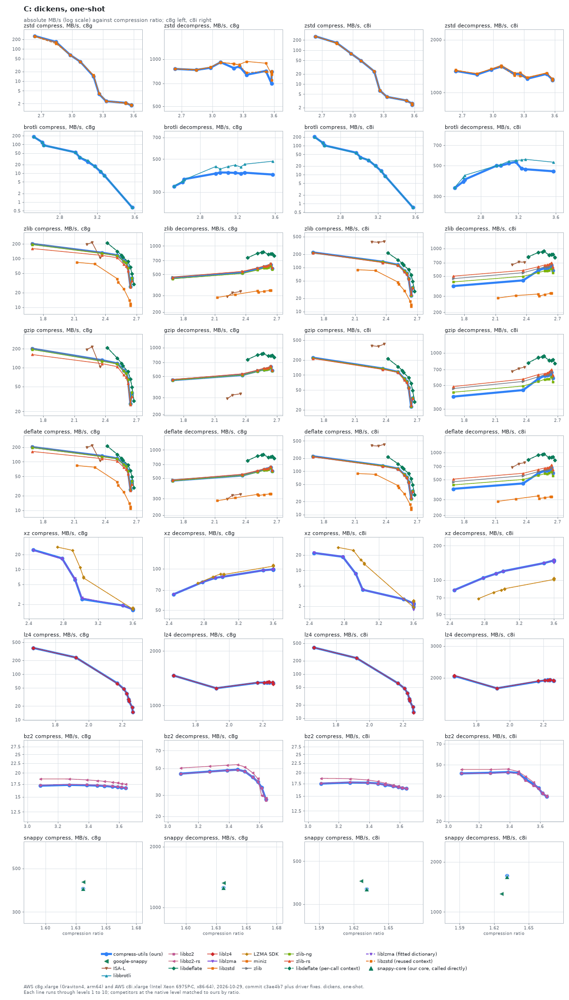
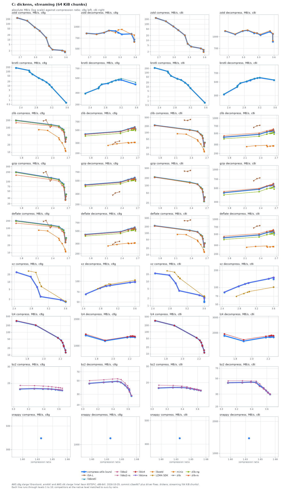
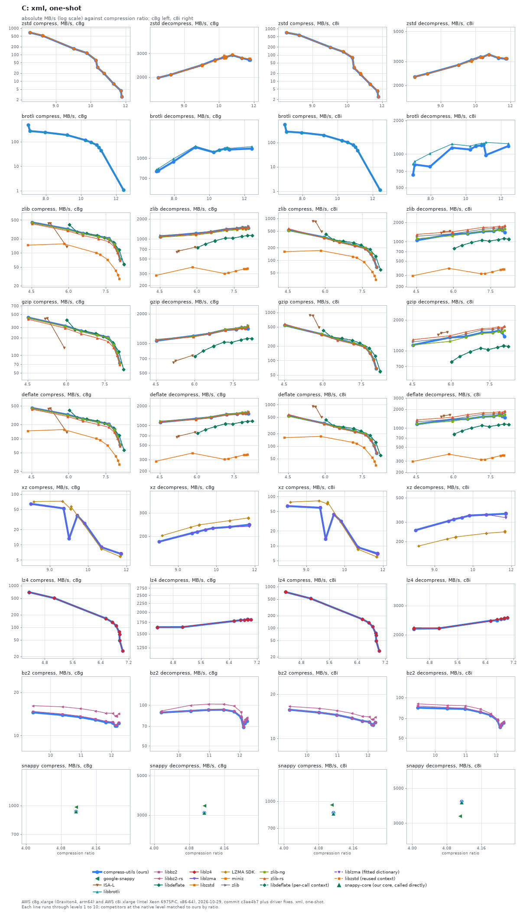
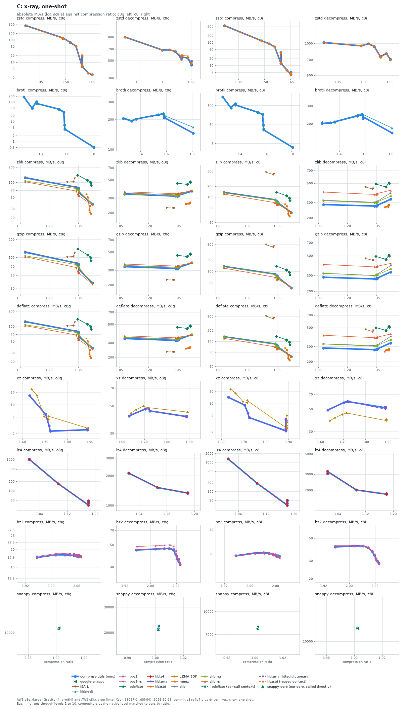
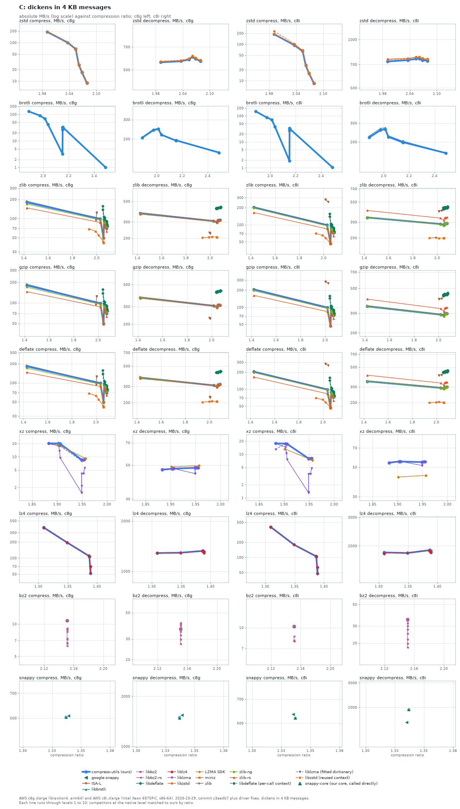

# The C core against native libraries

compress-utils' C core against 14 native libraries on five input sets, on two machines; at level 6 on dickens one-shot it is ahead of the fastest comparable library in 0, level in 14 and behind in 4 of 18 format and direction cells on c8g.

compress-utils' C library, called through its C ABI (`cu_compress`, `cu_decompress`, `cu_decompress_alloc` and the streaming API), against the C libraries that implement each format. The native-library baseline drivers link the same vendored codecs directly, so the C core and the libraries it wraps differ only by our wrapper.

Libraries compared: ISA-L, LZMA SDK, google-snappy, libbrotli, libbz2, libbz2-rs, libdeflate, liblz4, liblzma, libzstd, miniz, zlib, zlib-ng, zlib-rs. Variants of one library (a reused context, a per-call context, a fitted xz dictionary, our own snappy core called directly) are dashed and listed as separate rows: they show a library in its best configuration next to our default API, which flatters it.

How to read the charts: each line is one library, with a point per level (compress-utils levels 1 to 10; each competitor at the native level that matches ours by compression ratio, see [levels.json](../../benchmarks/levels.json)). A library with no levels is a single marker. The vertical axis is absolute throughput in MB/s on a log scale, the horizontal axis is compression ratio (input size over output size), so further right is smaller output and higher is faster. compress-utils is the bold blue line. Dashed lines are variants of a library in a second configuration. Where a competitor's levels cover a different ratio range than ours (klauspost zstd tops out at a lower ratio) the lines simply do not overlap; read speed at equal ratio.

In the tables, `Lx` is compress-utils level x (1 is fastest, 10 smallest), `comp` and `dec` are MB/s, and the multiple in brackets is the competitor's speed divided by ours at the same level: above 1.00x the competitor is faster, and **bold** marks more than 10% faster. Within 10% is a tie (one sample per cell). `-` means the library has no level matching that one. Libraries with no levels follow in a second table, compared with the compress-utils level closest in ratio.

## Dickens, one-shot

### dickens, one-shot: AWS c8g.xlarge (Graviton4, arm64)

| Format | Library | L1 ratio | L1 comp | L1 dec | L6 ratio | L6 comp | L6 dec | L10 ratio | L10 comp | L10 dec |
| :--- | :--- | ---: | ---: | ---: | ---: | ---: | ---: | ---: | ---: | ---: |
| **zstd** | **compress-utils** | **2.64** | **254** | **866** | **3.26** | **3.97** | **897** | **3.58** | **1.83** | **834** |
| zstd | libzstd | 2.64 | 251 (0.99x) | 867 (1.00x) | 3.26 | 4.12 (1.04x) | 924 (1.03x) | 3.58 | 1.83 (1.00x) | 733 (0.88x) |
| zstd | libzstd (reused context) | 2.64 | 244 (0.96x) | 867 (1.00x) | 3.26 | 4.08 (1.03x) | 910 (1.01x) | 3.58 | 1.77 (0.97x) | 837 (1.00x) |
| **brotli** | **compress-utils** | **2.52** | **183** | **328** | **3.10** | **24.9** | **406** | **3.57** | **0.65** | **394** |
| brotli | libbrotli | 2.52 | 183 (1.00x) | 330 (1.01x) | 3.10 | 28.1 (**1.13x**) | 446 (1.10x) | 3.57 | 0.65 (1.01x) | 484 (**1.23x**) |
| **zlib** | **compress-utils** | **1.69** | **200** | **457** | **2.62** | **65.8** | **610** | **2.64** | **26.7** | **635** |
| zlib | ISA-L | 2.22 | 195 (0.97x) | 292 (0.64x) | - | - | - | - | - | - |
| zlib | libdeflate | 2.42 | 209 (1.04x) | 748 (**1.64x**) | 2.64 | 66.2 (1.01x) | 822 (**1.35x**) | 2.67 | 29.5 (**1.10x**) | 791 (**1.25x**) |
| zlib | miniz | 2.13 | 83.4 (0.42x) | 285 (0.62x) | 2.63 | 13.9 (0.21x) | 338 (0.55x) | 2.64 | 10.9 (0.41x) | 339 (0.53x) |
| zlib | zlib | 1.69 | 205 (1.02x) | 470 (1.03x) | 2.62 | 65.8 (1.00x) | 618 (1.01x) | 2.64 | 26.7 (1.00x) | 645 (1.02x) |
| zlib | zlib-ng | 1.69 | 193 (0.97x) | 450 (0.98x) | 2.62 | 64.6 (0.98x) | 589 (0.97x) | 2.64 | 26.3 (0.99x) | 614 (0.97x) |
| zlib | zlib-rs | 1.69 | 160 (0.80x) | 465 (1.02x) | 2.62 | 56.3 (0.86x) | 622 (1.02x) | 2.64 | 25.9 (0.97x) | 651 (1.03x) |
| zlib | libdeflate (per-call context) | 2.42 | 209 (1.04x) | 749 (**1.64x**) | 2.64 | 66.2 (1.01x) | 822 (**1.35x**) | 2.67 | 29.6 (**1.11x**) | 788 (**1.24x**) |
| **gzip** | **compress-utils** | **1.69** | **201** | **457** | **2.62** | **65.7** | **603** | **2.64** | **26.7** | **628** |
| gzip | ISA-L | 2.22 | 195 (0.97x) | 292 (0.64x) | - | - | - | - | - | - |
| gzip | libdeflate | 2.42 | 209 (1.04x) | 751 (**1.64x**) | 2.64 | 66.2 (1.01x) | 824 (**1.37x**) | 2.67 | 29.5 (**1.11x**) | 792 (**1.26x**) |
| gzip | zlib | 1.69 | 204 (1.02x) | 463 (1.01x) | 2.62 | 65.7 (1.00x) | 612 (1.02x) | 2.64 | 26.7 (1.00x) | 640 (1.02x) |
| gzip | zlib-ng | 1.69 | 195 (0.97x) | 455 (1.00x) | 2.62 | 64.5 (0.98x) | 597 (0.99x) | 2.64 | 26.3 (0.98x) | 618 (0.99x) |
| gzip | zlib-rs | 1.69 | 162 (0.81x) | 463 (1.01x) | 2.62 | 56.4 (0.86x) | 616 (1.02x) | 2.64 | 25.8 (0.97x) | 646 (1.03x) |
| gzip | libdeflate (per-call context) | 2.42 | 209 (1.04x) | 751 (**1.64x**) | 2.64 | 66.2 (1.01x) | 825 (**1.37x**) | 2.67 | 29.6 (**1.11x**) | 790 (**1.26x**) |
| **deflate** | **compress-utils** | **1.69** | **201** | **468** | **2.62** | **66.0** | **626** | **2.64** | **26.7** | **653** |
| deflate | ISA-L | 2.22 | 197 (0.98x) | 298 (0.64x) | - | - | - | - | - | - |
| deflate | libdeflate | 2.42 | 211 (1.05x) | 769 (**1.64x**) | 2.64 | 66.4 (1.01x) | 846 (**1.35x**) | 2.67 | 29.5 (**1.10x**) | 813 (**1.24x**) |
| deflate | miniz | 2.13 | 83.5 (0.41x) | 285 (0.61x) | 2.63 | 13.9 (0.21x) | 338 (0.54x) | 2.64 | 10.9 (0.41x) | 340 (0.52x) |
| deflate | zlib | 1.69 | 206 (1.02x) | 478 (1.02x) | 2.62 | 65.9 (1.00x) | 632 (1.01x) | 2.64 | 26.7 (1.00x) | 661 (1.01x) |
| deflate | zlib-ng | 1.69 | 196 (0.97x) | 466 (0.99x) | 2.62 | 64.8 (0.98x) | 615 (0.98x) | 2.64 | 26.3 (0.99x) | 642 (0.98x) |
| deflate | zlib-rs | 1.69 | 163 (0.81x) | 474 (1.01x) | 2.62 | 56.5 (0.86x) | 635 (1.02x) | 2.64 | 25.9 (0.97x) | 670 (1.03x) |
| deflate | libdeflate (per-call context) | 2.42 | 211 (1.05x) | 768 (**1.64x**) | 2.64 | 66.4 (1.01x) | 845 (**1.35x**) | 2.67 | 29.6 (**1.11x**) | 812 (**1.24x**) |
| **xz** | **compress-utils** | **2.45** | **24.8** | **65.1** | **3.60** | **1.58** | **99.0** | **3.60** | **1.57** | **99.2** |
| xz | liblzma | 2.45 | 24.3 (0.98x) | 65.0 (1.00x) | 3.60 | 1.59 (1.01x) | 98.2 (0.99x) | 3.60 | 1.61 (1.03x) | 98.9 (1.00x) |
| xz | LZMA SDK | 2.73 | 28.1 (**1.13x**) | 78.5 (**1.21x**) | 3.60 | 1.63 (1.03x) | 105 (1.06x) | 3.60 | 1.69 (1.08x) | 106 (1.07x) |
| xz | liblzma (fitted dictionary) | 2.45 | 24.2 (0.98x) | 65.1 (1.00x) | 3.60 | 1.61 (1.02x) | 99.0 (1.00x) | 3.60 | 1.60 (1.02x) | 98.6 (0.99x) |
| **lz4** | **compress-utils** | **1.58** | **376** | **1462** | **2.28** | **37.8** | **1336** | **2.33** | **14.7** | **1325** |
| lz4 | liblz4 | 1.58 | 377 (1.00x) | 1462 (1.00x) | 2.28 | 37.6 (0.99x) | 1345 (1.01x) | 2.33 | 14.8 (1.00x) | 1314 (0.99x) |
| **bz2** | **compress-utils** | **3.09** | **17.1** | **45.1** | **3.56** | **16.9** | **42.1** | **3.64** | **16.6** | **23.9** |
| bz2 | libbz2 | 3.09 | 17.2 (1.01x) | 45.0 (1.00x) | 3.56 | 17.0 (1.01x) | 42.3 (1.00x) | 3.64 | 16.7 (1.00x) | 27.5 (**1.15x**) |
| bz2 | libbz2-rs | 3.09 | 18.6 (1.09x) | 50.3 (**1.11x**) | 3.56 | 17.9 (1.06x) | 45.9 (1.09x) | 3.64 | 17.5 (1.05x) | 27.1 (**1.13x**) |
| **snappy** | **compress-utils** | **1.63** | **395** | **1254** | **1.63** | **395** | **1254** | **1.63** | **395** | **1255** |

Libraries without levels, c8g:

| Format | Library | Ratio | Comp | Dec | Ours at | Ours ratio | Ours comp | Ours dec | Comp x | Dec x |
| :--- | :--- | ---: | ---: | ---: | :--- | ---: | ---: | ---: | ---: | ---: |
| snappy | google-snappy | 1.63 | 428 | 1324 | L6 | 1.63 | 395 | 1254 | 1.08x | 1.06x |
| snappy | snappy-core (our core, called directly) | 1.63 | 395 | 1253 | L6 | 1.63 | 395 | 1254 | 1.00x | 1.00x |

### dickens, one-shot: AWS c8i.xlarge (Intel Xeon 6975P-C, x86-64)

| Format | Library | L1 ratio | L1 comp | L1 dec | L6 ratio | L6 comp | L6 dec | L10 ratio | L10 comp | L10 dec |
| :--- | :--- | ---: | ---: | ---: | ---: | ---: | ---: | ---: | ---: | ---: |
| **zstd** | **compress-utils** | **2.64** | **258** | **1328** | **3.26** | **6.47** | **1277** | **3.58** | **2.43** | **1180** |
| zstd | libzstd | 2.64 | 258 (1.00x) | 1332 (1.00x) | 3.26 | 6.48 (1.00x) | 1296 (1.01x) | 3.58 | 2.38 (0.98x) | 1178 (1.00x) |
| zstd | libzstd (reused context) | 2.64 | 258 (1.00x) | 1345 (1.01x) | 3.26 | 6.36 (0.98x) | 1241 (0.97x) | 3.58 | 2.46 (1.01x) | 1188 (1.01x) |
| **brotli** | **compress-utils** | **2.52** | **202** | **345** | **3.10** | **31.3** | **519** | **3.57** | **0.73** | **455** |
| brotli | libbrotli | 2.52 | 199 (0.99x) | 349 (1.01x) | 3.10 | 32.9 (1.05x) | 538 (1.04x) | 3.57 | 0.74 (1.01x) | 529 (**1.16x**) |
| **zlib** | **compress-utils** | **1.69** | **219** | **387** | **2.62** | **56.0** | **622** | **2.64** | **23.1** | **659** |
| zlib | ISA-L | 2.26 | 381 (**1.74x**) | 662 (**1.71x**) | - | - | - | - | - | - |
| zlib | libdeflate | 2.42 | 213 (0.97x) | 810 (**2.09x**) | 2.64 | 67.5 (**1.20x**) | 860 (**1.38x**) | 2.67 | 28.8 (**1.25x**) | 800 (**1.21x**) |
| zlib | miniz | 2.13 | 88.6 (0.40x) | 287 (0.74x) | 2.63 | 17.1 (0.31x) | 322 (0.52x) | 2.64 | 13.1 (0.57x) | 324 (0.49x) |
| zlib | zlib | 1.69 | 220 (1.00x) | 467 (**1.21x**) | 2.62 | 56.0 (1.00x) | 634 (1.02x) | 2.64 | 23.2 (1.00x) | 670 (1.02x) |
| zlib | zlib-ng | 1.69 | 213 (0.97x) | 430 (**1.11x**) | 2.62 | 56.1 (1.00x) | 575 (0.92x) | 2.64 | 23.0 (1.00x) | 600 (0.91x) |
| zlib | zlib-rs | 1.69 | 215 (0.98x) | 497 (**1.28x**) | 2.62 | 54.8 (0.98x) | 669 (1.08x) | 2.64 | 24.9 (1.08x) | 706 (1.07x) |
| zlib | libdeflate (per-call context) | 2.42 | 212 (0.97x) | 807 (**2.09x**) | 2.64 | 67.8 (**1.21x**) | 856 (**1.38x**) | 2.67 | 28.8 (**1.25x**) | 798 (**1.21x**) |
| **gzip** | **compress-utils** | **1.69** | **222** | **392** | **2.62** | **56.3** | **625** | **2.64** | **23.1** | **661** |
| gzip | ISA-L | 2.26 | 384 (**1.73x**) | 671 (**1.71x**) | - | - | - | - | - | - |
| gzip | libdeflate | 2.42 | 213 (0.96x) | 810 (**2.07x**) | 2.64 | 67.5 (**1.20x**) | 852 (**1.36x**) | 2.67 | 28.8 (**1.24x**) | 789 (**1.19x**) |
| gzip | zlib | 1.69 | 222 (1.00x) | 466 (**1.19x**) | 2.62 | 56.1 (1.00x) | 625 (1.00x) | 2.64 | 23.1 (1.00x) | 669 (1.01x) |
| gzip | zlib-ng | 1.69 | 216 (0.97x) | 431 (1.10x) | 2.62 | 56.1 (1.00x) | 570 (0.91x) | 2.64 | 23.0 (1.00x) | 603 (0.91x) |
| gzip | zlib-rs | 1.69 | 214 (0.96x) | 486 (**1.24x**) | 2.62 | 54.9 (0.97x) | 665 (1.06x) | 2.64 | 24.7 (1.07x) | 705 (1.07x) |
| gzip | libdeflate (per-call context) | 2.42 | 213 (0.96x) | 807 (**2.06x**) | 2.64 | 67.5 (**1.20x**) | 848 (**1.36x**) | 2.67 | 28.8 (**1.25x**) | 799 (**1.21x**) |
| **deflate** | **compress-utils** | **1.69** | **222** | **394** | **2.62** | **56.2** | **640** | **2.64** | **23.1** | **674** |
| deflate | ISA-L | 2.26 | 389 (**1.75x**) | 684 (**1.73x**) | - | - | - | - | - | - |
| deflate | libdeflate | 2.42 | 215 (0.97x) | 835 (**2.12x**) | 2.64 | 67.9 (**1.21x**) | 890 (**1.39x**) | 2.67 | 28.9 (**1.25x**) | 820 (**1.22x**) |
| deflate | miniz | 2.13 | 88.5 (0.40x) | 287 (0.73x) | 2.63 | 17.1 (0.30x) | 322 (0.50x) | 2.64 | 13.1 (0.57x) | 323 (0.48x) |
| deflate | zlib | 1.69 | 223 (1.01x) | 473 (**1.20x**) | 2.62 | 56.4 (1.00x) | 651 (1.02x) | 2.64 | 23.2 (1.00x) | 686 (1.02x) |
| deflate | zlib-ng | 1.69 | 215 (0.97x) | 436 (**1.11x**) | 2.62 | 56.0 (1.00x) | 590 (0.92x) | 2.64 | 23.0 (1.00x) | 614 (0.91x) |
| deflate | zlib-rs | 1.69 | 215 (0.97x) | 506 (**1.28x**) | 2.62 | 54.8 (0.98x) | 684 (1.07x) | 2.64 | 24.8 (1.07x) | 725 (1.08x) |
| deflate | libdeflate (per-call context) | 2.42 | 215 (0.97x) | 831 (**2.11x**) | 2.64 | 67.7 (**1.21x**) | 889 (**1.39x**) | 2.67 | 28.8 (**1.25x**) | 821 (**1.22x**) |
| **xz** | **compress-utils** | **2.45** | **21.8** | **81.6** | **3.60** | **2.28** | **148** | **3.60** | **2.17** | **148** |
| xz | liblzma | 2.45 | 21.9 (1.00x) | 81.4 (1.00x) | 3.60 | 2.28 (1.00x) | 149 (1.00x) | 3.60 | 1.93 (0.89x) | 142 (0.96x) |
| xz | LZMA SDK | 2.73 | 27.9 (**1.28x**) | 69.0 (0.85x) | 3.60 | 2.55 (**1.12x**) | 104 (0.70x) | 3.60 | 2.45 (**1.13x**) | 103 (0.69x) |
| xz | liblzma (fitted dictionary) | 2.45 | 21.9 (1.00x) | 81.1 (0.99x) | 3.60 | 2.28 (1.00x) | 148 (1.00x) | 3.60 | 2.12 (0.98x) | 146 (0.98x) |
| **lz4** | **compress-utils** | **1.58** | **396** | **2039** | **2.28** | **36.9** | **1945** | **2.33** | **13.6** | **1927** |
| lz4 | liblz4 | 1.58 | 397 (1.00x) | 2042 (1.00x) | 2.28 | 37.0 (1.00x) | 1942 (1.00x) | 2.33 | 13.5 (0.99x) | 1925 (1.00x) |
| **bz2** | **compress-utils** | **3.09** | **17.5** | **43.4** | **3.56** | **16.9** | **36.6** | **3.64** | **16.5** | **29.9** |
| bz2 | libbz2 | 3.09 | 17.6 (1.00x) | 43.4 (1.00x) | 3.56 | 16.9 (1.00x) | 35.7 (0.98x) | 3.64 | 16.4 (1.00x) | 29.8 (1.00x) |
| bz2 | libbz2-rs | 3.09 | 18.7 (1.07x) | 46.4 (1.07x) | 3.56 | 17.2 (1.01x) | 37.7 (1.03x) | 3.64 | 16.5 (1.00x) | 30.3 (1.01x) |
| **snappy** | **compress-utils** | **1.63** | **359** | **1636** | **1.63** | **359** | **1664** | **1.63** | **360** | **1667** |

Libraries without levels, c8i:

| Format | Library | Ratio | Comp | Dec | Ours at | Ours ratio | Ours comp | Ours dec | Comp x | Dec x |
| :--- | :--- | ---: | ---: | ---: | :--- | ---: | ---: | ---: | ---: | ---: |
| snappy | google-snappy | 1.63 | 395 | 1284 | L6 | 1.63 | 359 | 1664 | **1.10x** | 0.77x |
| snappy | snappy-core (our core, called directly) | 1.63 | 358 | 1629 | L6 | 1.63 | 359 | 1664 | 1.00x | 0.98x |

## Dickens, streaming (64 KiB chunks)

### dickens, streaming (64 KiB chunks): AWS c8g.xlarge (Graviton4, arm64)

| Format | Library | L1 ratio | L1 comp | L1 dec | L6 ratio | L6 comp | L6 dec | L10 ratio | L10 comp | L10 dec |
| :--- | :--- | ---: | ---: | ---: | ---: | ---: | ---: | ---: | ---: | ---: |
| **zstd** | **compress-utils** | **2.64** | **242** | **814** | **3.26** | **4.06** | **831** | **3.58** | **1.62** | **624** |
| zstd | libzstd | 2.64 | 243 (1.00x) | 814 (1.00x) | 3.26 | 4.03 (0.99x) | 908 (1.09x) | 3.58 | 1.67 (1.03x) | 615 (0.99x) |
| **brotli** | **compress-utils** | **2.27** | **183** | **294** | **2.96** | **26.2** | **443** | **3.57** | **0.65** | **402** |
| brotli | libbrotli | 2.27 | 185 (1.01x) | 293 (1.00x) | 2.96 | 26.6 (1.02x) | 439 (0.99x) | 3.57 | 0.65 (1.00x) | 433 (1.08x) |
| **zlib** | **compress-utils** | **1.69** | **198** | **427** | **2.62** | **65.7** | **546** | **2.64** | **26.7** | **567** |
| zlib | ISA-L | 2.22 | 189 (0.95x) | 283 (0.66x) | - | - | - | - | - | - |
| zlib | miniz | 2.13 | 83.3 (0.42x) | 275 (0.64x) | 2.63 | 14.0 (0.21x) | 308 (0.56x) | 2.64 | 10.9 (0.41x) | 309 (0.55x) |
| zlib | zlib | 1.69 | 205 (1.03x) | 428 (1.00x) | 2.62 | 65.8 (1.00x) | 549 (1.00x) | 2.64 | 26.7 (1.00x) | 569 (1.00x) |
| zlib | zlib-ng | 1.69 | 195 (0.98x) | 396 (0.93x) | 2.62 | 64.6 (0.98x) | 507 (0.93x) | 2.64 | 26.3 (0.99x) | 524 (0.92x) |
| zlib | zlib-rs | 1.69 | 163 (0.82x) | 420 (0.98x) | 2.62 | 56.5 (0.86x) | 540 (0.99x) | 2.64 | 25.9 (0.97x) | 562 (0.99x) |
| **gzip** | **compress-utils** | **1.69** | **200** | **425** | **2.62** | **65.6** | **546** | **2.64** | **26.7** | **567** |
| gzip | ISA-L | 2.22 | 190 (0.95x) | 285 (0.67x) | - | - | - | - | - | - |
| gzip | zlib | 1.69 | 204 (1.02x) | 427 (1.00x) | 2.62 | 65.7 (1.00x) | 548 (1.00x) | 2.64 | 26.7 (1.00x) | 568 (1.00x) |
| gzip | zlib-ng | 1.69 | 194 (0.97x) | 399 (0.94x) | 2.62 | 64.5 (0.98x) | 510 (0.93x) | 2.64 | 26.3 (0.99x) | 528 (0.93x) |
| gzip | zlib-rs | 1.69 | 162 (0.81x) | 418 (0.98x) | 2.62 | 56.4 (0.86x) | 536 (0.98x) | 2.64 | 25.9 (0.97x) | 558 (0.98x) |
| **deflate** | **compress-utils** | **1.69** | **201** | **434** | **2.62** | **65.9** | **560** | **2.64** | **26.7** | **581** |
| deflate | ISA-L | 2.22 | 191 (0.95x) | 289 (0.67x) | - | - | - | - | - | - |
| deflate | miniz | 2.13 | 83.3 (0.41x) | 274 (0.63x) | 2.63 | 14.0 (0.21x) | 309 (0.55x) | 2.64 | 10.9 (0.41x) | 308 (0.53x) |
| deflate | zlib | 1.69 | 205 (1.02x) | 436 (1.00x) | 2.62 | 65.9 (1.00x) | 562 (1.00x) | 2.64 | 26.7 (1.00x) | 584 (1.00x) |
| deflate | zlib-ng | 1.69 | 195 (0.97x) | 407 (0.94x) | 2.62 | 64.8 (0.98x) | 522 (0.93x) | 2.64 | 26.3 (0.99x) | 541 (0.93x) |
| deflate | zlib-rs | 1.69 | 164 (0.81x) | 427 (0.98x) | 2.62 | 56.5 (0.86x) | 551 (0.98x) | 2.64 | 25.9 (0.97x) | 573 (0.99x) |
| **xz** | **compress-utils** | **2.45** | **24.6** | **65.0** | **3.60** | **1.61** | **97.8** | **3.60** | **1.59** | **98.9** |
| xz | liblzma | 2.45 | 24.2 (0.99x) | 65.0 (1.00x) | 3.60 | 1.65 (1.02x) | 99.1 (1.01x) | 3.60 | 1.61 (1.01x) | 98.2 (0.99x) |
| xz | LZMA SDK | 2.73 | 27.8 (**1.13x**) | 78.5 (**1.21x**) | 3.60 | 1.69 (1.05x) | 105 (1.07x) | 3.60 | 1.63 (1.03x) | 104 (1.05x) |
| **lz4** | **compress-utils** | **1.58** | **315** | **1313** | **2.28** | **35.2** | **1262** | **2.33** | **12.9** | **1250** |
| lz4 | liblz4 | 1.58 | 322 (1.02x) | 1353 (1.03x) | 2.28 | 35.1 (1.00x) | 1285 (1.02x) | 2.33 | 12.9 (1.00x) | 1273 (1.02x) |
| **bz2** | **compress-utils** | **3.09** | **17.3** | **45.2** | **3.56** | **17.1** | **42.3** | **3.64** | **16.8** | **29.1** |
| bz2 | libbz2 | 3.09 | 17.4 (1.00x) | 45.0 (1.00x) | 3.56 | 17.1 (1.00x) | 42.3 (1.00x) | 3.64 | 16.9 (1.00x) | 29.0 (1.00x) |
| bz2 | libbz2-rs | 3.09 | 18.9 (1.09x) | 50.3 (**1.11x**) | 3.56 | 18.1 (1.06x) | 46.0 (1.09x) | 3.64 | 17.7 (1.05x) | 27.7 (0.95x) |
| **snappy** | **compress-utils** | **1.63** | **382** | **1137** | **1.63** | **383** | **1149** | **1.63** | **383** | **1150** |

### dickens, streaming (64 KiB chunks): AWS c8i.xlarge (Intel Xeon 6975P-C, x86-64)

| Format | Library | L1 ratio | L1 comp | L1 dec | L6 ratio | L6 comp | L6 dec | L10 ratio | L10 comp | L10 dec |
| :--- | :--- | ---: | ---: | ---: | ---: | ---: | ---: | ---: | ---: | ---: |
| **zstd** | **compress-utils** | **2.64** | **240** | **1192** | **3.26** | **6.29** | **1115** | **3.58** | **2.04** | **859** |
| zstd | libzstd | 2.64 | 241 (1.00x) | 1200 (1.01x) | 3.26 | 6.30 (1.00x) | 1118 (1.00x) | 3.58 | 1.89 (0.93x) | 886 (1.03x) |
| **brotli** | **compress-utils** | **2.27** | **222** | **312** | **2.96** | **30.5** | **533** | **3.57** | **0.74** | **538** |
| brotli | libbrotli | 2.27 | 225 (1.01x) | 317 (1.02x) | 2.96 | 30.4 (1.00x) | 547 (1.03x) | 3.57 | 0.73 (0.98x) | 543 (1.01x) |
| **zlib** | **compress-utils** | **1.69** | **218** | **421** | **2.62** | **56.0** | **560** | **2.64** | **23.0** | **586** |
| zlib | ISA-L | 2.26 | 369 (**1.69x**) | 654 (**1.55x**) | - | - | - | - | - | - |
| zlib | miniz | 2.13 | 88.5 (0.41x) | 274 (0.65x) | 2.63 | 17.1 (0.31x) | 282 (0.50x) | 2.64 | 13.1 (0.57x) | 281 (0.48x) |
| zlib | zlib | 1.69 | 221 (1.01x) | 425 (1.01x) | 2.62 | 56.3 (1.01x) | 563 (1.01x) | 2.64 | 23.0 (1.00x) | 588 (1.00x) |
| zlib | zlib-ng | 1.69 | 215 (0.99x) | 390 (0.93x) | 2.62 | 56.0 (1.00x) | 509 (0.91x) | 2.64 | 23.0 (1.00x) | 527 (0.90x) |
| zlib | zlib-rs | 1.69 | 214 (0.98x) | 452 (1.08x) | 2.62 | 54.9 (0.98x) | 589 (1.05x) | 2.64 | 24.8 (1.08x) | 621 (1.06x) |
| **gzip** | **compress-utils** | **1.69** | **219** | **423** | **2.62** | **55.9** | **560** | **2.64** | **22.9** | **587** |
| gzip | ISA-L | 2.26 | 379 (**1.73x**) | 658 (**1.56x**) | - | - | - | - | - | - |
| gzip | zlib | 1.69 | 222 (1.01x) | 426 (1.01x) | 2.62 | 56.4 (1.01x) | 565 (1.01x) | 2.64 | 23.0 (1.00x) | 591 (1.01x) |
| gzip | zlib-ng | 1.69 | 217 (0.99x) | 391 (0.92x) | 2.62 | 56.1 (1.00x) | 511 (0.91x) | 2.64 | 23.0 (1.00x) | 529 (0.90x) |
| gzip | zlib-rs | 1.69 | 216 (0.98x) | 442 (1.05x) | 2.62 | 54.8 (0.98x) | 574 (1.02x) | 2.64 | 24.8 (1.08x) | 601 (1.02x) |
| **deflate** | **compress-utils** | **1.69** | **220** | **425** | **2.62** | **56.0** | **565** | **2.64** | **23.0** | **592** |
| deflate | ISA-L | 2.26 | 378 (**1.72x**) | 667 (**1.57x**) | - | - | - | - | - | - |
| deflate | miniz | 2.13 | 88.5 (0.40x) | 274 (0.65x) | 2.63 | 17.1 (0.31x) | 282 (0.50x) | 2.64 | 13.1 (0.57x) | 283 (0.48x) |
| deflate | zlib | 1.69 | 223 (1.01x) | 428 (1.01x) | 2.62 | 56.3 (1.01x) | 569 (1.01x) | 2.64 | 23.0 (1.00x) | 594 (1.00x) |
| deflate | zlib-ng | 1.69 | 215 (0.98x) | 392 (0.92x) | 2.62 | 56.0 (1.00x) | 514 (0.91x) | 2.64 | 23.0 (1.00x) | 533 (0.90x) |
| deflate | zlib-rs | 1.69 | 215 (0.98x) | 456 (1.07x) | 2.62 | 55.0 (0.98x) | 599 (1.06x) | 2.64 | 24.8 (1.08x) | 626 (1.06x) |
| **xz** | **compress-utils** | **2.45** | **21.8** | **81.8** | **3.60** | **2.27** | **149** | **3.60** | **1.42** | **139** |
| xz | liblzma | 2.45 | 22.1 (1.01x) | 82.3 (1.01x) | 3.60 | 2.28 (1.00x) | 150 (1.01x) | 3.60 | 1.94 (**1.37x**) | 144 (1.04x) |
| xz | LZMA SDK | 2.73 | 27.9 (**1.28x**) | 69.5 (0.85x) | 3.60 | 2.54 (**1.12x**) | 102 (0.68x) | 3.60 | 2.40 (**1.69x**) | 101 (0.73x) |
| **lz4** | **compress-utils** | **1.58** | **327** | **1847** | **2.28** | **33.1** | **1795** | **2.33** | **11.4** | **1779** |
| lz4 | liblz4 | 1.58 | 332 (1.01x) | 1939 (1.05x) | 2.28 | 33.2 (1.00x) | 1857 (1.03x) | 2.33 | 11.3 (0.99x) | 1844 (1.04x) |
| **bz2** | **compress-utils** | **3.09** | **17.5** | **43.5** | **3.56** | **17.0** | **36.6** | **3.64** | **16.5** | **29.8** |
| bz2 | libbz2 | 3.09 | 17.6 (1.01x) | 43.3 (1.00x) | 3.56 | 16.9 (1.00x) | 35.6 (0.97x) | 3.64 | 16.5 (1.00x) | 29.9 (1.00x) |
| bz2 | libbz2-rs | 3.09 | 18.8 (1.07x) | 46.3 (1.07x) | 3.56 | 17.2 (1.02x) | 36.9 (1.01x) | 3.64 | 16.6 (1.01x) | 30.4 (1.02x) |
| **snappy** | **compress-utils** | **1.63** | **328** | **1395** | **1.63** | **342** | **1375** | **1.63** | **342** | **1407** |

## Xml, one-shot

### xml, one-shot: AWS c8g.xlarge (Graviton4, arm64)

| Format | Library | L1 ratio | L1 comp | L1 dec | L6 ratio | L6 comp | L6 dec | L10 ratio | L10 comp | L10 dec |
| :--- | :--- | ---: | ---: | ---: | ---: | ---: | ---: | ---: | ---: | ---: |
| **zstd** | **compress-utils** | **7.88** | **685** | **1976** | **10.79** | **33.0** | **2812** | **11.84** | **2.57** | **2684** |
| zstd | libzstd | 7.88 | 700 (1.02x) | 1984 (1.00x) | 10.79 | 33.6 (1.02x) | 2772 (0.99x) | 11.84 | 2.56 (1.00x) | 2750 (1.02x) |
| zstd | libzstd (reused context) | 7.88 | 681 (0.99x) | 1979 (1.00x) | 10.79 | 33.7 (1.02x) | 2860 (1.02x) | 11.84 | 2.57 (1.00x) | 2724 (1.01x) |
| **brotli** | **compress-utils** | **6.99** | **496** | **790** | **10.56** | **95.5** | **1154** | **12.42** | **1.08** | **1186** |
| brotli | libbrotli | 6.99 | 499 (1.01x) | 816 (1.03x) | 10.56 | 94.3 (0.99x) | 1152 (1.00x) | 12.42 | 1.09 (1.01x) | 1227 (1.03x) |
| **zlib** | **compress-utils** | **4.52** | **446** | **1084** | **7.84** | **156** | **1475** | **8.08** | **73.9** | **1442** |
| zlib | ISA-L | 5.18 | 422 (0.95x) | 636 (0.59x) | - | - | - | - | - | - |
| zlib | libdeflate | 6.02 | 400 (0.90x) | 742 (0.68x) | 7.81 | 166 (1.07x) | 1089 (0.74x) | 8.23 | 57.3 (0.77x) | 1127 (0.78x) |
| zlib | miniz | 4.35 | 146 (0.33x) | 284 (0.26x) | 7.90 | 42.2 (0.27x) | 353 (0.24x) | 8.05 | 28.2 (0.38x) | 360 (0.25x) |
| zlib | zlib | 4.52 | 452 (1.02x) | 1124 (1.04x) | 7.84 | 156 (1.00x) | 1517 (1.03x) | 8.08 | 73.7 (1.00x) | 1558 (1.08x) |
| zlib | zlib-ng | 4.52 | 433 (0.97x) | 1060 (0.98x) | 7.84 | 153 (0.98x) | 1414 (0.96x) | 8.08 | 73.2 (0.99x) | 1452 (1.01x) |
| zlib | zlib-rs | 4.52 | 416 (0.93x) | 1086 (1.00x) | 7.84 | 135 (0.87x) | 1465 (0.99x) | 8.08 | 69.0 (0.93x) | 1503 (1.04x) |
| zlib | libdeflate (per-call context) | 6.02 | 399 (0.90x) | 738 (0.68x) | 7.81 | 166 (1.07x) | 1090 (0.74x) | 8.23 | 57.2 (0.77x) | 1128 (0.78x) |
| **gzip** | **compress-utils** | **4.52** | **442** | **1064** | **7.84** | **155** | **1438** | **8.08** | **73.8** | **1416** |
| gzip | ISA-L | 5.18 | 424 (0.96x) | 640 (0.60x) | - | - | - | - | - | - |
| gzip | libdeflate | 6.02 | 401 (0.91x) | 741 (0.70x) | 7.81 | 166 (1.07x) | 1087 (0.76x) | 8.23 | 57.3 (0.78x) | 1124 (0.79x) |
| gzip | zlib | 4.52 | 448 (1.01x) | 1097 (1.03x) | 7.84 | 155 (1.00x) | 1482 (1.03x) | 8.08 | 73.6 (1.00x) | 1528 (1.08x) |
| gzip | zlib-ng | 4.52 | 433 (0.98x) | 1078 (1.01x) | 7.84 | 153 (0.98x) | 1452 (1.01x) | 8.08 | 73.0 (0.99x) | 1506 (1.06x) |
| gzip | zlib-rs | 4.52 | 414 (0.94x) | 1078 (1.01x) | 7.84 | 135 (0.87x) | 1420 (0.99x) | 8.08 | 68.9 (0.93x) | 1481 (1.05x) |
| gzip | libdeflate (per-call context) | 6.02 | 401 (0.91x) | 740 (0.70x) | 7.81 | 167 (1.07x) | 1088 (0.76x) | 8.23 | 57.2 (0.78x) | 1122 (0.79x) |
| **deflate** | **compress-utils** | **4.52** | **452** | **1126** | **7.84** | **157** | **1553** | **8.08** | **74.0** | **1530** |
| deflate | ISA-L | 5.18 | 435 (0.96x) | 663 (0.59x) | - | - | - | - | - | - |
| deflate | libdeflate | 6.02 | 406 (0.90x) | 759 (0.67x) | 7.81 | 167 (1.07x) | 1127 (0.73x) | 8.23 | 57.4 (0.77x) | 1164 (0.76x) |
| deflate | miniz | 4.35 | 146 (0.32x) | 284 (0.25x) | 7.90 | 42.2 (0.27x) | 353 (0.23x) | 8.05 | 28.1 (0.38x) | 360 (0.24x) |
| deflate | zlib | 4.52 | 459 (1.02x) | 1166 (1.04x) | 7.84 | 157 (1.00x) | 1599 (1.03x) | 8.08 | 73.8 (1.00x) | 1649 (1.08x) |
| deflate | zlib-ng | 4.52 | 442 (0.98x) | 1147 (1.02x) | 7.84 | 154 (0.98x) | 1571 (1.01x) | 8.08 | 73.3 (0.99x) | 1615 (1.06x) |
| deflate | zlib-rs | 4.52 | 423 (0.94x) | 1136 (1.01x) | 7.84 | 136 (0.87x) | 1541 (0.99x) | 8.08 | 69.2 (0.93x) | 1594 (1.04x) |
| deflate | libdeflate (per-call context) | 6.02 | 407 (0.90x) | 757 (0.67x) | 7.81 | 168 (1.07x) | 1120 (0.72x) | 8.23 | 57.3 (0.77x) | 1165 (0.76x) |
| **xz** | **compress-utils** | **8.26** | **64.5** | **182** | **11.03** | **8.93** | **235** | **11.79** | **6.67** | **244** |
| xz | liblzma | 8.26 | 63.2 (0.98x) | 181 (0.99x) | 11.03 | 9.05 (1.01x) | 234 (1.00x) | 11.79 | 6.61 (0.99x) | 238 (0.97x) |
| xz | LZMA SDK | 8.37 | 71.3 (**1.11x**) | 202 (**1.11x**) | 11.02 | 8.31 (0.93x) | 262 (**1.12x**) | 11.75 | 5.87 (0.88x) | 275 (**1.13x**) |
| xz | liblzma (fitted dictionary) | 8.26 | 63.5 (0.99x) | 182 (1.00x) | 11.03 | 9.05 (1.01x) | 235 (1.00x) | 11.79 | 6.74 (1.01x) | 245 (1.00x) |
| **lz4** | **compress-utils** | **4.35** | **695** | **1629** | **6.84** | **110** | **1802** | **7.03** | **27.3** | **1812** |
| lz4 | liblz4 | 4.35 | 693 (1.00x) | 1637 (1.00x) | 6.84 | 110 (1.00x) | 1805 (1.00x) | 7.03 | 27.3 (1.00x) | 1810 (1.00x) |
| **bz2** | **compress-utils** | **9.42** | **14.5** | **88.2** | **12.04** | **12.3** | **81.7** | **12.12** | **11.7** | **70.6** |
| bz2 | libbz2 | 9.42 | 14.7 (1.02x) | 88.4 (1.00x) | 12.04 | 12.4 (1.01x) | 83.0 (1.02x) | 12.12 | 11.9 (1.02x) | 70.5 (1.00x) |
| bz2 | libbz2-rs | 9.42 | 16.1 (**1.11x**) | 90.5 (1.03x) | 12.04 | 14.3 (**1.16x**) | 89.0 (1.09x) | 12.12 | 13.7 (**1.17x**) | 75.4 (1.07x) |
| **snappy** | **compress-utils** | **4.11** | **934** | **3101** | **4.11** | **934** | **3116** | **4.11** | **934** | **3073** |

Libraries without levels, c8g:

| Format | Library | Ratio | Comp | Dec | Ours at | Ours ratio | Ours comp | Ours dec | Comp x | Dec x |
| :--- | :--- | ---: | ---: | ---: | :--- | ---: | ---: | ---: | ---: | ---: |
| snappy | google-snappy | 4.11 | 982 | 3394 | L6 | 4.11 | 934 | 3116 | 1.05x | 1.09x |
| snappy | snappy-core (our core, called directly) | 4.11 | 933 | 3105 | L6 | 4.11 | 934 | 3116 | 1.00x | 1.00x |

### xml, one-shot: AWS c8i.xlarge (Intel Xeon 6975P-C, x86-64)

| Format | Library | L1 ratio | L1 comp | L1 dec | L6 ratio | L6 comp | L6 dec | L10 ratio | L10 comp | L10 dec |
| :--- | :--- | ---: | ---: | ---: | ---: | ---: | ---: | ---: | ---: | ---: |
| **zstd** | **compress-utils** | **7.88** | **711** | **2312** | **10.79** | **32.2** | **3227** | **11.84** | **2.51** | **3155** |
| zstd | libzstd | 7.88 | 711 (1.00x) | 2321 (1.00x) | 10.79 | 32.6 (1.01x) | 3253 (1.01x) | 11.84 | 2.50 (1.00x) | 3170 (1.00x) |
| zstd | libzstd (reused context) | 7.88 | 736 (1.04x) | 2279 (0.99x) | 10.79 | 34.8 (1.08x) | 3211 (1.00x) | 11.84 | 2.53 (1.01x) | 3142 (1.00x) |
| **brotli** | **compress-utils** | **6.99** | **549** | **653** | **10.56** | **103** | **1175** | **12.42** | **1.11** | **1179** |
| brotli | libbrotli | 6.99 | 548 (1.00x) | 816 (**1.25x**) | 10.56 | 104 (1.01x) | 1214 (1.03x) | 12.42 | 1.11 (1.00x) | 1238 (1.05x) |
| **zlib** | **compress-utils** | **4.52** | **529** | **1052** | **7.84** | **144** | **1553** | **8.08** | **68.2** | **1426** |
| zlib | ISA-L | 5.50 | 872 (**1.65x**) | 1383 (**1.31x**) | - | - | - | - | - | - |
| zlib | libdeflate | 6.02 | 424 (0.80x) | 778 (0.74x) | 7.81 | 181 (**1.26x**) | 1078 (0.69x) | 8.23 | 59.3 (0.87x) | 1099 (0.77x) |
| zlib | miniz | 4.35 | 161 (0.30x) | 294 (0.28x) | 7.90 | 53.0 (0.37x) | 365 (0.23x) | 8.05 | 34.4 (0.50x) | 374 (0.26x) |
| zlib | zlib | 4.52 | 539 (1.02x) | 1214 (**1.15x**) | 7.84 | 144 (1.00x) | 1647 (1.06x) | 8.08 | 68.3 (1.00x) | 1710 (**1.20x**) |
| zlib | zlib-ng | 4.52 | 512 (0.97x) | 1115 (1.06x) | 7.84 | 146 (1.01x) | 1540 (0.99x) | 8.08 | 69.4 (1.02x) | 1584 (**1.11x**) |
| zlib | zlib-rs | 4.52 | 572 (1.08x) | 1300 (**1.24x**) | 7.84 | 140 (0.97x) | 1742 (**1.12x**) | 8.08 | 70.8 (1.04x) | 1798 (**1.26x**) |
| zlib | libdeflate (per-call context) | 6.02 | 422 (0.80x) | 778 (0.74x) | 7.81 | 182 (**1.26x**) | 1073 (0.69x) | 8.23 | 59.2 (0.87x) | 1097 (0.77x) |
| **gzip** | **compress-utils** | **4.52** | **539** | **1135** | **7.84** | **144** | **1569** | **8.08** | **68.0** | **1299** |
| gzip | ISA-L | 5.50 | 882 (**1.64x**) | 1430 (**1.26x**) | - | - | - | - | - | - |
| gzip | libdeflate | 6.02 | 423 (0.79x) | 777 (0.68x) | 7.81 | 181 (**1.26x**) | 1077 (0.69x) | 8.23 | 59.3 (0.87x) | 1097 (0.84x) |
| gzip | zlib | 4.52 | 539 (1.00x) | 1220 (1.07x) | 7.84 | 144 (1.00x) | 1663 (1.06x) | 8.08 | 68.2 (1.00x) | 1699 (**1.31x**) |
| gzip | zlib-ng | 4.52 | 528 (0.98x) | 1135 (1.00x) | 7.84 | 146 (1.02x) | 1545 (0.98x) | 8.08 | 69.3 (1.02x) | 1574 (**1.21x**) |
| gzip | zlib-rs | 4.52 | 574 (1.07x) | 1281 (**1.13x**) | 7.84 | 140 (0.97x) | 1715 (1.09x) | 8.08 | 70.7 (1.04x) | 1750 (**1.35x**) |
| gzip | libdeflate (per-call context) | 6.02 | 423 (0.78x) | 779 (0.69x) | 7.81 | 181 (**1.25x**) | 1076 (0.69x) | 8.23 | 59.2 (0.87x) | 1096 (0.84x) |
| **deflate** | **compress-utils** | **4.52** | **544** | **1153** | **7.84** | **144** | **1608** | **8.08** | **68.2** | **1463** |
| deflate | ISA-L | 5.50 | 905 (**1.66x**) | 1508 (**1.31x**) | - | - | - | - | - | - |
| deflate | libdeflate | 6.02 | 431 (0.79x) | 800 (0.69x) | 7.81 | 182 (**1.26x**) | 1117 (0.69x) | 8.23 | 59.4 (0.87x) | 1140 (0.78x) |
| deflate | miniz | 4.35 | 160 (0.29x) | 295 (0.26x) | 7.90 | 53.1 (0.37x) | 366 (0.23x) | 8.05 | 34.4 (0.50x) | 373 (0.25x) |
| deflate | zlib | 4.52 | 541 (0.99x) | 1264 (1.10x) | 7.84 | 144 (1.00x) | 1724 (1.07x) | 8.08 | 68.4 (1.00x) | 1786 (**1.22x**) |
| deflate | zlib-ng | 4.52 | 527 (0.97x) | 1170 (1.01x) | 7.84 | 146 (1.02x) | 1596 (0.99x) | 8.08 | 69.4 (1.02x) | 1628 (**1.11x**) |
| deflate | zlib-rs | 4.52 | 584 (1.07x) | 1351 (**1.17x**) | 7.84 | 140 (0.97x) | 1821 (**1.13x**) | 8.08 | 70.6 (1.04x) | 1876 (**1.28x**) |
| deflate | libdeflate (per-call context) | 6.02 | 430 (0.79x) | 798 (0.69x) | 7.81 | 182 (**1.26x**) | 1116 (0.69x) | 8.23 | 59.4 (0.87x) | 1138 (0.78x) |
| **xz** | **compress-utils** | **8.26** | **64.1** | **253** | **11.03** | **9.25** | **350** | **11.79** | **6.95** | **361** |
| xz | liblzma | 8.26 | 64.8 (1.01x) | 252 (0.99x) | 11.03 | 9.27 (1.00x) | 351 (1.00x) | 11.79 | 6.56 (0.94x) | 330 (0.91x) |
| xz | LZMA SDK | 8.37 | 77.4 (**1.21x**) | 182 (0.72x) | 11.02 | 8.51 (0.92x) | 237 (0.68x) | 11.75 | 5.98 (0.86x) | 249 (0.69x) |
| xz | liblzma (fitted dictionary) | 8.26 | 64.3 (1.00x) | 251 (0.99x) | 11.03 | 9.20 (0.99x) | 346 (0.99x) | 11.79 | 6.98 (1.00x) | 358 (0.99x) |
| **lz4** | **compress-utils** | **4.35** | **740** | **2174** | **6.84** | **108** | **2489** | **7.03** | **27.8** | **2524** |
| lz4 | liblz4 | 4.35 | 741 (1.00x) | 2176 (1.00x) | 6.84 | 108 (1.00x) | 2497 (1.00x) | 7.03 | 27.7 (1.00x) | 2545 (1.01x) |
| **bz2** | **compress-utils** | **9.42** | **15.7** | **84.1** | **12.04** | **13.0** | **67.7** | **12.12** | **12.4** | **60.1** |
| bz2 | libbz2 | 9.42 | 15.7 (1.00x) | 86.5 (1.03x) | 12.04 | 13.0 (1.00x) | 67.9 (1.00x) | 12.12 | 12.4 (1.00x) | 60.4 (1.00x) |
| bz2 | libbz2-rs | 9.42 | 16.5 (1.05x) | 89.8 (1.07x) | 12.04 | 14.0 (1.08x) | 69.0 (1.02x) | 12.12 | 13.5 (1.08x) | 61.0 (1.01x) |
| **snappy** | **compress-utils** | **4.11** | **855** | **4038** | **4.11** | **861** | **4149** | **4.11** | **859** | **4190** |

Libraries without levels, c8i:

| Format | Library | Ratio | Comp | Dec | Ours at | Ours ratio | Ours comp | Ours dec | Comp x | Dec x |
| :--- | :--- | ---: | ---: | ---: | :--- | ---: | ---: | ---: | ---: | ---: |
| snappy | google-snappy | 4.11 | 956 | 3325 | L6 | 4.11 | 861 | 4149 | **1.11x** | 0.80x |
| snappy | snappy-core (our core, called directly) | 4.11 | 853 | 4074 | L6 | 4.11 | 861 | 4149 | 0.99x | 0.98x |

## X-ray, one-shot

### x-ray, one-shot: AWS c8g.xlarge (Graviton4, arm64)

| Format | Library | L1 ratio | L1 comp | L1 dec | L6 ratio | L6 comp | L6 dec | L10 ratio | L10 comp | L10 dec |
| :--- | :--- | ---: | ---: | ---: | ---: | ---: | ---: | ---: | ---: | ---: |
| **zstd** | **compress-utils** | **1.27** | **450** | **998** | **1.59** | **6.67** | **532** | **1.65** | **2.71** | **440** |
| zstd | libzstd | 1.27 | 454 (1.01x) | 1000 (1.00x) | 1.59 | 6.51 (0.98x) | 573 (1.08x) | 1.65 | 2.75 (1.02x) | 472 (1.07x) |
| zstd | libzstd (reused context) | 1.27 | 446 (0.99x) | 1000 (1.00x) | 1.59 | 6.60 (0.99x) | 566 (1.07x) | 1.65 | 2.77 (1.02x) | 461 (1.05x) |
| **brotli** | **compress-utils** | **1.27** | **182** | **206** | **1.58** | **31.4** | **228** | **1.81** | **0.51** | **146** |
| brotli | libbrotli | 1.27 | 184 (1.01x) | 208 (1.01x) | 1.58 | 29.6 (0.94x) | 232 (1.01x) | 1.81 | 0.51 (1.01x) | 167 (**1.15x**) |
| **zlib** | **compress-utils** | **1.08** | **124** | **338** | **1.35** | **77.5** | **320** | **1.42** | **37.3** | **365** |
| zlib | ISA-L | 1.29 | 102 (0.82x) | 230 (0.68x) | - | - | - | - | - | - |
| zlib | libdeflate | 1.35 | 139 (**1.13x**) | 455 (**1.35x**) | 1.41 | 99.8 (**1.29x**) | 475 (**1.48x**) | 1.42 | 88.1 (**2.36x**) | 465 (**1.27x**) |
| zlib | miniz | 1.39 | 58.5 (0.47x) | 257 (0.76x) | 1.41 | 24.2 (0.31x) | 266 (0.83x) | 1.41 | 24.1 (0.65x) | 266 (0.73x) |
| zlib | zlib | 1.08 | 127 (1.03x) | 347 (1.03x) | 1.35 | 77.3 (1.00x) | 330 (1.03x) | 1.42 | 37.1 (0.99x) | 375 (1.03x) |
| zlib | zlib-ng | 1.08 | 107 (0.86x) | 338 (1.00x) | 1.35 | 69.6 (0.90x) | 323 (1.01x) | 1.42 | 36.9 (0.99x) | 371 (1.02x) |
| zlib | zlib-rs | 1.08 | 103 (0.83x) | 358 (1.06x) | 1.35 | 53.9 (0.69x) | 341 (1.06x) | 1.42 | 35.5 (0.95x) | 368 (1.01x) |
| zlib | libdeflate (per-call context) | 1.35 | 139 (**1.13x**) | 456 (**1.35x**) | 1.41 | 99.8 (**1.29x**) | 474 (**1.48x**) | 1.42 | 88.2 (**2.36x**) | 466 (**1.28x**) |
| **gzip** | **compress-utils** | **1.08** | **123** | **332** | **1.35** | **77.6** | **318** | **1.42** | **37.3** | **371** |
| gzip | ISA-L | 1.29 | 102 (0.83x) | 230 (0.69x) | - | - | - | - | - | - |
| gzip | libdeflate | 1.35 | 139 (**1.14x**) | 455 (**1.37x**) | 1.41 | 99.8 (**1.29x**) | 475 (**1.50x**) | 1.42 | 88.1 (**2.36x**) | 466 (**1.26x**) |
| gzip | zlib | 1.08 | 126 (1.03x) | 343 (1.03x) | 1.35 | 77.4 (1.00x) | 328 (1.03x) | 1.42 | 37.1 (0.99x) | 373 (1.01x) |
| gzip | zlib-ng | 1.08 | 107 (0.87x) | 340 (1.03x) | 1.35 | 69.5 (0.90x) | 325 (1.02x) | 1.42 | 36.9 (0.99x) | 372 (1.00x) |
| gzip | zlib-rs | 1.08 | 103 (0.84x) | 356 (1.07x) | 1.35 | 54.2 (0.70x) | 338 (1.07x) | 1.42 | 35.4 (0.95x) | 366 (0.99x) |
| gzip | libdeflate (per-call context) | 1.35 | 139 (**1.14x**) | 456 (**1.37x**) | 1.41 | 99.8 (**1.29x**) | 474 (**1.49x**) | 1.42 | 88.2 (**2.36x**) | 466 (**1.26x**) |
| **deflate** | **compress-utils** | **1.08** | **125** | **337** | **1.35** | **77.8** | **323** | **1.42** | **37.4** | **377** |
| deflate | ISA-L | 1.29 | 102 (0.82x) | 233 (0.69x) | - | - | - | - | - | - |
| deflate | libdeflate | 1.35 | 140 (**1.12x**) | 462 (**1.37x**) | 1.41 | 100 (**1.29x**) | 482 (**1.49x**) | 1.42 | 88.3 (**2.36x**) | 474 (**1.26x**) |
| deflate | miniz | 1.39 | 58.3 (0.47x) | 256 (0.76x) | 1.41 | 24.2 (0.31x) | 265 (0.82x) | 1.41 | 24.1 (0.64x) | 265 (0.70x) |
| deflate | zlib | 1.08 | 127 (1.02x) | 351 (1.04x) | 1.35 | 77.6 (1.00x) | 334 (1.03x) | 1.42 | 37.2 (1.00x) | 380 (1.01x) |
| deflate | zlib-ng | 1.08 | 108 (0.86x) | 347 (1.03x) | 1.35 | 69.8 (0.90x) | 331 (1.02x) | 1.42 | 37.0 (0.99x) | 381 (1.01x) |
| deflate | zlib-rs | 1.08 | 104 (0.83x) | 363 (1.08x) | 1.35 | 54.4 (0.70x) | 345 (1.07x) | 1.42 | 35.5 (0.95x) | 372 (0.99x) |
| deflate | libdeflate (per-call context) | 1.35 | 140 (**1.12x**) | 462 (**1.37x**) | 1.41 | 100 (**1.29x**) | 482 (**1.49x**) | 1.42 | 88.6 (**2.37x**) | 474 (**1.26x**) |
| **xz** | **compress-utils** | **1.63** | **16.6** | **41.6** | **1.89** | **2.46** | **41.0** | **1.89** | **2.57** | **41.2** |
| xz | liblzma | 1.63 | 16.4 (0.99x) | 41.5 (1.00x) | 1.89 | 2.47 (1.00x) | 41.0 (1.00x) | 1.89 | 2.56 (1.00x) | 41.0 (0.99x) |
| xz | LZMA SDK | 1.64 | 23.8 (**1.44x**) | 43.9 (1.06x) | 1.89 | 2.74 (**1.11x**) | 44.7 (1.09x) | 1.89 | 2.77 (1.08x) | 44.8 (1.09x) |
| xz | liblzma (fitted dictionary) | 1.63 | 16.4 (0.99x) | 41.6 (1.00x) | 1.89 | 2.50 (1.01x) | 41.0 (1.00x) | 1.89 | 2.58 (1.00x) | 41.2 (1.00x) |
| **lz4** | **compress-utils** | **1.01** | **1026** | **2120** | **1.18** | **47.4** | **1342** | **1.18** | **34.9** | **1332** |
| lz4 | liblz4 | 1.01 | 1015 (0.99x) | 2131 (1.01x) | 1.18 | 47.4 (1.00x) | 1347 (1.00x) | 1.18 | 35.0 (1.00x) | 1335 (1.00x) |
| **bz2** | **compress-utils** | **1.96** | **17.5** | **44.4** | **2.08** | **18.0** | **40.1** | **2.09** | **17.8** | **31.2** |
| bz2 | libbz2 | 1.96 | 17.9 (1.02x) | 44.6 (1.00x) | 2.08 | 18.4 (1.02x) | 40.6 (1.01x) | 2.09 | 18.1 (1.02x) | 30.0 (0.96x) |
| bz2 | libbz2-rs | 1.96 | 17.5 (1.00x) | 48.1 (1.08x) | 2.08 | 17.9 (0.99x) | 43.3 (1.08x) | 2.09 | 17.6 (0.99x) | 31.8 (1.02x) |
| **snappy** | **compress-utils** | **1.00** | **10980** | **22210** | **1.00** | **10950** | **21060** | **1.00** | **10670** | **21470** |

Libraries without levels, c8g:

| Format | Library | Ratio | Comp | Dec | Ours at | Ours ratio | Ours comp | Ours dec | Comp x | Dec x |
| :--- | :--- | ---: | ---: | ---: | :--- | ---: | ---: | ---: | ---: | ---: |
| snappy | google-snappy | 1.00 | 10835 | 22210 | L6 | 1.00 | 10950 | 21060 | 0.99x | 1.05x |
| snappy | snappy-core (our core, called directly) | 1.00 | 10758 | 21113 | L6 | 1.00 | 10950 | 21060 | 0.98x | 1.00x |

### x-ray, one-shot: AWS c8i.xlarge (Intel Xeon 6975P-C, x86-64)

| Format | Library | L1 ratio | L1 comp | L1 dec | L6 ratio | L6 comp | L6 dec | L10 ratio | L10 comp | L10 dec |
| :--- | :--- | ---: | ---: | ---: | ---: | ---: | ---: | ---: | ---: | ---: |
| **zstd** | **compress-utils** | **1.27** | **560** | **1020** | **1.59** | **12.6** | **756** | **1.65** | **4.07** | **707** |
| zstd | libzstd | 1.27 | 559 (1.00x) | 1021 (1.00x) | 1.59 | 12.3 (0.98x) | 746 (0.99x) | 1.65 | 3.90 (0.96x) | 697 (0.99x) |
| zstd | libzstd (reused context) | 1.27 | 551 (0.98x) | 1021 (1.00x) | 1.59 | 12.8 (1.02x) | 756 (1.00x) | 1.65 | 4.17 (1.02x) | 702 (0.99x) |
| **brotli** | **compress-utils** | **1.27** | **278** | **201** | **1.58** | **32.9** | **246** | **1.81** | **0.61** | **162** |
| brotli | libbrotli | 1.27 | 280 (1.01x) | 209 (1.04x) | 1.58 | 31.1 (0.95x) | 254 (1.03x) | 1.81 | 0.61 (1.01x) | 182 (**1.12x**) |
| **zlib** | **compress-utils** | **1.08** | **135** | **285** | **1.35** | **71.9** | **272** | **1.42** | **37.5** | **327** |
| zlib | ISA-L | 1.29 | 488 (**3.61x**) | 453 (**1.59x**) | - | - | - | - | - | - |
| zlib | libdeflate | 1.35 | 138 (1.02x) | 490 (**1.72x**) | 1.41 | 94.3 (**1.31x**) | 508 (**1.87x**) | 1.42 | 80.9 (**2.16x**) | 498 (**1.52x**) |
| zlib | miniz | 1.39 | 64.4 (0.48x) | 265 (0.93x) | 1.41 | 29.5 (0.41x) | 280 (1.03x) | 1.41 | 29.5 (0.79x) | 283 (0.86x) |
| zlib | zlib | 1.08 | 134 (1.00x) | 319 (**1.12x**) | 1.35 | 71.4 (0.99x) | 303 (**1.11x**) | 1.42 | 37.4 (1.00x) | 387 (**1.18x**) |
| zlib | zlib-ng | 1.08 | 130 (0.97x) | 315 (**1.11x**) | 1.35 | 68.7 (0.96x) | 301 (**1.10x**) | 1.42 | 37.1 (0.99x) | 355 (1.09x) |
| zlib | zlib-rs | 1.08 | 121 (0.90x) | 396 (**1.39x**) | 1.35 | 60.9 (0.85x) | 376 (**1.38x**) | 1.42 | 38.2 (1.02x) | 415 (**1.27x**) |
| zlib | libdeflate (per-call context) | 1.35 | 137 (1.02x) | 489 (**1.72x**) | 1.41 | 93.9 (**1.31x**) | 508 (**1.87x**) | 1.42 | 80.7 (**2.15x**) | 498 (**1.52x**) |
| **gzip** | **compress-utils** | **1.08** | **135** | **287** | **1.35** | **71.9** | **277** | **1.42** | **37.3** | **329** |
| gzip | ISA-L | 1.29 | 497 (**3.69x**) | 466 (**1.63x**) | - | - | - | - | - | - |
| gzip | libdeflate | 1.35 | 137 (1.01x) | 491 (**1.71x**) | 1.41 | 94.4 (**1.31x**) | 509 (**1.84x**) | 1.42 | 80.8 (**2.17x**) | 498 (**1.51x**) |
| gzip | zlib | 1.08 | 134 (0.99x) | 318 (**1.11x**) | 1.35 | 71.6 (1.00x) | 306 (**1.11x**) | 1.42 | 37.4 (1.00x) | 388 (**1.18x**) |
| gzip | zlib-ng | 1.08 | 132 (0.97x) | 317 (**1.10x**) | 1.35 | 68.9 (0.96x) | 301 (1.09x) | 1.42 | 37.1 (1.00x) | 355 (1.08x) |
| gzip | zlib-rs | 1.08 | 121 (0.90x) | 399 (**1.39x**) | 1.35 | 61.0 (0.85x) | 375 (**1.36x**) | 1.42 | 38.1 (1.02x) | 412 (**1.25x**) |
| gzip | libdeflate (per-call context) | 1.35 | 137 (1.02x) | 491 (**1.71x**) | 1.41 | 94.5 (**1.31x**) | 508 (**1.84x**) | 1.42 | 80.8 (**2.17x**) | 497 (**1.51x**) |
| **deflate** | **compress-utils** | **1.08** | **134** | **289** | **1.35** | **71.7** | **278** | **1.42** | **37.4** | **331** |
| deflate | ISA-L | 1.29 | 508 (**3.78x**) | 477 (**1.65x**) | - | - | - | - | - | - |
| deflate | libdeflate | 1.35 | 138 (1.03x) | 500 (**1.73x**) | 1.41 | 94.9 (**1.32x**) | 519 (**1.87x**) | 1.42 | 81.1 (**2.17x**) | 507 (**1.53x**) |
| deflate | miniz | 1.39 | 64.4 (0.48x) | 262 (0.91x) | 1.41 | 29.5 (0.41x) | 273 (0.98x) | 1.41 | 29.5 (0.79x) | 277 (0.84x) |
| deflate | zlib | 1.08 | 134 (1.00x) | 323 (**1.12x**) | 1.35 | 71.4 (1.00x) | 310 (**1.11x**) | 1.42 | 37.4 (1.00x) | 394 (**1.19x**) |
| deflate | zlib-ng | 1.08 | 131 (0.98x) | 322 (**1.11x**) | 1.35 | 68.8 (0.96x) | 305 (1.10x) | 1.42 | 37.2 (1.00x) | 360 (1.09x) |
| deflate | zlib-rs | 1.08 | 121 (0.90x) | 407 (**1.41x**) | 1.35 | 60.8 (0.85x) | 381 (**1.37x**) | 1.42 | 38.1 (1.02x) | 421 (**1.27x**) |
| deflate | libdeflate (per-call context) | 1.35 | 138 (1.03x) | 501 (**1.73x**) | 1.41 | 94.5 (**1.32x**) | 518 (**1.86x**) | 1.42 | 81.0 (**2.17x**) | 506 (**1.53x**) |
| **xz** | **compress-utils** | **1.63** | **14.3** | **49.0** | **1.89** | **3.76** | **52.1** | **1.89** | **2.15** | **52.0** |
| xz | liblzma | 1.63 | 14.4 (1.00x) | 49.0 (1.00x) | 1.89 | 3.75 (1.00x) | 52.0 (1.00x) | 1.89 | 2.23 (1.04x) | 49.9 (0.96x) |
| xz | LZMA SDK | 1.64 | 22.8 (**1.59x**) | 38.4 (0.78x) | 1.89 | 5.08 (**1.35x**) | 39.8 (0.76x) | 1.89 | 2.52 (**1.17x**) | 38.5 (0.74x) |
| xz | liblzma (fitted dictionary) | 1.63 | 14.5 (1.02x) | 49.0 (1.00x) | 1.89 | 3.66 (0.97x) | 51.4 (0.99x) | 1.89 | 2.34 (1.09x) | 51.5 (0.99x) |
| **lz4** | **compress-utils** | **1.01** | **1314** | **3037** | **1.18** | **49.9** | **1823** | **1.18** | **34.0** | **1807** |
| lz4 | liblz4 | 1.01 | 1315 (1.00x) | 3053 (1.01x) | 1.18 | 49.9 (1.00x) | 1831 (1.00x) | 1.18 | 33.5 (0.98x) | 1790 (0.99x) |
| **bz2** | **compress-utils** | **1.96** | **19.4** | **41.0** | **2.08** | **19.7** | **34.0** | **2.09** | **19.2** | **28.2** |
| bz2 | libbz2 | 1.96 | 19.5 (1.00x) | 42.2 (1.03x) | 2.08 | 19.8 (1.00x) | 34.7 (1.02x) | 2.09 | 19.1 (1.00x) | 28.3 (1.00x) |
| bz2 | libbz2-rs | 1.96 | 19.2 (0.99x) | 41.6 (1.02x) | 2.08 | 19.3 (0.98x) | 34.1 (1.01x) | 2.09 | 18.6 (0.97x) | 27.6 (0.98x) |
| **snappy** | **compress-utils** | **1.00** | **6994** | **10600** | **1.00** | **8039** | **13060** | **1.00** | **7816** | **12710** |

Libraries without levels, c8i:

| Format | Library | Ratio | Comp | Dec | Ours at | Ours ratio | Ours comp | Ours dec | Comp x | Dec x |
| :--- | :--- | ---: | ---: | ---: | :--- | ---: | ---: | ---: | ---: | ---: |
| snappy | google-snappy | 1.00 | 7891 | 12263 | L6 | 1.00 | 8039 | 13060 | 0.98x | 0.94x |
| snappy | snappy-core (our core, called directly) | 1.00 | 7672 | 12424 | L6 | 1.00 | 8039 | 13060 | 0.95x | 0.95x |

## Dickens in 4 KB messages

### dickens in 4 KB messages: AWS c8g.xlarge (Graviton4, arm64)

| Format | Library | L1 ratio | L1 comp | L1 dec | L6 ratio | L6 comp | L6 dec | L10 ratio | L10 comp | L10 dec |
| :--- | :--- | ---: | ---: | ---: | ---: | ---: | ---: | ---: | ---: | ---: |
| **zstd** | **compress-utils** | **1.99** | **190** | **559** | **2.07** | **16.8** | **589** | **2.08** | **8.86** | **568** |
| zstd | libzstd | 1.99 | 192 (1.01x) | 563 (1.01x) | 2.07 | 16.9 (1.00x) | 594 (1.01x) | 2.08 | 8.87 (1.00x) | 575 (1.01x) |
| zstd | libzstd (reused context) | 1.99 | 193 (1.02x) | 567 (1.02x) | 2.07 | 17.4 (1.04x) | 598 (1.01x) | 2.08 | 9.17 (1.04x) | 575 (1.01x) |
| **brotli** | **compress-utils** | **1.89** | **128** | **205** | **2.15** | **32.8** | **194** | **2.49** | **1.02** | **150** |
| brotli | libbrotli | 1.89 | 129 (1.01x) | 208 (1.01x) | 2.15 | 32.8 (1.00x) | 195 (1.00x) | 2.49 | 1.03 (1.01x) | 152 (1.01x) |
| **zlib** | **compress-utils** | **1.42** | **180** | **371** | **2.07** | **89.3** | **311** | **2.06** | **49.7** | **298** |
| zlib | ISA-L | 2.00 | 124 (0.69x) | 226 (0.61x) | - | - | - | - | - | - |
| zlib | libdeflate | 2.05 | 156 (0.87x) | 423 (**1.14x**) | 2.08 | 89.5 (1.00x) | 432 (**1.39x**) | 2.09 | 79.6 (**1.60x**) | 435 (**1.46x**) |
| zlib | miniz | 1.94 | 68.5 (0.38x) | 202 (0.55x) | 2.06 | 41.4 (0.46x) | 206 (0.66x) | 2.06 | 41.4 (0.83x) | 206 (0.69x) |
| zlib | zlib | 1.42 | 188 (1.05x) | 378 (1.02x) | 2.07 | 89.2 (1.00x) | 316 (1.01x) | 2.06 | 49.7 (1.00x) | 301 (1.01x) |
| zlib | zlib-ng | 1.42 | 169 (0.94x) | 368 (0.99x) | 2.07 | 83.8 (0.94x) | 307 (0.99x) | 2.06 | 49.6 (1.00x) | 293 (0.98x) |
| zlib | zlib-rs | 1.42 | 147 (0.82x) | 364 (0.98x) | 2.07 | 72.8 (0.82x) | 311 (1.00x) | 2.06 | 48.8 (0.98x) | 294 (0.99x) |
| zlib | libdeflate (per-call context) | 2.05 | 139 (0.77x) | 418 (**1.13x**) | 2.08 | 83.7 (0.94x) | 427 (**1.37x**) | 2.09 | 75.1 (**1.51x**) | 430 (**1.44x**) |
| **gzip** | **compress-utils** | **1.42** | **180** | **369** | **2.06** | **89.2** | **311** | **2.04** | **49.7** | **296** |
| gzip | ISA-L | 1.99 | 125 (0.69x) | 228 (0.62x) | - | - | - | - | - | - |
| gzip | libdeflate | 2.04 | 157 (0.87x) | 424 (**1.15x**) | 2.07 | 89.5 (1.00x) | 433 (**1.39x**) | 2.08 | 79.5 (**1.60x**) | 437 (**1.48x**) |
| gzip | zlib | 1.42 | 188 (1.04x) | 376 (1.02x) | 2.06 | 89.3 (1.00x) | 315 (1.01x) | 2.04 | 49.8 (1.00x) | 301 (1.01x) |
| gzip | zlib-ng | 1.42 | 170 (0.94x) | 371 (1.00x) | 2.06 | 83.9 (0.94x) | 309 (0.99x) | 2.04 | 49.5 (1.00x) | 295 (1.00x) |
| gzip | zlib-rs | 1.42 | 146 (0.81x) | 365 (0.99x) | 2.06 | 73.7 (0.83x) | 310 (1.00x) | 2.04 | 48.8 (0.98x) | 293 (0.99x) |
| gzip | libdeflate (per-call context) | 2.04 | 139 (0.77x) | 418 (**1.13x**) | 2.07 | 83.7 (0.94x) | 427 (**1.37x**) | 2.08 | 75.1 (**1.51x**) | 430 (**1.45x**) |
| **deflate** | **compress-utils** | **1.43** | **182** | **373** | **2.08** | **89.7** | **314** | **2.06** | **49.8** | **299** |
| deflate | ISA-L | 2.01 | 126 (0.69x) | 228 (0.61x) | - | - | - | - | - | - |
| deflate | libdeflate | 2.06 | 158 (0.86x) | 428 (**1.15x**) | 2.09 | 89.9 (1.00x) | 438 (**1.40x**) | 2.09 | 79.8 (**1.60x**) | 441 (**1.48x**) |
| deflate | miniz | 1.94 | 68.4 (0.38x) | 202 (0.54x) | 2.06 | 41.5 (0.46x) | 206 (0.66x) | 2.06 | 41.4 (0.83x) | 206 (0.69x) |
| deflate | zlib | 1.43 | 190 (1.04x) | 380 (1.02x) | 2.08 | 89.6 (1.00x) | 317 (1.01x) | 2.06 | 49.9 (1.00x) | 302 (1.01x) |
| deflate | zlib-ng | 1.43 | 170 (0.94x) | 375 (1.01x) | 2.08 | 84.2 (0.94x) | 311 (0.99x) | 2.06 | 49.6 (1.00x) | 298 (1.00x) |
| deflate | zlib-rs | 1.43 | 146 (0.80x) | 366 (0.98x) | 2.08 | 74.1 (0.83x) | 312 (1.00x) | 2.06 | 48.8 (0.98x) | 295 (0.99x) |
| deflate | libdeflate (per-call context) | 2.06 | 140 (0.77x) | 422 (**1.13x**) | 2.09 | 83.6 (0.93x) | 432 (**1.38x**) | 2.09 | 75.2 (**1.51x**) | 434 (**1.45x**) |
| **xz** | **compress-utils** | **1.88** | **20.2** | **46.6** | **1.95** | **8.65** | **48.1** | **1.95** | **8.61** | **47.9** |
| xz | liblzma | 1.88 | 19.8 (0.98x) | 46.8 (1.00x) | 1.95 | 4.15 (0.48x) | 48.1 (1.00x) | 1.95 | 1.51 (0.18x) | 44.0 (0.92x) |
| xz | LZMA SDK | 1.90 | 18.5 (0.91x) | 48.7 (1.04x) | 1.96 | 9.23 (1.07x) | 49.6 (1.03x) | 1.96 | 9.15 (1.06x) | 49.6 (1.03x) |
| xz | liblzma (fitted dictionary) | 1.88 | 19.8 (0.98x) | 46.9 (1.01x) | 1.95 | 8.18 (0.95x) | 48.2 (1.00x) | 1.95 | 8.14 (0.94x) | 48.2 (1.01x) |
| **lz4** | **compress-utils** | **1.31** | **373** | **1286** | **1.39** | **107** | **1329** | **1.39** | **52.0** | **1290** |
| lz4 | liblz4 | 1.31 | 370 (0.99x) | 1284 (1.00x) | 1.39 | 107 (1.00x) | 1323 (1.00x) | 1.39 | 52.5 (1.01x) | 1286 (1.00x) |
| **bz2** | **compress-utils** | **2.15** | **10.7** | **36.4** | **2.15** | **10.7** | **36.4** | **2.15** | **10.7** | **36.4** |
| bz2 | libbz2 | 2.15 | 10.7 (1.00x) | 36.4 (1.00x) | 2.15 | 10.7 (1.00x) | 36.5 (1.00x) | 2.15 | 10.7 (1.00x) | 36.4 (1.00x) |
| bz2 | libbz2-rs | 2.15 | 9.16 (0.85x) | 41.1 (**1.13x**) | 2.15 | 7.34 (0.68x) | 36.2 (0.99x) | 2.15 | 6.31 (0.59x) | 29.7 (0.82x) |
| **snappy** | **compress-utils** | **1.34** | **507** | **1489** | **1.34** | **509** | **1494** | **1.34** | **510** | **1492** |

Libraries without levels, c8g:

| Format | Library | Ratio | Comp | Dec | Ours at | Ours ratio | Ours comp | Ours dec | Comp x | Dec x |
| :--- | :--- | ---: | ---: | ---: | :--- | ---: | ---: | ---: | ---: | ---: |
| snappy | google-snappy | 1.34 | 517 | 1548 | L6 | 1.34 | 509 | 1494 | 1.02x | 1.04x |
| snappy | snappy-core (our core, called directly) | 1.34 | 509 | 1492 | L6 | 1.34 | 509 | 1494 | 1.00x | 1.00x |

### dickens in 4 KB messages: AWS c8i.xlarge (Intel Xeon 6975P-C, x86-64)

| Format | Library | L1 ratio | L1 comp | L1 dec | L6 ratio | L6 comp | L6 dec | L10 ratio | L10 comp | L10 dec |
| :--- | :--- | ---: | ---: | ---: | ---: | ---: | ---: | ---: | ---: | ---: |
| **zstd** | **compress-utils** | **1.99** | **188** | **731** | **2.07** | **16.2** | **742** | **2.08** | **8.58** | **741** |
| zstd | libzstd | 1.99 | 193 (1.02x) | 756 (1.03x) | 2.07 | 16.1 (1.00x) | 765 (1.03x) | 2.08 | 8.48 (0.99x) | 746 (1.01x) |
| zstd | libzstd (reused context) | 1.99 | 227 (**1.20x**) | 748 (1.02x) | 2.07 | 16.7 (1.03x) | 767 (1.03x) | 2.08 | 8.76 (1.02x) | 756 (1.02x) |
| **brotli** | **compress-utils** | **1.89** | **150** | **220** | **2.15** | **32.2** | **199** | **2.49** | **1.04** | **157** |
| brotli | libbrotli | 1.89 | 151 (1.01x) | 227 (1.03x) | 2.15 | 32.3 (1.00x) | 203 (1.02x) | 2.49 | 1.05 (1.00x) | 158 (1.01x) |
| **zlib** | **compress-utils** | **1.42** | **203** | **337** | **2.07** | **81.8** | **288** | **2.06** | **47.2** | **272** |
| zlib | ISA-L | 2.02 | 276 (**1.36x**) | 398 (**1.18x**) | - | - | - | - | - | - |
| zlib | libdeflate | 2.05 | 155 (0.77x) | 432 (**1.28x**) | 2.08 | 87.1 (1.06x) | 442 (**1.53x**) | 2.09 | 76.4 (**1.62x**) | 446 (**1.64x**) |
| zlib | miniz | 1.94 | 70.6 (0.35x) | 200 (0.59x) | 2.06 | 45.7 (0.56x) | 200 (0.69x) | 2.06 | 45.9 (0.97x) | 199 (0.73x) |
| zlib | zlib | 1.42 | 204 (1.00x) | 337 (1.00x) | 2.07 | 82.3 (1.01x) | 294 (1.02x) | 2.06 | 47.4 (1.00x) | 284 (1.05x) |
| zlib | zlib-ng | 1.42 | 196 (0.97x) | 340 (1.01x) | 2.07 | 80.1 (0.98x) | 288 (1.00x) | 2.06 | 47.2 (1.00x) | 274 (1.01x) |
| zlib | zlib-rs | 1.42 | 164 (0.81x) | 403 (**1.20x**) | 2.07 | 73.4 (0.90x) | 334 (**1.16x**) | 2.06 | 46.8 (0.99x) | 312 (**1.15x**) |
| zlib | libdeflate (per-call context) | 2.05 | 140 (0.69x) | 419 (**1.24x**) | 2.08 | 81.8 (1.00x) | 431 (**1.49x**) | 2.09 | 72.2 (**1.53x**) | 432 (**1.59x**) |
| **gzip** | **compress-utils** | **1.42** | **206** | **345** | **2.06** | **81.9** | **297** | **2.04** | **47.1** | **288** |
| gzip | ISA-L | 2.00 | 280 (**1.36x**) | 401 (**1.16x**) | - | - | - | - | - | - |
| gzip | libdeflate | 2.04 | 159 (0.77x) | 439 (**1.27x**) | 2.07 | 89.2 (1.09x) | 450 (**1.52x**) | 2.08 | 78.3 (**1.66x**) | 455 (**1.58x**) |
| gzip | zlib | 1.42 | 205 (0.99x) | 351 (1.02x) | 2.06 | 82.1 (1.00x) | 300 (1.01x) | 2.04 | 47.3 (1.00x) | 291 (1.01x) |
| gzip | zlib-ng | 1.42 | 196 (0.95x) | 348 (1.01x) | 2.06 | 80.1 (0.98x) | 295 (0.99x) | 2.04 | 47.4 (1.01x) | 280 (0.97x) |
| gzip | zlib-rs | 1.42 | 162 (0.79x) | 401 (**1.16x**) | 2.06 | 73.0 (0.89x) | 335 (**1.13x**) | 2.04 | 46.4 (0.98x) | 312 (1.08x) |
| gzip | libdeflate (per-call context) | 2.04 | 144 (0.70x) | 428 (**1.24x**) | 2.07 | 84.0 (1.03x) | 442 (**1.49x**) | 2.08 | 74.1 (**1.57x**) | 444 (**1.54x**) |
| **deflate** | **compress-utils** | **1.43** | **204** | **347** | **2.08** | **82.0** | **297** | **2.06** | **47.2** | **288** |
| deflate | ISA-L | 2.02 | 281 (**1.37x**) | 404 (**1.16x**) | - | - | - | - | - | - |
| deflate | libdeflate | 2.06 | 160 (0.78x) | 443 (**1.28x**) | 2.09 | 89.5 (1.09x) | 456 (**1.54x**) | 2.09 | 78.5 (**1.66x**) | 460 (**1.60x**) |
| deflate | miniz | 1.94 | 69.7 (0.34x) | 200 (0.58x) | 2.06 | 45.9 (0.56x) | 200 (0.67x) | 2.06 | 45.8 (0.97x) | 200 (0.70x) |
| deflate | zlib | 1.43 | 205 (1.01x) | 352 (1.02x) | 2.08 | 82.3 (1.00x) | 302 (1.02x) | 2.06 | 47.5 (1.01x) | 293 (1.02x) |
| deflate | zlib-ng | 1.43 | 197 (0.97x) | 350 (1.01x) | 2.08 | 80.3 (0.98x) | 296 (1.00x) | 2.06 | 47.4 (1.00x) | 283 (0.98x) |
| deflate | zlib-rs | 1.43 | 164 (0.80x) | 406 (**1.17x**) | 2.08 | 73.5 (0.90x) | 338 (**1.14x**) | 2.06 | 46.6 (0.99x) | 316 (1.10x) |
| deflate | libdeflate (per-call context) | 2.06 | 144 (0.71x) | 432 (**1.25x**) | 2.09 | 84.1 (1.03x) | 444 (**1.49x**) | 2.09 | 74.3 (**1.58x**) | 448 (**1.56x**) |
| **xz** | **compress-utils** | **1.88** | **17.7** | **54.1** | **1.95** | **8.00** | **54.9** | **1.95** | **7.99** | **54.8** |
| xz | liblzma | 1.88 | 17.6 (0.99x) | 54.2 (1.00x) | 1.95 | 3.52 (0.44x) | 55.1 (1.00x) | 1.95 | 1.32 (0.16x) | 51.6 (0.94x) |
| xz | LZMA SDK | 1.90 | 13.1 (0.74x) | 42.2 (0.78x) | 1.96 | 7.30 (0.91x) | 43.4 (0.79x) | 1.96 | 7.24 (0.91x) | 43.4 (0.79x) |
| xz | liblzma (fitted dictionary) | 1.88 | 13.0 (0.73x) | 54.0 (1.00x) | 1.95 | 8.01 (1.00x) | 54.8 (1.00x) | 1.95 | 8.01 (1.00x) | 54.6 (1.00x) |
| **lz4** | **compress-utils** | **1.31** | **405** | **1823** | **1.39** | **103** | **1893** | **1.39** | **47.8** | **1827** |
| lz4 | liblz4 | 1.31 | 399 (0.99x) | 1806 (0.99x) | 1.39 | 105 (1.01x) | 1848 (0.98x) | 1.39 | 47.4 (0.99x) | 1820 (1.00x) |
| **bz2** | **compress-utils** | **2.15** | **10.2** | **35.0** | **2.15** | **10.2** | **34.9** | **2.15** | **10.2** | **35.0** |
| bz2 | libbz2 | 2.15 | 10.2 (1.00x) | 35.2 (1.01x) | 2.15 | 10.3 (1.01x) | 35.1 (1.00x) | 2.15 | 10.3 (1.00x) | 35.1 (1.00x) |
| bz2 | libbz2-rs | 2.15 | 8.00 (0.78x) | 35.8 (1.02x) | 2.15 | 7.95 (0.78x) | 25.0 (0.72x) | 2.15 | 7.95 (0.78x) | 18.0 (0.51x) |
| **snappy** | **compress-utils** | **1.34** | **538** | **1942** | **1.34** | **538** | **1939** | **1.34** | **538** | **1923** |

Libraries without levels, c8i:

| Format | Library | Ratio | Comp | Dec | Ours at | Ours ratio | Ours comp | Ours dec | Comp x | Dec x |
| :--- | :--- | ---: | ---: | ---: | :--- | ---: | ---: | ---: | ---: | ---: |
| snappy | google-snappy | 1.33 | 565 | 1560 | L6 | 1.34 | 538 | 1939 | 1.05x | 0.80x |
| snappy | snappy-core (our core, called directly) | 1.34 | 541 | 1939 | L6 | 1.34 | 538 | 1939 | 1.01x | 1.00x |

---

Generated by benchmarks/publish.py from run 2026-10-29, commit c3ae4b7 plus driver fixes; do not edit by hand.
