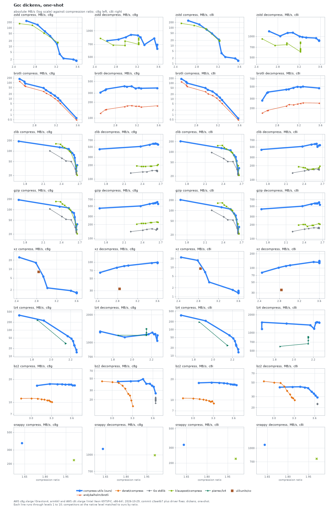
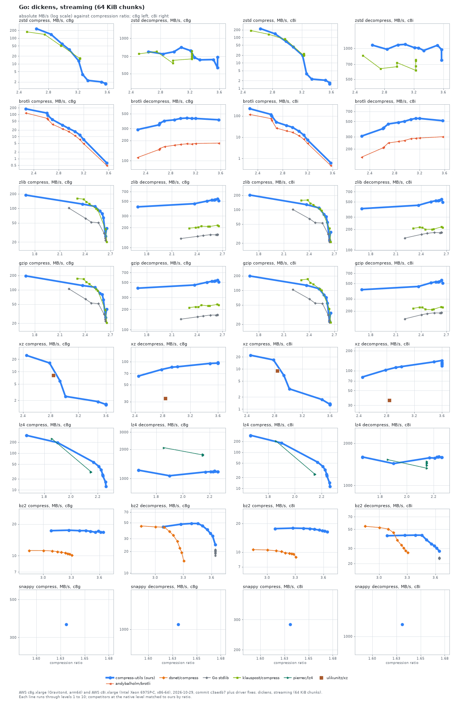
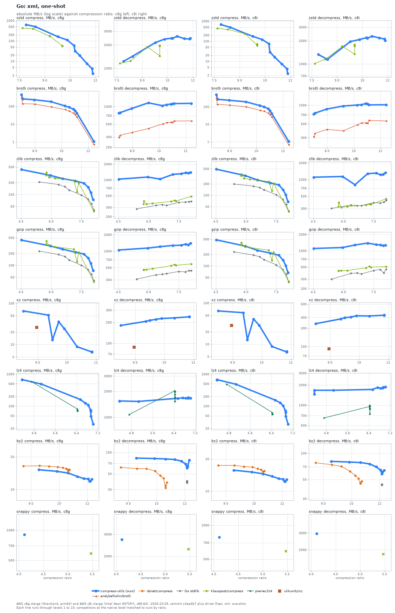
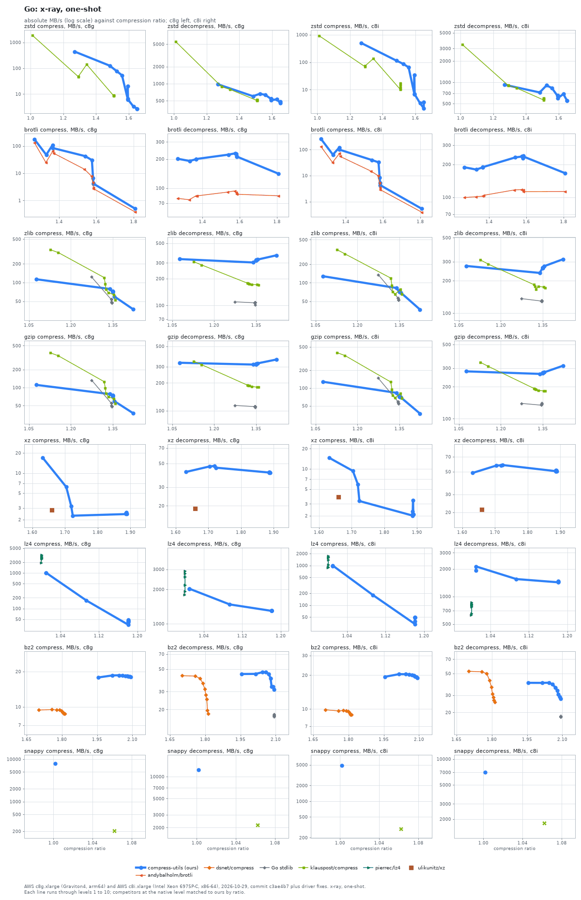
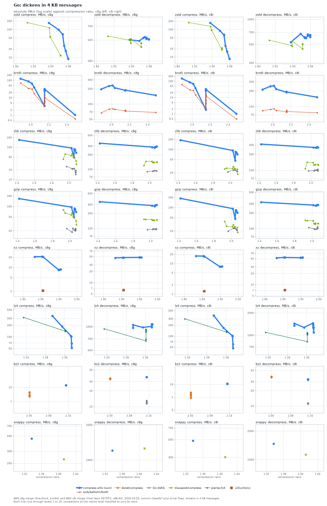

# The Go binding against Go libraries

compress-utils through Go against 6 libraries on five input sets, on two machines; at level 6 on dickens one-shot it is ahead of the fastest comparable peer in 9, level in 1 and behind in 3 of 13 format and direction cells on c8g.

The binding calls the C core through cgo, measured against the standard library, klauspost/compress, andybalholm/brotli, pierrec/lz4, ulikunitz/xz and dsnet/compress. The Go binding has no raw deflate format, and klauspost's snappy encoder produces a better ratio than the C port, so compare that row on decompress.

Libraries compared: Go stdlib, andybalholm/brotli, dsnet/compress, klauspost/compress, pierrec/lz4, ulikunitz/xz. klauspost zstd covers a lower ratio range than ours (its levels top out about where our level 5 is): its speed at a level is not a like-for-like multiple, which is why the charts plot speed against ratio.

How to read the charts: each line is one library, with a point per level (compress-utils levels 1 to 10; each competitor at the native level that matches ours by compression ratio, see [levels.json](../../benchmarks/levels.json)). A library with no levels is a single marker. The vertical axis is absolute throughput in MB/s on a log scale, the horizontal axis is compression ratio (input size over output size), so further right is smaller output and higher is faster. compress-utils is the bold blue line. Dashed lines are variants of a library in a second configuration. Where a competitor's levels cover a different ratio range than ours (klauspost zstd tops out at a lower ratio) the lines simply do not overlap; read speed at equal ratio.

In the tables, `Lx` is compress-utils level x (1 is fastest, 10 smallest), `comp` and `dec` are MB/s, and the multiple in brackets is the competitor's speed divided by ours at the same level: above 1.00x the competitor is faster, and **bold** marks more than 10% faster. Within 10% is a tie (one sample per cell). `-` means the library has no level matching that one. Libraries with no levels follow in a second table, compared with the compress-utils level closest in ratio.

## Dickens, one-shot

### dickens, one-shot: AWS c8g.xlarge (Graviton4, arm64)

| Format | Library | L1 ratio | L1 comp | L1 dec | L6 ratio | L6 comp | L6 dec | L10 ratio | L10 comp | L10 dec |
| :--- | :--- | ---: | ---: | ---: | ---: | ---: | ---: | ---: | ---: | ---: |
| **zstd** | **compress-utils** | **2.64** | **241** | **769** | **3.26** | **3.92** | **841** | **3.58** | **1.69** | **694** |
| zstd | klauspost/compress | 2.50 | 169 (0.70x) | 820 (1.07x) | 3.23 | 16.7 (**4.26x**) | 699 (0.83x) | 3.23 | 16.4 (**9.68x**) | 727 (1.05x) |
| **brotli** | **compress-utils** | **2.52** | **175** | **308** | **3.10** | **23.2** | **403** | **3.57** | **0.64** | **373** |
| brotli | andybalholm/brotli | 2.52 | 123 (0.70x) | 122 (0.40x) | 3.10 | 15.8 (0.68x) | 172 (0.43x) | 3.57 | 0.49 (0.76x) | 171 (0.46x) |
| **zlib** | **compress-utils** | **1.69** | **190** | **446** | **2.62** | **63.9** | **593** | **2.64** | **26.5** | **616** |
| zlib | Go stdlib | 2.20 | 101 (0.53x) | 134 (0.30x) | 2.64 | 24.1 (0.38x) | 153 (0.26x) | 2.64 | 21.8 (0.82x) | 155 (0.25x) |
| zlib | klauspost/compress | 2.31 | 162 (0.85x) | 193 (0.43x) | 2.55 | 92.6 (**1.45x**) | 190 (0.32x) | 2.66 | 20.3 (0.77x) | 207 (0.34x) |
| **gzip** | **compress-utils** | **1.69** | **190** | **450** | **2.62** | **61.8** | **587** | **2.64** | **26.7** | **609** |
| gzip | Go stdlib | 2.20 | 104 (0.55x) | 140 (0.31x) | 2.64 | 24.4 (0.39x) | 164 (0.28x) | 2.64 | 22.0 (0.82x) | 161 (0.26x) |
| gzip | klauspost/compress | 2.31 | 171 (0.90x) | 205 (0.46x) | 2.55 | 96.7 (**1.56x**) | 221 (0.38x) | 2.66 | 20.6 (0.77x) | 224 (0.37x) |
| **xz** | **compress-utils** | **2.45** | **24.9** | **64.2** | **3.60** | **1.60** | **98.2** | **3.60** | **1.55** | **96.3** |
| **lz4** | **compress-utils** | **1.58** | **369** | **1322** | **2.28** | **37.7** | **1235** | **2.33** | **14.1** | **1202** |
| lz4 | pierrec/lz4 | 1.82 | 239 (0.65x) | 1201 (0.91x) | 2.19 | 30.8 (0.82x) | 1230 (1.00x) | - | - | - |
| **bz2** | **compress-utils** | **3.09** | **16.5** | **43.8** | **3.56** | **17.1** | **40.0** | **3.64** | **16.8** | **24.1** |
| bz2 | dsnet/compress | 2.85 | 11.2 (0.68x) | 44.4 (1.01x) | 3.24 | 10.6 (0.62x) | 25.8 (0.64x) | 3.31 | 10.0 (0.59x) | 14.5 (0.60x) |
| bz2 | Go stdlib | 3.64 | - | 19.0 (0.43x) | 3.64 | - | 19.6 (0.49x) | 3.64 | - | 18.9 (0.78x) |
| **snappy** | **compress-utils** | **1.63** | **358** | **1162** | **1.63** | **359** | **1183** | **1.63** | **367** | **1017** |

Libraries without levels, c8g:

| Format | Library | Ratio | Comp | Dec | Ours at | Ours ratio | Ours comp | Ours dec | Comp x | Dec x |
| :--- | :--- | ---: | ---: | ---: | :--- | ---: | ---: | ---: | ---: | ---: |
| xz | ulikunitz/xz | 2.84 | 8.10 | 32.4 | L2 | 2.78 | 16.5 | 79.1 | 0.49x | 0.41x |
| snappy | klauspost/compress | 2.01 | 223 | 993 | L6 | 1.63 | 359 | 1183 | 0.62x | 0.84x |

### dickens, one-shot: AWS c8i.xlarge (Intel Xeon 6975P-C, x86-64)

| Format | Library | L1 ratio | L1 comp | L1 dec | L6 ratio | L6 comp | L6 dec | L10 ratio | L10 comp | L10 dec |
| :--- | :--- | ---: | ---: | ---: | ---: | ---: | ---: | ---: | ---: | ---: |
| **zstd** | **compress-utils** | **2.64** | **248** | **1182** | **3.26** | **3.80** | **979** | **3.58** | **1.40** | **880** |
| zstd | klauspost/compress | 2.50 | 174 (0.70x) | 923 (0.78x) | 3.23 | 19.5 (**5.14x**) | 604 (0.62x) | 3.23 | 18.0 (**12.85x**) | 630 (0.72x) |
| **brotli** | **compress-utils** | **2.52** | **187** | **279** | **3.10** | **30.0** | **477** | **3.57** | **0.61** | **469** |
| brotli | andybalholm/brotli | 2.52 | 122 (0.65x) | 163 (0.58x) | 3.10 | 16.3 (0.54x) | 230 (0.48x) | 3.57 | 0.48 (0.78x) | 248 (0.53x) |
| **zlib** | **compress-utils** | **1.69** | **204** | **439** | **2.62** | **55.2** | **508** | **2.64** | **22.8** | **511** |
| zlib | Go stdlib | 2.20 | 96.6 (0.47x) | 140 (0.32x) | 2.64 | 24.0 (0.44x) | 167 (0.33x) | 2.64 | 21.3 (0.93x) | 163 (0.32x) |
| zlib | klauspost/compress | 2.31 | 153 (0.75x) | 190 (0.43x) | 2.55 | 94.1 (**1.70x**) | 170 (0.33x) | 2.66 | 21.3 (0.93x) | 196 (0.38x) |
| **gzip** | **compress-utils** | **1.69** | **204** | **434** | **2.62** | **55.2** | **579** | **2.64** | **22.8** | **615** |
| gzip | Go stdlib | 2.20 | 102 (0.50x) | 142 (0.33x) | 2.64 | 24.3 (0.44x) | 174 (0.30x) | 2.64 | 21.6 (0.95x) | 170 (0.28x) |
| gzip | klauspost/compress | 2.31 | 163 (0.80x) | 197 (0.45x) | 2.55 | 100.0 (**1.81x**) | 195 (0.34x) | 2.66 | 21.5 (0.94x) | 207 (0.34x) |
| **xz** | **compress-utils** | **2.45** | **22.3** | **79.8** | **3.60** | **1.45** | **135** | **3.60** | **1.61** | **141** |
| **lz4** | **compress-utils** | **1.58** | **345** | **1154** | **2.28** | **36.5** | **1468** | **2.33** | **13.5** | **1474** |
| lz4 | pierrec/lz4 | 1.82 | 193 (0.56x) | 592 (0.51x) | 2.19 | 24.5 (0.67x) | 739 (0.50x) | - | - | - |
| **bz2** | **compress-utils** | **3.09** | **17.7** | **42.1** | **3.56** | **16.9** | **35.8** | **3.64** | **16.4** | **29.1** |
| bz2 | dsnet/compress | 2.85 | 10.6 (0.60x) | 52.4 (**1.25x**) | 3.24 | 9.72 (0.57x) | 32.5 (0.91x) | 3.31 | 8.86 (0.54x) | 26.1 (0.90x) |
| bz2 | Go stdlib | 3.64 | - | 22.9 (0.54x) | 3.64 | - | 22.5 (0.63x) | 3.64 | - | 22.9 (0.79x) |
| **snappy** | **compress-utils** | **1.63** | **331** | **1210** | **1.63** | **323** | **1062** | **1.63** | **326** | **1120** |

Libraries without levels, c8i:

| Format | Library | Ratio | Comp | Dec | Ours at | Ours ratio | Ours comp | Ours dec | Comp x | Dec x |
| :--- | :--- | ---: | ---: | ---: | :--- | ---: | ---: | ---: | ---: | ---: |
| xz | ulikunitz/xz | 2.84 | 9.14 | 34.3 | L2 | 2.78 | 17.3 | 101 | 0.53x | 0.34x |
| snappy | klauspost/compress | 2.01 | 224 | 758 | L6 | 1.63 | 323 | 1062 | 0.69x | 0.71x |

## Dickens, streaming (64 KiB chunks)

### dickens, streaming (64 KiB chunks): AWS c8g.xlarge (Graviton4, arm64)

| Format | Library | L1 ratio | L1 comp | L1 dec | L6 ratio | L6 comp | L6 dec | L10 ratio | L10 comp | L10 dec |
| :--- | :--- | ---: | ---: | ---: | ---: | ---: | ---: | ---: | ---: | ---: |
| **zstd** | **compress-utils** | **2.64** | **232** | **769** | **3.26** | **3.90** | **685** | **3.58** | **1.66** | **691** |
| zstd | klauspost/compress | 2.50 | 175 (0.75x) | 736 (0.96x) | 3.23 | 16.3 (**4.18x**) | 707 (1.03x) | 3.23 | 16.6 (**9.97x**) | 779 (**1.13x**) |
| **brotli** | **compress-utils** | **2.27** | **179** | **290** | **2.96** | **23.5** | **425** | **3.57** | **0.63** | **406** |
| brotli | andybalholm/brotli | 2.27 | 117 (0.65x) | 112 (0.38x) | 2.96 | 17.0 (0.72x) | 174 (0.41x) | 3.57 | 0.49 (0.78x) | 183 (0.45x) |
| **zlib** | **compress-utils** | **1.69** | **189** | **412** | **2.62** | **64.2** | **528** | **2.64** | **26.6** | **545** |
| zlib | Go stdlib | 2.20 | 102 (0.54x) | 137 (0.33x) | 2.64 | 24.2 (0.38x) | 158 (0.30x) | 2.64 | 21.8 (0.82x) | 157 (0.29x) |
| zlib | klauspost/compress | 2.31 | 162 (0.85x) | 196 (0.48x) | 2.55 | 92.7 (**1.44x**) | 208 (0.39x) | 2.66 | 20.3 (0.77x) | 211 (0.39x) |
| **gzip** | **compress-utils** | **1.69** | **196** | **411** | **2.62** | **62.0** | **526** | **2.64** | **26.6** | **544** |
| gzip | Go stdlib | 2.20 | 105 (0.54x) | 143 (0.35x) | 2.64 | 24.3 (0.39x) | 166 (0.32x) | 2.64 | 22.0 (0.83x) | 167 (0.31x) |
| gzip | klauspost/compress | 2.31 | 172 (0.88x) | 213 (0.52x) | 2.55 | 96.8 (**1.56x**) | 227 (0.43x) | 2.66 | 20.5 (0.77x) | 232 (0.43x) |
| **xz** | **compress-utils** | **2.45** | **24.9** | **64.8** | **3.60** | **1.60** | **95.9** | **3.60** | **1.56** | **97.3** |
| **lz4** | **compress-utils** | **1.58** | **302** | **1217** | **2.28** | **35.2** | **1178** | **2.33** | **12.4** | **1172** |
| lz4 | pierrec/lz4 | 1.82 | 246 (0.82x) | 2073 (**1.70x**) | 2.19 | 30.9 (0.88x) | 1749 (**1.48x**) | - | - | - |
| **bz2** | **compress-utils** | **3.09** | **17.3** | **43.8** | **3.56** | **16.7** | **39.8** | **3.64** | **16.8** | **25.0** |
| bz2 | dsnet/compress | 2.85 | 11.2 (0.65x) | 44.9 (1.03x) | 3.24 | 10.7 (0.64x) | 27.6 (0.69x) | 3.31 | 10.1 (0.60x) | 14.2 (0.57x) |
| bz2 | Go stdlib | 3.64 | - | 17.5 (0.40x) | 3.64 | - | 20.2 (0.51x) | 3.64 | - | 18.7 (0.75x) |
| **snappy** | **compress-utils** | **1.63** | **339** | **1068** | **1.63** | **347** | **1063** | **1.63** | **366** | **1071** |

Libraries without levels, c8g:

| Format | Library | Ratio | Comp | Dec | Ours at | Ours ratio | Ours comp | Ours dec | Comp x | Dec x |
| :--- | :--- | ---: | ---: | ---: | :--- | ---: | ---: | ---: | ---: | ---: |
| xz | ulikunitz/xz | 2.84 | 8.16 | 32.9 | L2 | 2.78 | 16.2 | 78.9 | 0.50x | 0.42x |

### dickens, streaming (64 KiB chunks): AWS c8i.xlarge (Intel Xeon 6975P-C, x86-64)

| Format | Library | L1 ratio | L1 comp | L1 dec | L6 ratio | L6 comp | L6 dec | L10 ratio | L10 comp | L10 dec |
| :--- | :--- | ---: | ---: | ---: | ---: | ---: | ---: | ---: | ---: | ---: |
| **zstd** | **compress-utils** | **2.64** | **222** | **1074** | **3.26** | **3.71** | **1011** | **3.58** | **1.49** | **766** |
| zstd | klauspost/compress | 2.50 | 186 (0.84x) | 852 (0.79x) | 3.23 | 19.7 (**5.33x**) | 669 (0.66x) | 3.23 | 23.2 (**15.58x**) | 610 (0.80x) |
| **brotli** | **compress-utils** | **2.27** | **218** | **307** | **2.96** | **29.1** | **503** | **3.57** | **0.62** | **513** |
| brotli | andybalholm/brotli | 2.27 | 117 (0.54x) | 152 (0.50x) | 2.96 | 17.0 (0.58x) | 265 (0.53x) | 3.57 | 0.46 (0.74x) | 301 (0.59x) |
| **zlib** | **compress-utils** | **1.69** | **203** | **398** | **2.62** | **55.0** | **525** | **2.64** | **22.7** | **544** |
| zlib | Go stdlib | 2.20 | 101 (0.50x) | 149 (0.37x) | 2.64 | 24.1 (0.44x) | 179 (0.34x) | 2.64 | 21.4 (0.94x) | 180 (0.33x) |
| zlib | klauspost/compress | 2.31 | 157 (0.77x) | 206 (0.52x) | 2.55 | 96.4 (**1.75x**) | 201 (0.38x) | 2.66 | 21.4 (0.94x) | 213 (0.39x) |
| **gzip** | **compress-utils** | **1.69** | **198** | **406** | **2.62** | **54.8** | **531** | **2.64** | **22.8** | **558** |
| gzip | Go stdlib | 2.20 | 104 (0.52x) | 154 (0.38x) | 2.64 | 24.2 (0.44x) | 189 (0.36x) | 2.64 | 21.5 (0.94x) | 189 (0.34x) |
| gzip | klauspost/compress | 2.31 | 164 (0.83x) | 218 (0.54x) | 2.55 | 100 (**1.83x**) | 212 (0.40x) | 2.66 | 21.5 (0.94x) | 226 (0.41x) |
| **xz** | **compress-utils** | **2.45** | **22.1** | **80.2** | **3.60** | **1.36** | **133** | **3.60** | **1.33** | **119** |
| **lz4** | **compress-utils** | **1.58** | **283** | **1597** | **2.28** | **32.7** | **1594** | **2.33** | **11.3** | **1586** |
| lz4 | pierrec/lz4 | 1.82 | 203 (0.72x) | 1526 (0.96x) | 2.19 | 24.4 (0.75x) | 1439 (0.90x) | - | - | - |
| **bz2** | **compress-utils** | **3.09** | **17.6** | **42.1** | **3.56** | **17.0** | **34.0** | **3.64** | **16.4** | **27.9** |
| bz2 | dsnet/compress | 2.85 | 10.6 (0.60x) | 54.2 (**1.29x**) | 3.24 | 9.70 (0.57x) | 32.9 (0.97x) | 3.31 | 8.86 (0.54x) | 26.9 (0.97x) |
| bz2 | Go stdlib | 3.64 | - | 23.1 (0.55x) | 3.64 | - | 23.0 (0.68x) | 3.64 | - | 22.8 (0.82x) |
| **snappy** | **compress-utils** | **1.63** | **280** | **1235** | **1.63** | **281** | **1168** | **1.63** | **282** | **1201** |

Libraries without levels, c8i:

| Format | Library | Ratio | Comp | Dec | Ours at | Ours ratio | Ours comp | Ours dec | Comp x | Dec x |
| :--- | :--- | ---: | ---: | ---: | :--- | ---: | ---: | ---: | ---: | ---: |
| xz | ulikunitz/xz | 2.84 | 8.96 | 35.6 | L2 | 2.78 | 16.8 | 102 | 0.53x | 0.35x |

## Xml, one-shot

### xml, one-shot: AWS c8g.xlarge (Graviton4, arm64)

| Format | Library | L1 ratio | L1 comp | L1 dec | L6 ratio | L6 comp | L6 dec | L10 ratio | L10 comp | L10 dec |
| :--- | :--- | ---: | ---: | ---: | ---: | ---: | ---: | ---: | ---: | ---: |
| **zstd** | **compress-utils** | **7.88** | **638** | **1229** | **10.79** | **32.2** | **2440** | **11.84** | **2.50** | **2439** |
| zstd | klauspost/compress | 7.68 | 429 (0.67x) | 1158 (0.94x) | 10.04 | 57.4 (**1.78x**) | 1977 (0.81x) | 10.04 | 57.6 (**23.06x**) | 1958 (0.80x) |
| **brotli** | **compress-utils** | **6.99** | **457** | **774** | **10.56** | **89.1** | **1079** | **12.42** | **1.09** | **1135** |
| brotli | andybalholm/brotli | 6.99 | 303 (0.66x) | 296 (0.38x) | 10.57 | 54.5 (0.61x) | 528 (0.49x) | 12.42 | 0.72 (0.66x) | 568 (0.50x) |
| **zlib** | **compress-utils** | **4.52** | **431** | **1037** | **7.84** | **153** | **1376** | **8.08** | **73.2** | **1416** |
| zlib | Go stdlib | 5.40 | 210 (0.49x) | 281 (0.27x) | 7.82 | 76.6 (0.50x) | 379 (0.28x) | 8.11 | 40.9 (0.56x) | 391 (0.28x) |
| zlib | klauspost/compress | 5.75 | 364 (0.85x) | 398 (0.38x) | 7.36 | 198 (**1.29x**) | 397 (0.29x) | 8.12 | 37.9 (0.52x) | 520 (0.37x) |
| **gzip** | **compress-utils** | **4.52** | **438** | **1053** | **7.84** | **153** | **1348** | **8.08** | **73.2** | **1409** |
| gzip | Go stdlib | 5.40 | 232 (0.53x) | 310 (0.29x) | 7.82 | 78.7 (0.52x) | 420 (0.31x) | 8.11 | 41.6 (0.57x) | 448 (0.32x) |
| gzip | klauspost/compress | 5.75 | 413 (0.94x) | 461 (0.44x) | 7.36 | 218 (**1.43x**) | 554 (0.41x) | 8.12 | 38.5 (0.53x) | 628 (0.45x) |
| **xz** | **compress-utils** | **8.26** | **65.2** | **181** | **11.03** | **8.83** | **232** | **11.79** | **6.65** | **242** |
| **lz4** | **compress-utils** | **4.35** | **669** | **1547** | **6.84** | **109** | **1665** | **7.03** | **27.4** | **1666** |
| lz4 | pierrec/lz4 | 4.71 | 580 (0.87x) | 1078 (0.70x) | 6.44 | 71.7 (0.66x) | 1522 (0.91x) | - | - | - |
| **bz2** | **compress-utils** | **9.42** | **15.2** | **83.1** | **12.04** | **12.5** | **68.8** | **12.12** | **12.0** | **61.2** |
| bz2 | dsnet/compress | 8.59 | 16.4 (1.08x) | 61.4 (0.74x) | 10.87 | 15.6 (**1.25x**) | 43.2 (0.63x) | 10.97 | 14.9 (**1.25x**) | 31.4 (0.51x) |
| bz2 | Go stdlib | 12.12 | - | 37.1 (0.45x) | 12.12 | - | 39.0 (0.57x) | 12.12 | - | 38.3 (0.63x) |
| **snappy** | **compress-utils** | **4.11** | **867** | **2060** | **4.11** | **912** | **2895** | **4.11** | **911** | **2943** |

Libraries without levels, c8g:

| Format | Library | Ratio | Comp | Dec | Ours at | Ours ratio | Ours comp | Ours dec | Comp x | Dec x |
| :--- | :--- | ---: | ---: | ---: | :--- | ---: | ---: | ---: | ---: | ---: |
| xz | ulikunitz/xz | 8.94 | 26.1 | 88.4 | L2 | 9.54 | 51.8 | 207 | 0.50x | 0.43x |
| snappy | klauspost/compress | 5.47 | 589 | 2290 | L6 | 4.11 | 912 | 2895 | 0.65x | 0.79x |

### xml, one-shot: AWS c8i.xlarge (Intel Xeon 6975P-C, x86-64)

| Format | Library | L1 ratio | L1 comp | L1 dec | L6 ratio | L6 comp | L6 dec | L10 ratio | L10 comp | L10 dec |
| :--- | :--- | ---: | ---: | ---: | ---: | ---: | ---: | ---: | ---: | ---: |
| **zstd** | **compress-utils** | **7.88** | **679** | **1327** | **10.79** | **29.1** | **2158** | **11.84** | **2.44** | **2019** |
| zstd | klauspost/compress | 7.68 | 433 (0.64x) | 1013 (0.76x) | 10.04 | 62.0 (**2.13x**) | 1705 (0.79x) | 10.04 | 65.9 (**27.01x**) | 1768 (0.88x) |
| **brotli** | **compress-utils** | **6.99** | **508** | **722** | **10.56** | **99.5** | **1017** | **12.42** | **1.05** | **1018** |
| brotli | andybalholm/brotli | 6.99 | 294 (0.58x) | 311 (0.43x) | 10.57 | 56.5 (0.57x) | 520 (0.51x) | 12.42 | 0.68 (0.65x) | 558 (0.55x) |
| **zlib** | **compress-utils** | **4.52** | **488** | **1104** | **7.84** | **140** | **1225** | **8.08** | **67.8** | **1315** |
| zlib | Go stdlib | 5.40 | 199 (0.41x) | 301 (0.27x) | 7.82 | 78.3 (0.56x) | 377 (0.31x) | 8.11 | 38.5 (0.57x) | 419 (0.32x) |
| zlib | klauspost/compress | 5.75 | 366 (0.75x) | 387 (0.35x) | 7.36 | 208 (**1.49x**) | 358 (0.29x) | 8.12 | 37.4 (0.55x) | 487 (0.37x) |
| **gzip** | **compress-utils** | **4.52** | **483** | **1102** | **7.84** | **142** | **1277** | **8.08** | **67.9** | **1253** |
| gzip | Go stdlib | 5.40 | 233 (0.48x) | 299 (0.27x) | 7.82 | 79.8 (0.56x) | 452 (0.35x) | 8.11 | 39.2 (0.58x) | 456 (0.36x) |
| gzip | klauspost/compress | 5.75 | 405 (0.84x) | 430 (0.39x) | 7.36 | 231 (**1.63x**) | 498 (0.39x) | 8.12 | 38.1 (0.56x) | 561 (0.45x) |
| **xz** | **compress-utils** | **8.26** | **64.5** | **238** | **11.03** | **8.82** | **318** | **11.79** | **6.49** | **331** |
| **lz4** | **compress-utils** | **4.35** | **662** | **1464** | **6.84** | **104** | **1791** | **7.03** | **27.4** | **1882** |
| lz4 | pierrec/lz4 | 4.71 | 488 (0.74x) | 646 (0.44x) | 6.44 | 55.8 (0.53x) | 900 (0.50x) | - | - | - |
| **bz2** | **compress-utils** | **9.42** | **15.7** | **80.7** | **12.04** | **12.9** | **64.2** | **12.12** | **12.4** | **58.4** |
| bz2 | dsnet/compress | 8.59 | 17.4 (**1.11x**) | 77.7 (0.96x) | 10.87 | 15.9 (**1.23x**) | 51.1 (0.80x) | 10.97 | 15.1 (**1.22x**) | 45.0 (0.77x) |
| bz2 | Go stdlib | 12.12 | - | 44.3 (0.55x) | 12.12 | - | 44.2 (0.69x) | 12.12 | - | 43.2 (0.74x) |
| **snappy** | **compress-utils** | **4.11** | **787** | **2576** | **4.11** | **721** | **3435** | **4.11** | **787** | **3138** |

Libraries without levels, c8i:

| Format | Library | Ratio | Comp | Dec | Ours at | Ours ratio | Ours comp | Ours dec | Comp x | Dec x |
| :--- | :--- | ---: | ---: | ---: | :--- | ---: | ---: | ---: | ---: | ---: |
| xz | ulikunitz/xz | 8.94 | 29.1 | 92.7 | L2 | 9.54 | 58.5 | 284 | 0.50x | 0.33x |
| snappy | klauspost/compress | 5.47 | 591 | 1805 | L6 | 4.11 | 721 | 3435 | 0.82x | 0.53x |

## X-ray, one-shot

### x-ray, one-shot: AWS c8g.xlarge (Graviton4, arm64)

| Format | Library | L1 ratio | L1 comp | L1 dec | L6 ratio | L6 comp | L6 dec | L10 ratio | L10 comp | L10 dec |
| :--- | :--- | ---: | ---: | ---: | ---: | ---: | ---: | ---: | ---: | ---: |
| **zstd** | **compress-utils** | **1.27** | **440** | **976** | **1.59** | **6.54** | **539** | **1.65** | **2.73** | **480** |
| zstd | klauspost/compress | 1.01 | 1879 (**4.27x**) | 5557 (**5.69x**) | 1.51 | 8.75 (**1.34x**) | 515 (0.95x) | 1.51 | 8.79 (**3.21x**) | 517 (1.08x) |
| **brotli** | **compress-utils** | **1.27** | **178** | **201** | **1.58** | **30.3** | **229** | **1.81** | **0.50** | **141** |
| brotli | andybalholm/brotli | 1.27 | 133 (0.75x) | 78.3 (0.39x) | 1.57 | 7.90 (0.26x) | 93.5 (0.41x) | 1.81 | 0.38 (0.76x) | 83.2 (0.59x) |
| **zlib** | **compress-utils** | **1.08** | **113** | **332** | **1.35** | **71.2** | **323** | **1.42** | **37.0** | **366** |
| zlib | Go stdlib | 1.27 | 123 (1.09x) | 110 (0.33x) | 1.35 | 47.2 (0.66x) | 108 (0.33x) | 1.35 | 47.4 (**1.28x**) | 108 (0.30x) |
| zlib | klauspost/compress | 1.13 | 337 (**2.98x**) | 309 (0.93x) | 1.33 | 68.6 (0.96x) | 172 (0.53x) | 1.36 | 52.1 (**1.41x**) | 169 (0.46x) |
| **gzip** | **compress-utils** | **1.08** | **111** | **331** | **1.35** | **73.0** | **318** | **1.42** | **37.3** | **358** |
| gzip | Go stdlib | 1.27 | 133 (**1.20x**) | 114 (0.34x) | 1.35 | 48.4 (0.66x) | 111 (0.35x) | 1.35 | 48.4 (**1.30x**) | 110 (0.31x) |
| gzip | klauspost/compress | 1.13 | 379 (**3.42x**) | 344 (1.04x) | 1.33 | 69.8 (0.96x) | 183 (0.58x) | 1.36 | 54.1 (**1.45x**) | 180 (0.50x) |
| **xz** | **compress-utils** | **1.63** | **16.9** | **41.6** | **1.89** | **2.45** | **41.0** | **1.89** | **2.49** | **41.2** |
| **lz4** | **compress-utils** | **1.01** | **1016** | **2028** | **1.18** | **43.4** | **1304** | **1.18** | **34.9** | **1299** |
| lz4 | pierrec/lz4 | 1.00 | 1968 (**1.94x**) | 1796 (0.89x) | 1.00 | 3209 (**73.89x**) | 2582 (**1.98x**) | - | - | - |
| **bz2** | **compress-utils** | **1.96** | **17.8** | **44.6** | **2.08** | **18.4** | **40.5** | **2.09** | **18.1** | **32.5** |
| bz2 | dsnet/compress | 1.70 | 9.40 (0.53x) | 43.0 (0.96x) | 1.80 | 9.03 (0.49x) | 28.0 (0.69x) | 1.81 | 8.68 (0.48x) | 17.1 (0.53x) |
| bz2 | Go stdlib | 2.09 | - | 17.1 (0.38x) | 2.09 | - | 17.5 (0.43x) | 2.09 | - | 16.9 (0.52x) |
| **snappy** | **compress-utils** | **1.00** | **7946** | **14370** | **1.00** | **7972** | **13550** | **1.00** | **8072** | **13000** |

Libraries without levels, c8g:

| Format | Library | Ratio | Comp | Dec | Ours at | Ours ratio | Ours comp | Ours dec | Comp x | Dec x |
| :--- | :--- | ---: | ---: | ---: | :--- | ---: | ---: | ---: | ---: | ---: |
| xz | ulikunitz/xz | 1.66 | 2.78 | 18.8 | L1 | 1.63 | 16.9 | 41.6 | 0.16x | 0.45x |
| snappy | klauspost/compress | 1.06 | 208 | 2160 | L6 | 1.00 | 7972 | 13550 | 0.03x | 0.16x |

### x-ray, one-shot: AWS c8i.xlarge (Intel Xeon 6975P-C, x86-64)

| Format | Library | L1 ratio | L1 comp | L1 dec | L6 ratio | L6 comp | L6 dec | L10 ratio | L10 comp | L10 dec |
| :--- | :--- | ---: | ---: | ---: | ---: | ---: | ---: | ---: | ---: | ---: |
| **zstd** | **compress-utils** | **1.27** | **500** | **924** | **1.59** | **7.12** | **640** | **1.65** | **2.09** | **549** |
| zstd | klauspost/compress | 1.01 | 928 (**1.86x**) | 3420 (**3.70x**) | 1.51 | 10.4 (**1.46x**) | 594 (0.93x) | 1.51 | 10.3 (**4.90x**) | 577 (1.05x) |
| **brotli** | **compress-utils** | **1.27** | **261** | **188** | **1.58** | **32.5** | **236** | **1.81** | **0.53** | **166** |
| brotli | andybalholm/brotli | 1.27 | 132 (0.51x) | 99.4 (0.53x) | 1.57 | 9.99 (0.31x) | 117 (0.50x) | 1.81 | 0.39 (0.74x) | 113 (0.68x) |
| **zlib** | **compress-utils** | **1.08** | **128** | **274** | **1.35** | **71.3** | **263** | **1.42** | **36.9** | **316** |
| zlib | Go stdlib | 1.27 | 136 (1.06x) | 136 (0.50x) | 1.35 | 52.6 (0.74x) | 131 (0.50x) | 1.35 | 52.9 (**1.43x**) | 131 (0.42x) |
| zlib | klauspost/compress | 1.13 | 345 (**2.70x**) | 312 (**1.14x**) | 1.33 | 65.7 (0.92x) | 177 (0.67x) | 1.36 | 64.5 (**1.75x**) | 166 (0.53x) |
| **gzip** | **compress-utils** | **1.08** | **128** | **279** | **1.35** | **71.3** | **268** | **1.42** | **37.0** | **315** |
| gzip | Go stdlib | 1.27 | 148 (**1.15x**) | 140 (0.50x) | 1.35 | 54.1 (0.76x) | 139 (0.52x) | 1.35 | 54.4 (**1.47x**) | 137 (0.43x) |
| gzip | klauspost/compress | 1.13 | 400 (**3.12x**) | 340 (**1.22x**) | 1.33 | 68.0 (0.95x) | 185 (0.69x) | 1.36 | 67.5 (**1.83x**) | 183 (0.58x) |
| **xz** | **compress-utils** | **1.63** | **14.6** | **48.6** | **1.89** | **2.10** | **50.7** | **1.89** | **2.07** | **50.9** |
| **lz4** | **compress-utils** | **1.01** | **970** | **1920** | **1.18** | **48.9** | **1457** | **1.18** | **33.5** | **1428** |
| lz4 | pierrec/lz4 | 1.00 | 882 (0.91x) | 629 (0.33x) | 1.00 | 1585 (**32.40x**) | 857 (0.59x) | - | - | - |
| **bz2** | **compress-utils** | **1.96** | **19.4** | **40.2** | **2.08** | **19.8** | **33.5** | **2.09** | **18.9** | **27.5** |
| bz2 | dsnet/compress | 1.70 | 9.82 (0.51x) | 52.7 (**1.31x**) | 1.80 | 9.33 (0.47x) | 31.0 (0.92x) | 1.81 | 8.95 (0.47x) | 25.5 (0.93x) |
| bz2 | Go stdlib | 2.09 | - | 18.2 (0.45x) | 2.09 | - | 18.4 (0.55x) | 2.09 | - | 17.7 (0.64x) |
| **snappy** | **compress-utils** | **1.00** | **2294** | **4210** | **1.00** | **5803** | **9028** | **1.00** | **5934** | **9106** |

Libraries without levels, c8i:

| Format | Library | Ratio | Comp | Dec | Ours at | Ours ratio | Ours comp | Ours dec | Comp x | Dec x |
| :--- | :--- | ---: | ---: | ---: | :--- | ---: | ---: | ---: | ---: | ---: |
| xz | ulikunitz/xz | 1.66 | 3.82 | 21.3 | L1 | 1.63 | 14.6 | 48.6 | 0.26x | 0.44x |
| snappy | klauspost/compress | 1.06 | 295 | 1802 | L6 | 1.00 | 5803 | 9028 | 0.05x | 0.20x |

## Dickens in 4 KB messages

### dickens in 4 KB messages: AWS c8g.xlarge (Graviton4, arm64)

| Format | Library | L1 ratio | L1 comp | L1 dec | L6 ratio | L6 comp | L6 dec | L10 ratio | L10 comp | L10 dec |
| :--- | :--- | ---: | ---: | ---: | ---: | ---: | ---: | ---: | ---: | ---: |
| **zstd** | **compress-utils** | **1.99** | **171** | **502** | **2.07** | **17.1** | **514** | **2.08** | **9.03** | **510** |
| zstd | klauspost/compress | 1.89 | 176 (1.03x) | 549 (1.09x) | 2.04 | 12.0 (0.70x) | 463 (0.90x) | 2.04 | 11.9 (**1.32x**) | 460 (0.90x) |
| **brotli** | **compress-utils** | **1.89** | **126** | **196** | **2.15** | **31.2** | **188** | **2.49** | **1.02** | **148** |
| brotli | andybalholm/brotli | 1.89 | 69.5 (0.55x) | 66.6 (0.34x) | 2.15 | 9.95 (0.32x) | 72.9 (0.39x) | 2.49 | 0.60 (0.59x) | 68.1 (0.46x) |
| **zlib** | **compress-utils** | **1.42** | **169** | **344** | **2.07** | **83.4** | **288** | **2.06** | **48.7** | **280** |
| zlib | Go stdlib | 1.97 | 25.6 (0.15x) | 90.1 (0.26x) | 2.08 | 19.2 (0.23x) | 93.3 (0.32x) | 2.08 | 17.9 (0.37x) | 94.4 (0.34x) |
| zlib | klauspost/compress | 1.94 | 42.6 (0.25x) | 120 (0.35x) | 2.05 | 51.5 (0.62x) | 140 (0.49x) | 2.08 | 29.6 (0.61x) | 142 (0.51x) |
| **gzip** | **compress-utils** | **1.42** | **168** | **342** | **2.06** | **83.5** | **292** | **2.04** | **49.1** | **279** |
| gzip | Go stdlib | 1.96 | 23.3 (0.14x) | 95.0 (0.28x) | 2.06 | 21.9 (0.26x) | 98.6 (0.34x) | 2.06 | 20.7 (0.42x) | 98.3 (0.35x) |
| gzip | klauspost/compress | 1.92 | 79.9 (0.48x) | 153 (0.45x) | 2.04 | 52.7 (0.63x) | 146 (0.50x) | 2.07 | 29.9 (0.61x) | 148 (0.53x) |
| **xz** | **compress-utils** | **1.88** | **20.7** | **46.1** | **1.95** | **8.55** | **47.3** | **1.95** | **8.54** | **47.3** |
| **lz4** | **compress-utils** | **1.31** | **346** | **1054** | **1.39** | **102** | **1083** | **1.39** | **51.7** | **1074** |
| lz4 | pierrec/lz4 | 1.19 | 318 (0.92x) | 939 (0.89x) | 1.36 | 147 (**1.44x**) | 657 (0.61x) | - | - | - |
| **bz2** | **compress-utils** | **2.15** | **10.5** | **36.4** | **2.15** | **10.5** | **36.6** | **2.15** | **10.6** | **36.5** |
| bz2 | dsnet/compress | 2.00 | 8.88 (0.84x) | 34.6 (0.95x) | 2.00 | 8.12 (0.77x) | 33.5 (0.92x) | 2.00 | 7.96 (0.75x) | 33.6 (0.92x) |
| bz2 | Go stdlib | 2.15 | - | 13.0 (0.36x) | 2.15 | - | 12.3 (0.34x) | 2.15 | - | 13.0 (0.36x) |
| **snappy** | **compress-utils** | **1.34** | **460** | **1231** | **1.34** | **464** | **1203** | **1.34** | **452** | **1196** |

Libraries without levels, c8g:

| Format | Library | Ratio | Comp | Dec | Ours at | Ours ratio | Ours comp | Ours dec | Comp x | Dec x |
| :--- | :--- | ---: | ---: | ---: | :--- | ---: | ---: | ---: | ---: | ---: |
| xz | ulikunitz/xz | 1.91 | 2.07 | 6.38 | L3 | 1.91 | 20.4 | 46.8 | 0.10x | 0.14x |
| snappy | klauspost/compress | 1.41 | 230 | 1262 | L6 | 1.34 | 464 | 1203 | 0.50x | 1.05x |

### dickens in 4 KB messages: AWS c8i.xlarge (Intel Xeon 6975P-C, x86-64)

| Format | Library | L1 ratio | L1 comp | L1 dec | L6 ratio | L6 comp | L6 dec | L10 ratio | L10 comp | L10 dec |
| :--- | :--- | ---: | ---: | ---: | ---: | ---: | ---: | ---: | ---: | ---: |
| **zstd** | **compress-utils** | **1.99** | **174** | **531** | **2.07** | **16.1** | **664** | **2.08** | **8.59** | **652** |
| zstd | klauspost/compress | 1.89 | 179 (1.03x) | 561 (1.06x) | 2.04 | 21.0 (**1.31x**) | 507 (0.76x) | 2.04 | 18.4 (**2.14x**) | 502 (0.77x) |
| **brotli** | **compress-utils** | **1.89** | **147** | **212** | **2.15** | **31.0** | **191** | **2.49** | **1.02** | **152** |
| brotli | andybalholm/brotli | 1.89 | 62.7 (0.43x) | 83.5 (0.39x) | 2.15 | 12.3 (0.40x) | 80.5 (0.42x) | 2.49 | 0.49 (0.47x) | 76.4 (0.50x) |
| **zlib** | **compress-utils** | **1.42** | **190** | **310** | **2.07** | **79.5** | **274** | **2.06** | **46.1** | **266** |
| zlib | Go stdlib | 1.97 | 21.2 (0.11x) | 97.8 (0.32x) | 2.08 | 22.2 (0.28x) | 101 (0.37x) | 2.08 | 22.2 (0.48x) | 99.8 (0.37x) |
| zlib | klauspost/compress | 1.94 | 26.1 (0.14x) | 106 (0.34x) | 2.05 | 27.0 (0.34x) | 128 (0.47x) | 2.08 | 18.1 (0.39x) | 130 (0.49x) |
| **gzip** | **compress-utils** | **1.42** | **188** | **323** | **2.06** | **78.7** | **283** | **2.04** | **46.6** | **276** |
| gzip | Go stdlib | 1.96 | 19.6 (0.10x) | 106 (0.33x) | 2.06 | 21.3 (0.27x) | 99.8 (0.35x) | 2.06 | 21.5 (0.46x) | 107 (0.39x) |
| gzip | klauspost/compress | 1.92 | 38.4 (0.20x) | 146 (0.45x) | 2.04 | 26.9 (0.34x) | 127 (0.45x) | 2.07 | 17.9 (0.38x) | 125 (0.45x) |
| **xz** | **compress-utils** | **1.88** | **17.7** | **52.5** | **1.95** | **7.92** | **53.3** | **1.95** | **7.90** | **53.1** |
| **lz4** | **compress-utils** | **1.31** | **364** | **1344** | **1.39** | **101** | **1375** | **1.39** | **46.5** | **1089** |
| lz4 | pierrec/lz4 | 1.19 | 297 (0.82x) | 1094 (0.81x) | 1.36 | 136 (**1.35x**) | 1086 (0.79x) | - | - | - |
| **bz2** | **compress-utils** | **2.15** | **10.1** | **33.3** | **2.15** | **10.2** | **33.2** | **2.15** | **10.1** | **33.2** |
| bz2 | dsnet/compress | 2.00 | 8.04 (0.80x) | 37.7 (**1.13x**) | 2.00 | 7.29 (0.72x) | 37.4 (**1.13x**) | 2.00 | 6.91 (0.68x) | 35.9 (1.08x) |
| bz2 | Go stdlib | 2.15 | - | 11.2 (0.34x) | 2.15 | - | 11.2 (0.34x) | 2.15 | - | 11.2 (0.34x) |
| **snappy** | **compress-utils** | **1.34** | **483** | **1433** | **1.34** | **476** | **1573** | **1.34** | **487** | **1459** |

Libraries without levels, c8i:

| Format | Library | Ratio | Comp | Dec | Ours at | Ours ratio | Ours comp | Ours dec | Comp x | Dec x |
| :--- | :--- | ---: | ---: | ---: | :--- | ---: | ---: | ---: | ---: | ---: |
| xz | ulikunitz/xz | 1.91 | 1.24 | 7.15 | L3 | 1.91 | 17.3 | 54.3 | 0.07x | 0.13x |
| snappy | klauspost/compress | 1.41 | 302 | 1132 | L6 | 1.34 | 476 | 1573 | 0.63x | 0.72x |

---

Generated by benchmarks/publish.py from run 2026-10-29, commit c3ae4b7 plus driver fixes; do not edit by hand.
