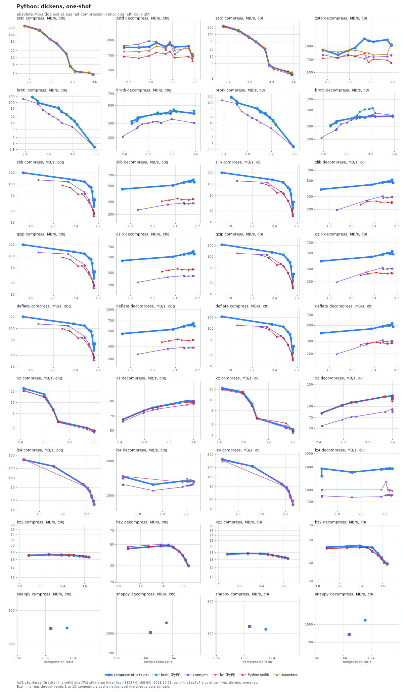
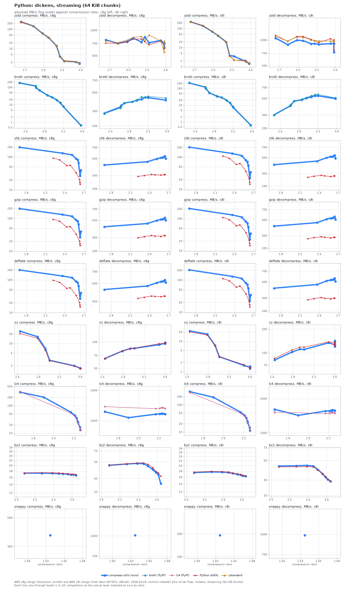
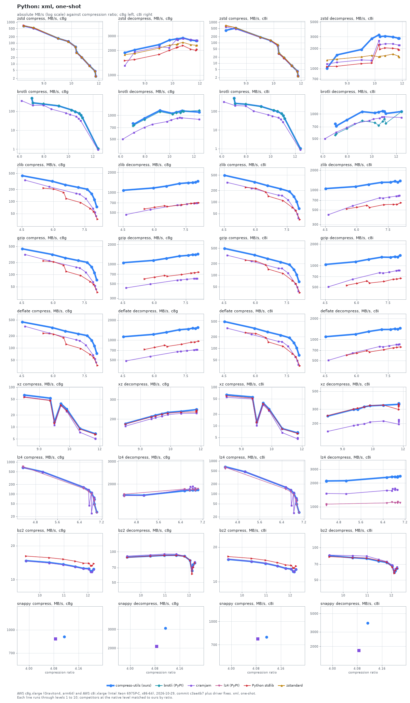
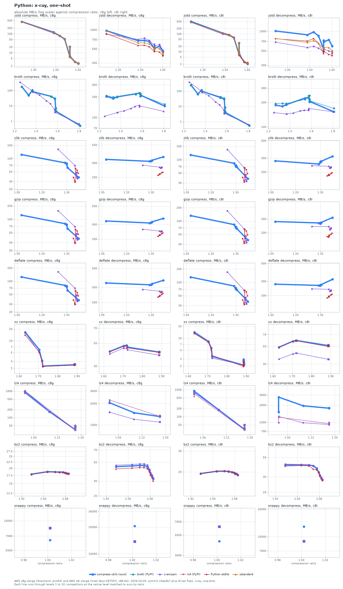
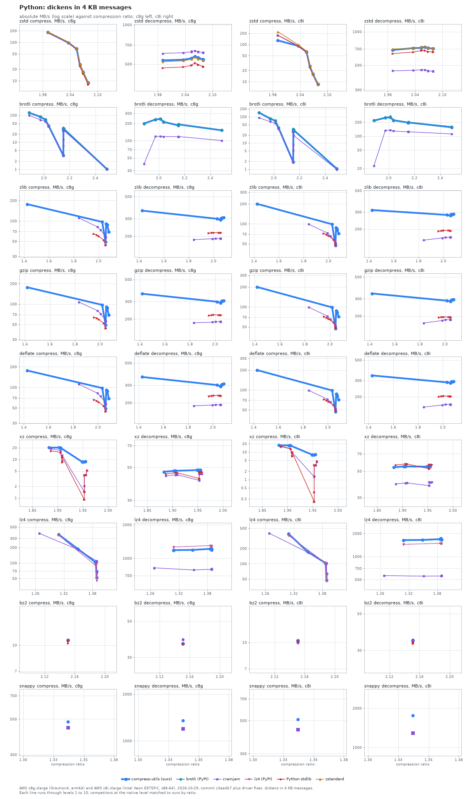

# The Python binding against Python libraries

compress-utils through Python against 5 libraries on five input sets, on two machines; at level 6 on dickens one-shot it is ahead of the fastest comparable peer in 7, level in 11 and behind in 0 of 18 format and direction cells on c8g.

The binding is the C core through pybind11, measured against the standard library (zlib, bz2, lzma and, on 3.14, zstd), cramjam, zstandard, brotli and lz4. Python 3.14 on Linux; the standard library's zlib is the distribution's.

Libraries compared: Python stdlib, brotli (PyPI), cramjam, lz4 (PyPI), zstandard.

How to read the charts: each line is one library, with a point per level (compress-utils levels 1 to 10; each competitor at the native level that matches ours by compression ratio, see [levels.json](../../benchmarks/levels.json)). A library with no levels is a single marker. The vertical axis is absolute throughput in MB/s on a log scale, the horizontal axis is compression ratio (input size over output size), so further right is smaller output and higher is faster. compress-utils is the bold blue line. Dashed lines are variants of a library in a second configuration. Where a competitor's levels cover a different ratio range than ours (klauspost zstd tops out at a lower ratio) the lines simply do not overlap; read speed at equal ratio.

In the tables, `Lx` is compress-utils level x (1 is fastest, 10 smallest), `comp` and `dec` are MB/s, and the multiple in brackets is the competitor's speed divided by ours at the same level: above 1.00x the competitor is faster, and **bold** marks more than 10% faster. Within 10% is a tie (one sample per cell). `-` means the library has no level matching that one. Libraries with no levels follow in a second table, compared with the compress-utils level closest in ratio.

## Dickens, one-shot

### dickens, one-shot: AWS c8g.xlarge (Graviton4, arm64)

| Format | Library | L1 ratio | L1 comp | L1 dec | L6 ratio | L6 comp | L6 dec | L10 ratio | L10 comp | L10 dec |
| :--- | :--- | ---: | ---: | ---: | ---: | ---: | ---: | ---: | ---: | ---: |
| **zstd** | **compress-utils** | **2.64** | **247** | **846** | **3.26** | **4.13** | **924** | **3.58** | **1.77** | **707** |
| zstd | cramjam | 2.64 | 234 (0.95x) | 877 (1.04x) | 3.26 | 4.07 (0.98x) | 959 (1.04x) | 3.58 | 1.80 (1.02x) | 735 (1.04x) |
| zstd | Python stdlib | 2.64 | 255 (1.03x) | 684 (0.81x) | 3.26 | 4.11 (0.99x) | 770 (0.83x) | 3.58 | 1.74 (0.98x) | 611 (0.86x) |
| zstd | zstandard | 2.64 | 244 (0.99x) | 776 (0.92x) | 3.26 | 4.14 (1.00x) | 900 (0.97x) | 3.58 | 1.75 (0.99x) | 712 (1.01x) |
| **brotli** | **compress-utils** | **2.52** | **182** | **318** | **3.10** | **26.1** | **403** | **3.57** | **0.66** | **398** |
| brotli | brotli (PyPI) | 2.52 | 179 (0.98x) | 296 (0.93x) | 3.10 | 25.6 (0.98x) | 406 (1.01x) | 3.57 | 0.66 (1.01x) | 429 (1.08x) |
| brotli | cramjam | 2.37 | 149 (0.82x) | 206 (0.65x) | 2.87 | 20.6 (0.79x) | 313 (0.78x) | 3.57 | 0.67 (1.02x) | 303 (0.76x) |
| **zlib** | **compress-utils** | **1.69** | **199** | **449** | **2.62** | **65.6** | **587** | **2.64** | **26.7** | **608** |
| zlib | cramjam | 1.90 | 129 (0.65x) | 230 (0.51x) | 2.63 | 21.9 (0.33x) | 286 (0.49x) | 2.64 | 16.9 (0.63x) | 286 (0.47x) |
| zlib | Python stdlib | 2.22 | 93.1 (0.47x) | 305 (0.68x) | 2.63 | 20.4 (0.31x) | 327 (0.56x) | 2.64 | 14.9 (0.56x) | 328 (0.54x) |
| **gzip** | **compress-utils** | **1.69** | **199** | **446** | **2.62** | **65.5** | **580** | **2.64** | **26.7** | **605** |
| gzip | cramjam | 1.90 | 125 (0.63x) | 219 (0.49x) | 2.63 | 21.7 (0.33x) | 270 (0.47x) | 2.64 | 16.8 (0.63x) | 270 (0.45x) |
| gzip | Python stdlib | 2.22 | 93.9 (0.47x) | 314 (0.70x) | 2.63 | 20.4 (0.31x) | 335 (0.58x) | 2.64 | 14.9 (0.56x) | 338 (0.56x) |
| **deflate** | **compress-utils** | **1.69** | **201** | **456** | **2.62** | **65.8** | **612** | **2.64** | **26.7** | **640** |
| deflate | cramjam | 1.90 | 129 (0.64x) | 232 (0.51x) | 2.63 | 21.9 (0.33x) | 289 (0.47x) | 2.64 | 16.9 (0.63x) | 289 (0.45x) |
| deflate | Python stdlib | 2.22 | 97.3 (0.48x) | 346 (0.76x) | 2.63 | 20.6 (0.31x) | 372 (0.61x) | 2.64 | 15.0 (0.56x) | 373 (0.58x) |
| **xz** | **compress-utils** | **2.45** | **24.6** | **64.8** | **3.60** | **1.65** | **100** | **3.60** | **1.67** | **99.1** |
| xz | cramjam | 2.45 | 22.0 (0.90x) | 61.8 (0.95x) | 3.60 | 1.52 (0.92x) | 93.1 (0.93x) | 3.60 | 1.51 (0.91x) | 94.0 (0.95x) |
| xz | Python stdlib | 2.45 | 20.6 (0.84x) | 64.5 (1.00x) | 3.60 | 1.64 (1.00x) | 97.5 (0.97x) | 3.60 | 1.64 (0.98x) | 98.5 (0.99x) |
| **lz4** | **compress-utils** | **1.58** | **370** | **1423** | **2.28** | **37.9** | **1340** | **2.33** | **14.8** | **1328** |
| lz4 | cramjam | 1.58 | 355 (0.96x) | 1243 (0.87x) | 2.28 | 38.5 (1.02x) | 1221 (0.91x) | 2.32 | 14.1 (0.95x) | 1256 (0.95x) |
| lz4 | lz4 (PyPI) | 1.58 | 371 (1.00x) | 1469 (1.03x) | 2.28 | 34.3 (0.91x) | 1352 (1.01x) | 2.33 | 14.0 (0.95x) | 1323 (1.00x) |
| **bz2** | **compress-utils** | **3.09** | **17.1** | **45.1** | **3.56** | **16.9** | **42.3** | **3.64** | **16.6** | **29.0** |
| bz2 | cramjam | 3.09 | 17.1 (1.00x) | 47.2 (1.05x) | 3.56 | 16.9 (1.00x) | 42.0 (0.99x) | 3.64 | 16.6 (1.00x) | 31.4 (1.08x) |
| bz2 | Python stdlib | 3.09 | 17.4 (1.02x) | 45.3 (1.00x) | 3.56 | 17.1 (1.01x) | 42.5 (1.01x) | 3.64 | 16.9 (1.02x) | 29.3 (1.01x) |
| **snappy** | **compress-utils** | **1.63** | **387** | **1252** | **1.63** | **382** | **1217** | **1.63** | **384** | **1219** |

Libraries without levels, c8g:

| Format | Library | Ratio | Comp | Dec | Ours at | Ours ratio | Ours comp | Ours dec | Comp x | Dec x |
| :--- | :--- | ---: | ---: | ---: | :--- | ---: | ---: | ---: | ---: | ---: |
| snappy | cramjam | 1.61 | 382 | 1021 | L6 | 1.63 | 382 | 1217 | 1.00x | 0.84x |

### dickens, one-shot: AWS c8i.xlarge (Intel Xeon 6975P-C, x86-64)

| Format | Library | L1 ratio | L1 comp | L1 dec | L6 ratio | L6 comp | L6 dec | L10 ratio | L10 comp | L10 dec |
| :--- | :--- | ---: | ---: | ---: | ---: | ---: | ---: | ---: | ---: | ---: |
| **zstd** | **compress-utils** | **2.64** | **228** | **909** | **3.26** | **4.24** | **1152** | **3.58** | **1.59** | **1047** |
| zstd | cramjam | 2.64 | 222 (0.98x) | 796 (0.88x) | 3.26 | 3.83 (0.90x) | 759 (0.66x) | 3.58 | 1.78 (**1.12x**) | 794 (0.76x) |
| zstd | Python stdlib | 2.64 | 237 (1.04x) | 726 (0.80x) | 3.26 | 4.03 (0.95x) | 651 (0.56x) | 3.58 | 1.49 (0.94x) | 633 (0.60x) |
| zstd | zstandard | 2.64 | 252 (**1.11x**) | 890 (0.98x) | 3.26 | 4.13 (0.97x) | 832 (0.72x) | 3.58 | 1.85 (**1.16x**) | 1074 (1.03x) |
| **brotli** | **compress-utils** | **2.52** | **196** | **310** | **3.10** | **28.1** | **394** | **3.57** | **0.68** | **411** |
| brotli | brotli (PyPI) | 2.52 | 182 (0.93x) | 302 (0.98x) | 3.10 | 31.8 (**1.13x**) | 509 (**1.29x**) | 3.57 | 0.62 (0.91x) | 424 (1.03x) |
| brotli | cramjam | 2.37 | 132 (0.67x) | 209 (0.67x) | 2.87 | 17.7 (0.63x) | 369 (0.94x) | 3.57 | 0.66 (0.97x) | 405 (0.99x) |
| **zlib** | **compress-utils** | **1.69** | **202** | **378** | **2.62** | **55.4** | **484** | **2.64** | **23.1** | **515** |
| zlib | cramjam | 1.90 | 121 (0.60x) | 195 (0.51x) | 2.63 | 19.8 (0.36x) | 294 (0.61x) | 2.64 | 14.8 (0.64x) | 298 (0.58x) |
| zlib | Python stdlib | 2.22 | 108 (0.53x) | 233 (0.62x) | 2.63 | 20.8 (0.38x) | 242 (0.50x) | 2.64 | 14.4 (0.63x) | 260 (0.50x) |
| **gzip** | **compress-utils** | **1.69** | **211** | **386** | **2.62** | **55.4** | **490** | **2.64** | **23.1** | **520** |
| gzip | cramjam | 1.90 | 122 (0.58x) | 196 (0.51x) | 2.63 | 19.8 (0.36x) | 306 (0.62x) | 2.64 | 14.8 (0.64x) | 304 (0.58x) |
| gzip | Python stdlib | 2.22 | 109 (0.52x) | 245 (0.63x) | 2.63 | 20.9 (0.38x) | 265 (0.54x) | 2.64 | 14.4 (0.63x) | 258 (0.50x) |
| **deflate** | **compress-utils** | **1.69** | **211** | **388** | **2.62** | **55.5** | **502** | **2.64** | **23.1** | **531** |
| deflate | cramjam | 1.90 | 122 (0.58x) | 197 (0.51x) | 2.63 | 19.8 (0.36x) | 301 (0.60x) | 2.64 | 14.8 (0.64x) | 301 (0.57x) |
| deflate | Python stdlib | 2.22 | 111 (0.53x) | 270 (0.70x) | 2.63 | 20.9 (0.38x) | 283 (0.56x) | 2.64 | 14.4 (0.63x) | 283 (0.53x) |
| **xz** | **compress-utils** | **2.45** | **21.7** | **80.9** | **3.60** | **1.30** | **132** | **3.60** | **1.28** | **128** |
| xz | cramjam | 2.45 | 19.3 (0.89x) | 53.7 (0.66x) | 3.60 | 1.29 (0.99x) | 88.9 (0.68x) | 3.60 | 1.28 (1.00x) | 89.4 (0.70x) |
| xz | Python stdlib | 2.45 | 20.1 (0.93x) | 81.8 (1.01x) | 3.60 | 1.35 (1.04x) | 131 (1.00x) | 3.60 | 1.29 (1.00x) | 117 (0.92x) |
| **lz4** | **compress-utils** | **1.58** | **352** | **1518** | **2.28** | **36.5** | **1905** | **2.33** | **13.7** | **1895** |
| lz4 | cramjam | 1.58 | 327 (0.93x) | 836 (0.55x) | 2.28 | 37.0 (1.01x) | 856 (0.45x) | 2.32 | 13.3 (0.97x) | 859 (0.45x) |
| lz4 | lz4 (PyPI) | 1.58 | 301 (0.86x) | 977 (0.64x) | 2.28 | 32.1 (0.88x) | 989 (0.52x) | 2.33 | 13.2 (0.96x) | 961 (0.51x) |
| **bz2** | **compress-utils** | **3.09** | **17.5** | **42.6** | **3.56** | **16.9** | **37.0** | **3.64** | **16.3** | **29.6** |
| bz2 | cramjam | 3.09 | 17.6 (1.01x) | 42.0 (0.98x) | 3.56 | 17.0 (1.01x) | 35.7 (0.97x) | 3.64 | 16.4 (1.00x) | 29.0 (0.98x) |
| bz2 | Python stdlib | 3.09 | 17.6 (1.01x) | 41.3 (0.97x) | 3.56 | 17.0 (1.01x) | 35.4 (0.96x) | 3.64 | 16.4 (1.00x) | 28.8 (0.97x) |
| **snappy** | **compress-utils** | **1.63** | **335** | **1037** | **1.63** | **320** | **1102** | **1.63** | **320** | **1096** |

Libraries without levels, c8i:

| Format | Library | Ratio | Comp | Dec | Ours at | Ours ratio | Ours comp | Ours dec | Comp x | Dec x |
| :--- | :--- | ---: | ---: | ---: | :--- | ---: | ---: | ---: | ---: | ---: |
| snappy | cramjam | 1.61 | 336 | 815 | L6 | 1.63 | 320 | 1102 | 1.05x | 0.74x |

## Dickens, streaming (64 KiB chunks)

### dickens, streaming (64 KiB chunks): AWS c8g.xlarge (Graviton4, arm64)

| Format | Library | L1 ratio | L1 comp | L1 dec | L6 ratio | L6 comp | L6 dec | L10 ratio | L10 comp | L10 dec |
| :--- | :--- | ---: | ---: | ---: | ---: | ---: | ---: | ---: | ---: | ---: |
| **zstd** | **compress-utils** | **2.64** | **238** | **769** | **3.26** | **3.95** | **831** | **3.58** | **1.69** | **621** |
| zstd | Python stdlib | 2.64 | 242 (1.02x) | 708 (0.92x) | 3.26 | 4.02 (1.02x) | 735 (0.88x) | 3.58 | 1.68 (0.99x) | 609 (0.98x) |
| zstd | zstandard | 2.64 | 224 (0.94x) | 750 (0.97x) | 3.26 | 4.09 (1.03x) | 760 (0.91x) | 3.58 | 1.71 (1.01x) | 747 (**1.20x**) |
| **brotli** | **compress-utils** | **2.27** | **180** | **283** | **2.96** | **27.3** | **404** | **3.57** | **0.66** | **406** |
| brotli | brotli (PyPI) | 2.27 | 183 (1.01x) | 279 (0.99x) | 2.96 | 26.7 (0.98x) | 409 (1.01x) | 3.57 | 0.66 (1.01x) | 430 (1.06x) |
| **zlib** | **compress-utils** | **1.69** | **198** | **412** | **2.62** | **65.4** | **522** | **2.64** | **26.6** | **540** |
| zlib | Python stdlib | 2.22 | 93.0 (0.47x) | 290 (0.71x) | 2.63 | 20.4 (0.31x) | 308 (0.59x) | 2.64 | 14.9 (0.56x) | 309 (0.57x) |
| **gzip** | **compress-utils** | **1.69** | **198** | **412** | **2.62** | **65.4** | **522** | **2.64** | **26.6** | **540** |
| gzip | Python stdlib | 2.22 | 93.8 (0.47x) | 298 (0.72x) | 2.63 | 20.4 (0.31x) | 317 (0.61x) | 2.64 | 14.9 (0.56x) | 317 (0.59x) |
| **deflate** | **compress-utils** | **1.69** | **200** | **420** | **2.62** | **65.7** | **534** | **2.64** | **26.7** | **554** |
| deflate | Python stdlib | 2.22 | 97.1 (0.49x) | 327 (0.78x) | 2.63 | 20.5 (0.31x) | 349 (0.65x) | 2.64 | 15.0 (0.56x) | 349 (0.63x) |
| **xz** | **compress-utils** | **2.45** | **24.5** | **64.7** | **3.60** | **1.65** | **96.5** | **3.60** | **1.66** | **98.2** |
| xz | Python stdlib | 2.45 | 20.6 (0.84x) | 64.6 (1.00x) | 3.60 | 1.65 (1.00x) | 98.1 (1.02x) | 3.60 | 1.64 (0.99x) | 95.5 (0.97x) |
| **lz4** | **compress-utils** | **1.58** | **308** | **1227** | **2.28** | **35.4** | **1175** | **2.33** | **12.9** | **1162** |
| lz4 | lz4 (PyPI) | 1.58 | 320 (1.04x) | 1372 (**1.12x**) | 2.28 | 31.9 (0.90x) | 1337 (**1.14x**) | 2.33 | 12.3 (0.96x) | 1317 (**1.13x**) |
| **bz2** | **compress-utils** | **3.09** | **17.3** | **45.0** | **3.56** | **16.9** | **39.4** | **3.64** | **16.7** | **26.5** |
| bz2 | Python stdlib | 3.09 | 17.4 (1.01x) | 45.3 (1.01x) | 3.56 | 17.1 (1.01x) | 42.0 (1.06x) | 3.64 | 16.9 (1.01x) | 33.3 (**1.26x**) |
| **snappy** | **compress-utils** | **1.63** | **364** | **1014** | **1.63** | **366** | **1010** | **1.63** | **366** | **1008** |

### dickens, streaming (64 KiB chunks): AWS c8i.xlarge (Intel Xeon 6975P-C, x86-64)

| Format | Library | L1 ratio | L1 comp | L1 dec | L6 ratio | L6 comp | L6 dec | L10 ratio | L10 comp | L10 dec |
| :--- | :--- | ---: | ---: | ---: | ---: | ---: | ---: | ---: | ---: | ---: |
| **zstd** | **compress-utils** | **2.64** | **224** | **1055** | **3.26** | **3.84** | **910** | **3.58** | **1.45** | **721** |
| zstd | Python stdlib | 2.64 | 221 (0.98x) | 1140 (1.08x) | 3.26 | 3.68 (0.96x) | 979 (1.08x) | 3.58 | 1.42 (0.98x) | 762 (1.06x) |
| zstd | zstandard | 2.64 | 229 (1.02x) | 1099 (1.04x) | 3.26 | 3.98 (1.03x) | 990 (1.09x) | 3.58 | 1.65 (**1.13x**) | 1021 (**1.42x**) |
| **brotli** | **compress-utils** | **2.27** | **213** | **302** | **2.96** | **29.1** | **506** | **3.57** | **0.64** | **497** |
| brotli | brotli (PyPI) | 2.27 | 224 (1.05x) | 298 (0.99x) | 2.96 | 29.7 (1.02x) | 514 (1.02x) | 3.57 | 0.60 (0.94x) | 509 (1.02x) |
| **zlib** | **compress-utils** | **1.69** | **204** | **398** | **2.62** | **55.2** | **520** | **2.64** | **22.8** | **544** |
| zlib | Python stdlib | 2.22 | 107 (0.53x) | 265 (0.67x) | 2.63 | 20.7 (0.38x) | 277 (0.53x) | 2.64 | 14.4 (0.63x) | 278 (0.51x) |
| **gzip** | **compress-utils** | **1.69** | **206** | **408** | **2.62** | **55.0** | **535** | **2.64** | **22.8** | **557** |
| gzip | Python stdlib | 2.22 | 109 (0.53x) | 271 (0.66x) | 2.63 | 20.8 (0.38x) | 285 (0.53x) | 2.64 | 14.4 (0.63x) | 285 (0.51x) |
| **deflate** | **compress-utils** | **1.69** | **206** | **410** | **2.62** | **55.1** | **537** | **2.64** | **22.8** | **562** |
| deflate | Python stdlib | 2.22 | 110 (0.54x) | 284 (0.69x) | 2.63 | 20.9 (0.38x) | 299 (0.56x) | 2.64 | 14.5 (0.63x) | 300 (0.53x) |
| **xz** | **compress-utils** | **2.45** | **21.7** | **81.0** | **3.60** | **1.51** | **142** | **3.60** | **1.34** | **123** |
| xz | Python stdlib | 2.45 | 20.2 (0.93x) | 85.2 (1.05x) | 3.60 | 1.39 (0.92x) | 131 (0.93x) | 3.60 | 1.29 (0.97x) | 123 (1.00x) |
| **lz4** | **compress-utils** | **1.58** | **306** | **1610** | **2.28** | **32.8** | **1575** | **2.33** | **11.4** | **1562** |
| lz4 | lz4 (PyPI) | 1.58 | 283 (0.93x) | 1522 (0.95x) | 2.28 | 29.7 (0.90x) | 1506 (0.96x) | 2.33 | 11.2 (0.98x) | 1477 (0.95x) |
| **bz2** | **compress-utils** | **3.09** | **17.4** | **43.2** | **3.56** | **16.9** | **35.4** | **3.64** | **16.3** | **29.0** |
| bz2 | Python stdlib | 3.09 | 17.6 (1.01x) | 42.2 (0.98x) | 3.56 | 17.1 (1.01x) | 35.6 (1.01x) | 3.64 | 16.4 (1.01x) | 29.2 (1.01x) |
| **snappy** | **compress-utils** | **1.63** | **295** | **995** | **1.63** | **291** | **972** | **1.63** | **292** | **962** |

## Xml, one-shot

### xml, one-shot: AWS c8g.xlarge (Graviton4, arm64)

| Format | Library | L1 ratio | L1 comp | L1 dec | L6 ratio | L6 comp | L6 dec | L10 ratio | L10 comp | L10 dec |
| :--- | :--- | ---: | ---: | ---: | ---: | ---: | ---: | ---: | ---: | ---: |
| **zstd** | **compress-utils** | **7.88** | **663** | **1873** | **10.79** | **35.1** | **2769** | **11.84** | **2.57** | **2638** |
| zstd | cramjam | 7.89 | 635 (0.96x) | 1305 (0.70x) | 10.78 | 34.2 (0.97x) | 2686 (0.97x) | 11.85 | 2.55 (0.99x) | 2646 (1.00x) |
| zstd | Python stdlib | 7.88 | 697 (1.05x) | 1499 (0.80x) | 10.79 | 33.6 (0.96x) | 2199 (0.79x) | 11.84 | 2.54 (0.99x) | 2059 (0.78x) |
| zstd | zstandard | 7.88 | 667 (1.01x) | 1777 (0.95x) | 10.79 | 34.8 (0.99x) | 2418 (0.87x) | 11.84 | 2.50 (0.97x) | 2319 (0.88x) |
| **brotli** | **compress-utils** | **6.99** | **489** | **788** | **10.56** | **96.0** | **1101** | **12.42** | **1.08** | **1100** |
| brotli | brotli (PyPI) | 6.99 | 488 (1.00x) | 741 (0.94x) | 10.56 | 96.5 (1.01x) | 1073 (0.97x) | 12.42 | 1.09 (1.01x) | 1152 (1.05x) |
| brotli | cramjam | 6.17 | 361 (0.74x) | 499 (0.63x) | 10.15 | 66.2 (0.69x) | 874 (0.79x) | 12.42 | 0.93 (0.86x) | 889 (0.81x) |
| **zlib** | **compress-utils** | **4.52** | **438** | **1079** | **7.84** | **155** | **1405** | **8.08** | **73.7** | **1487** |
| zlib | cramjam | 4.66 | 339 (0.77x) | 467 (0.43x) | 7.90 | 66.6 (0.43x) | 690 (0.49x) | 8.05 | 43.7 (0.59x) | 698 (0.47x) |
| zlib | Python stdlib | 5.54 | 214 (0.49x) | 567 (0.53x) | 7.77 | 66.8 (0.43x) | 687 (0.49x) | 8.11 | 36.1 (0.49x) | 706 (0.47x) |
| **gzip** | **compress-utils** | **4.52** | **435** | **1053** | **7.84** | **154** | **1402** | **8.08** | **73.5** | **1442** |
| gzip | cramjam | 4.66 | 315 (0.72x) | 432 (0.41x) | 7.90 | 65.5 (0.42x) | 600 (0.43x) | 8.05 | 43.2 (0.59x) | 604 (0.42x) |
| gzip | Python stdlib | 5.54 | 218 (0.50x) | 597 (0.57x) | 7.77 | 67.1 (0.44x) | 730 (0.52x) | 8.11 | 36.2 (0.49x) | 754 (0.52x) |
| **deflate** | **compress-utils** | **4.52** | **444** | **1121** | **7.84** | **156** | **1508** | **8.08** | **73.8** | **1557** |
| deflate | cramjam | 4.66 | 345 (0.78x) | 485 (0.43x) | 7.90 | 66.8 (0.43x) | 710 (0.47x) | 8.05 | 43.8 (0.59x) | 716 (0.46x) |
| deflate | Python stdlib | 5.54 | 232 (0.52x) | 721 (0.64x) | 7.77 | 68.5 (0.44x) | 926 (0.61x) | 8.11 | 36.6 (0.50x) | 962 (0.62x) |
| **xz** | **compress-utils** | **8.26** | **63.5** | **182** | **11.03** | **9.05** | **235** | **11.79** | **6.80** | **244** |
| xz | cramjam | 8.26 | 57.3 (0.90x) | 173 (0.95x) | 11.03 | 7.30 (0.81x) | 225 (0.96x) | 11.79 | 5.08 (0.75x) | 225 (0.92x) |
| xz | Python stdlib | 8.26 | 55.7 (0.88x) | 180 (0.99x) | 11.03 | 8.81 (0.97x) | 231 (0.98x) | 11.79 | 6.56 (0.97x) | 232 (0.95x) |
| **lz4** | **compress-utils** | **4.35** | **679** | **1632** | **6.84** | **109** | **1789** | **7.03** | **27.4** | **1810** |
| lz4 | cramjam | 4.35 | 667 (0.98x) | 1629 (1.00x) | 6.83 | 111 (1.02x) | 1836 (1.03x) | 6.83 | 25.2 (0.92x) | 1923 (1.06x) |
| lz4 | lz4 (PyPI) | 4.35 | 699 (1.03x) | 1666 (1.02x) | 6.84 | 98.1 (0.90x) | 1818 (1.02x) | 7.03 | 26.4 (0.96x) | 1834 (1.01x) |
| **bz2** | **compress-utils** | **9.42** | **14.7** | **88.2** | **12.04** | **12.5** | **82.2** | **12.12** | **11.8** | **64.8** |
| bz2 | cramjam | 9.42 | 14.6 (0.99x) | 90.5 (1.03x) | 12.04 | 12.3 (0.99x) | 82.5 (1.00x) | 12.12 | 11.7 (0.99x) | 68.2 (1.05x) |
| bz2 | Python stdlib | 9.42 | 16.2 (1.10x) | 88.0 (1.00x) | 12.04 | 13.9 (**1.12x**) | 82.5 (1.00x) | 12.12 | 13.2 (**1.12x**) | 58.6 (0.91x) |
| **snappy** | **compress-utils** | **4.11** | **873** | **2910** | **4.11** | **896** | **3107** | **4.11** | **900** | **3088** |

Libraries without levels, c8g:

| Format | Library | Ratio | Comp | Dec | Ours at | Ours ratio | Ours comp | Ours dec | Comp x | Dec x |
| :--- | :--- | ---: | ---: | ---: | :--- | ---: | ---: | ---: | ---: | ---: |
| snappy | cramjam | 4.08 | 872 | 2079 | L6 | 4.11 | 896 | 3107 | 0.97x | 0.67x |

### xml, one-shot: AWS c8i.xlarge (Intel Xeon 6975P-C, x86-64)

| Format | Library | L1 ratio | L1 comp | L1 dec | L6 ratio | L6 comp | L6 dec | L10 ratio | L10 comp | L10 dec |
| :--- | :--- | ---: | ---: | ---: | ---: | ---: | ---: | ---: | ---: | ---: |
| **zstd** | **compress-utils** | **7.88** | **402** | **1012** | **10.79** | **30.1** | **3016** | **11.84** | **2.39** | **2841** |
| zstd | cramjam | 7.89 | 588 (**1.46x**) | 1168 (**1.15x**) | 10.78 | 29.6 (0.99x) | 2286 (0.76x) | 11.85 | 2.26 (0.95x) | 2243 (0.79x) |
| zstd | Python stdlib | 7.88 | 665 (**1.65x**) | 1073 (1.06x) | 10.79 | 28.6 (0.95x) | 1955 (0.65x) | 11.84 | 2.36 (0.99x) | 1895 (0.67x) |
| zstd | zstandard | 7.88 | 702 (**1.74x**) | 1341 (**1.33x**) | 10.79 | 32.3 (1.07x) | 1529 (0.51x) | 11.84 | 2.26 (0.95x) | 1482 (0.52x) |
| **brotli** | **compress-utils** | **6.99** | **510** | **757** | **10.56** | **99.9** | **1056** | **12.42** | **1.07** | **1069** |
| brotli | brotli (PyPI) | 6.99 | 484 (0.95x) | 553 (0.73x) | 10.56 | 104 (1.04x) | 726 (0.69x) | 12.42 | 0.94 (0.88x) | 1064 (1.00x) |
| brotli | cramjam | 6.17 | 321 (0.63x) | 501 (0.66x) | 10.15 | 55.5 (0.56x) | 868 (0.82x) | 12.42 | 0.87 (0.82x) | 905 (0.85x) |
| **zlib** | **compress-utils** | **4.52** | **495** | **1050** | **7.84** | **140** | **1361** | **8.08** | **67.3** | **1371** |
| zlib | cramjam | 4.66 | 322 (0.65x) | 422 (0.40x) | 7.90 | 60.6 (0.43x) | 807 (0.59x) | 8.05 | 38.0 (0.57x) | 816 (0.59x) |
| zlib | Python stdlib | 5.54 | 240 (0.48x) | 518 (0.49x) | 7.77 | 71.5 (0.51x) | 603 (0.44x) | 8.11 | 35.1 (0.52x) | 620 (0.45x) |
| **gzip** | **compress-utils** | **4.52** | **493** | **1037** | **7.84** | **140** | **1335** | **8.08** | **67.4** | **1400** |
| gzip | cramjam | 4.66 | 328 (0.66x) | 504 (0.49x) | 7.90 | 60.6 (0.43x) | 849 (0.64x) | 8.05 | 38.1 (0.56x) | 861 (0.61x) |
| gzip | Python stdlib | 5.54 | 244 (0.49x) | 531 (0.51x) | 7.77 | 71.9 (0.51x) | 646 (0.48x) | 8.11 | 35.2 (0.52x) | 654 (0.47x) |
| **deflate** | **compress-utils** | **4.52** | **494** | **1095** | **7.84** | **140** | **1426** | **8.08** | **67.3** | **1447** |
| deflate | cramjam | 4.66 | 332 (0.67x) | 503 (0.46x) | 7.90 | 60.8 (0.43x) | 843 (0.59x) | 8.05 | 38.1 (0.57x) | 848 (0.59x) |
| deflate | Python stdlib | 5.54 | 256 (0.52x) | 596 (0.54x) | 7.77 | 72.8 (0.52x) | 760 (0.53x) | 8.11 | 35.4 (0.53x) | 783 (0.54x) |
| **xz** | **compress-utils** | **8.26** | **63.3** | **246** | **11.03** | **8.41** | **336** | **11.79** | **6.73** | **354** |
| xz | cramjam | 8.26 | 54.5 (0.86x) | 159 (0.65x) | 11.03 | 6.59 (0.78x) | 214 (0.64x) | 11.79 | 4.57 (0.68x) | 195 (0.55x) |
| xz | Python stdlib | 8.26 | 59.4 (0.94x) | 250 (1.01x) | 11.03 | 8.31 (0.99x) | 337 (1.00x) | 11.79 | 6.34 (0.94x) | 297 (0.84x) |
| **lz4** | **compress-utils** | **4.35** | **667** | **2125** | **6.84** | **105** | **2411** | **7.03** | **27.6** | **2456** |
| lz4 | cramjam | 4.35 | 639 (0.96x) | 1472 (0.69x) | 6.83 | 109 (1.04x) | 1651 (0.68x) | 6.83 | 26.0 (0.94x) | 1715 (0.70x) |
| lz4 | lz4 (PyPI) | 4.35 | 590 (0.88x) | 1052 (0.50x) | 6.84 | 92.6 (0.88x) | 1126 (0.47x) | 7.03 | 26.4 (0.95x) | 1125 (0.46x) |
| **bz2** | **compress-utils** | **9.42** | **15.6** | **83.8** | **12.04** | **12.9** | **67.1** | **12.12** | **12.3** | **58.5** |
| bz2 | cramjam | 9.42 | 15.7 (1.00x) | 85.0 (1.02x) | 12.04 | 12.8 (1.00x) | 68.7 (1.02x) | 12.12 | 12.3 (1.00x) | 59.8 (1.02x) |
| bz2 | Python stdlib | 9.42 | 16.5 (1.06x) | 82.2 (0.98x) | 12.04 | 13.8 (1.08x) | 65.8 (0.98x) | 12.12 | 13.2 (1.08x) | 58.3 (1.00x) |
| **snappy** | **compress-utils** | **4.11** | **782** | **3849** | **4.11** | **802** | **3336** | **4.11** | **793** | **3883** |

Libraries without levels, c8i:

| Format | Library | Ratio | Comp | Dec | Ours at | Ours ratio | Ours comp | Ours dec | Comp x | Dec x |
| :--- | :--- | ---: | ---: | ---: | :--- | ---: | ---: | ---: | ---: | ---: |
| snappy | cramjam | 4.08 | 768 | 1783 | L6 | 4.11 | 802 | 3336 | 0.96x | 0.53x |

## X-ray, one-shot

### x-ray, one-shot: AWS c8g.xlarge (Graviton4, arm64)

| Format | Library | L1 ratio | L1 comp | L1 dec | L6 ratio | L6 comp | L6 dec | L10 ratio | L10 comp | L10 dec |
| :--- | :--- | ---: | ---: | ---: | ---: | ---: | ---: | ---: | ---: | ---: |
| **zstd** | **compress-utils** | **1.27** | **438** | **969** | **1.59** | **6.50** | **533** | **1.65** | **2.72** | **450** |
| zstd | cramjam | 1.27 | 425 (0.97x) | 856 (0.88x) | 1.59 | 6.37 (0.98x) | 567 (1.06x) | 1.65 | 2.76 (1.01x) | 473 (1.05x) |
| zstd | Python stdlib | 1.27 | 422 (0.96x) | 873 (0.90x) | 1.59 | 5.99 (0.92x) | 452 (0.85x) | 1.65 | 2.70 (0.99x) | 387 (0.86x) |
| zstd | zstandard | 1.27 | 434 (0.99x) | 960 (0.99x) | 1.59 | 6.60 (1.02x) | 497 (0.93x) | 1.65 | 2.78 (1.02x) | 428 (0.95x) |
| **brotli** | **compress-utils** | **1.27** | **178** | **203** | **1.58** | **29.1** | **228** | **1.81** | **0.51** | **147** |
| brotli | brotli (PyPI) | 1.27 | 177 (0.99x) | 209 (1.03x) | 1.58 | 31.1 (1.07x) | 226 (0.99x) | 1.81 | 0.52 (1.02x) | 156 (1.06x) |
| brotli | cramjam | 1.25 | 353 (**1.99x**) | 104 (0.51x) | 1.53 | 13.7 (0.47x) | 145 (0.64x) | 1.80 | 0.67 (**1.31x**) | 123 (0.84x) |
| **zlib** | **compress-utils** | **1.08** | **123** | **332** | **1.35** | **77.1** | **318** | **1.42** | **37.2** | **357** |
| zlib | cramjam | 1.30 | 163 (**1.32x**) | 281 (0.85x) | 1.41 | 35.1 (0.46x) | 265 (0.83x) | 1.41 | 35.1 (0.94x) | 265 (0.74x) |
| zlib | Python stdlib | 1.40 | 59.3 (0.48x) | 221 (0.67x) | 1.40 | 29.4 (0.38x) | 220 (0.69x) | 1.40 | 29.3 (0.79x) | 219 (0.62x) |
| **gzip** | **compress-utils** | **1.08** | **124** | **330** | **1.35** | **76.9** | **318** | **1.42** | **37.1** | **353** |
| gzip | cramjam | 1.30 | 156 (**1.26x**) | 262 (0.79x) | 1.41 | 35.0 (0.46x) | 250 (0.79x) | 1.41 | 34.9 (0.94x) | 250 (0.71x) |
| gzip | Python stdlib | 1.40 | 59.6 (0.48x) | 226 (0.68x) | 1.40 | 29.5 (0.38x) | 223 (0.70x) | 1.40 | 29.4 (0.79x) | 223 (0.63x) |
| **deflate** | **compress-utils** | **1.08** | **125** | **337** | **1.35** | **77.2** | **323** | **1.42** | **37.2** | **362** |
| deflate | cramjam | 1.30 | 164 (**1.31x**) | 284 (0.84x) | 1.41 | 35.2 (0.46x) | 267 (0.83x) | 1.41 | 35.1 (0.95x) | 268 (0.74x) |
| deflate | Python stdlib | 1.40 | 60.6 (0.49x) | 241 (0.71x) | 1.40 | 29.7 (0.39x) | 240 (0.74x) | 1.40 | 29.7 (0.80x) | 239 (0.66x) |
| **xz** | **compress-utils** | **1.63** | **16.6** | **41.6** | **1.89** | **2.52** | **41.0** | **1.89** | **2.50** | **41.0** |
| xz | cramjam | 1.63 | 15.9 (0.96x) | 39.3 (0.95x) | 1.89 | 2.39 (0.95x) | 38.5 (0.94x) | 1.89 | 2.43 (0.97x) | 38.3 (0.93x) |
| xz | Python stdlib | 1.63 | 13.9 (0.84x) | 41.2 (0.99x) | 1.89 | 2.44 (0.97x) | 41.0 (1.00x) | 1.89 | 2.49 (1.00x) | 40.8 (1.00x) |
| **lz4** | **compress-utils** | **1.01** | **952** | **2058** | **1.18** | **47.3** | **1336** | **1.18** | **34.9** | **1329** |
| lz4 | cramjam | 1.01 | 841 (0.88x) | 1514 (0.74x) | 1.18 | 50.6 (1.07x) | 1104 (0.83x) | 1.18 | 34.6 (0.99x) | 1108 (0.83x) |
| lz4 | lz4 (PyPI) | 1.01 | 1006 (1.06x) | 2154 (1.05x) | 1.18 | 48.5 (1.03x) | 1348 (1.01x) | 1.18 | 34.1 (0.98x) | 1320 (0.99x) |
| **bz2** | **compress-utils** | **1.96** | **17.9** | **44.4** | **2.08** | **18.4** | **40.0** | **2.09** | **18.1** | **31.1** |
| bz2 | cramjam | 1.96 | 17.8 (1.00x) | 46.2 (1.04x) | 2.08 | 18.3 (1.00x) | 41.4 (1.03x) | 2.09 | 18.0 (0.99x) | 32.9 (1.06x) |
| bz2 | Python stdlib | 1.96 | 17.8 (1.00x) | 41.7 (0.94x) | 2.08 | 18.4 (1.00x) | 38.3 (0.96x) | 2.09 | 18.1 (1.00x) | 29.6 (0.95x) |
| **snappy** | **compress-utils** | **1.00** | **5134** | **20770** | **1.00** | **6538** | **20200** | **1.00** | **6554** | **20320** |

Libraries without levels, c8g:

| Format | Library | Ratio | Comp | Dec | Ours at | Ours ratio | Ours comp | Ours dec | Comp x | Dec x |
| :--- | :--- | ---: | ---: | ---: | :--- | ---: | ---: | ---: | ---: | ---: |
| snappy | cramjam | 1.00 | 8439 | 13734 | L6 | 1.00 | 6538 | 20200 | **1.29x** | 0.68x |

### x-ray, one-shot: AWS c8i.xlarge (Intel Xeon 6975P-C, x86-64)

| Format | Library | L1 ratio | L1 comp | L1 dec | L6 ratio | L6 comp | L6 dec | L10 ratio | L10 comp | L10 dec |
| :--- | :--- | ---: | ---: | ---: | ---: | ---: | ---: | ---: | ---: | ---: |
| **zstd** | **compress-utils** | **1.27** | **505** | **1010** | **1.59** | **7.31** | **535** | **1.65** | **2.09** | **591** |
| zstd | cramjam | 1.27 | 449 (0.89x) | 680 (0.67x) | 1.59 | 7.74 (1.06x) | 518 (0.97x) | 1.65 | 2.51 (**1.20x**) | 477 (0.81x) |
| zstd | Python stdlib | 1.27 | 446 (0.88x) | 767 (0.76x) | 1.59 | 7.85 (1.07x) | 452 (0.85x) | 1.65 | 2.36 (**1.13x**) | 452 (0.76x) |
| zstd | zstandard | 1.27 | 457 (0.90x) | 774 (0.77x) | 1.59 | 8.42 (**1.15x**) | 542 (1.01x) | 1.65 | 2.19 (1.05x) | 502 (0.85x) |
| **brotli** | **compress-utils** | **1.27** | **251** | **185** | **1.58** | **30.0** | **228** | **1.81** | **0.57** | **154** |
| brotli | brotli (PyPI) | 1.27 | 235 (0.94x) | 192 (1.04x) | 1.58 | 34.0 (**1.13x**) | 242 (1.06x) | 1.81 | 0.55 (0.96x) | 169 (**1.10x**) |
| brotli | cramjam | 1.25 | 388 (**1.55x**) | 150 (0.81x) | 1.53 | 12.7 (0.42x) | 160 (0.70x) | 1.80 | 0.65 (**1.14x**) | 154 (1.00x) |
| **zlib** | **compress-utils** | **1.08** | **128** | **277** | **1.35** | **70.8** | **268** | **1.42** | **37.0** | **313** |
| zlib | cramjam | 1.30 | 171 (**1.34x**) | 240 (0.87x) | 1.41 | 32.9 (0.46x) | 230 (0.86x) | 1.41 | 32.8 (0.88x) | 230 (0.73x) |
| zlib | Python stdlib | 1.40 | 65.7 (0.52x) | 182 (0.66x) | 1.40 | 31.8 (0.45x) | 183 (0.68x) | 1.40 | 31.7 (0.86x) | 183 (0.58x) |
| **gzip** | **compress-utils** | **1.08** | **132** | **278** | **1.35** | **70.7** | **262** | **1.42** | **37.1** | **310** |
| gzip | cramjam | 1.30 | 172 (**1.30x**) | 240 (0.87x) | 1.41 | 32.9 (0.46x) | 228 (0.87x) | 1.41 | 32.8 (0.88x) | 228 (0.74x) |
| gzip | Python stdlib | 1.40 | 66.2 (0.50x) | 186 (0.67x) | 1.40 | 31.8 (0.45x) | 182 (0.69x) | 1.40 | 31.8 (0.86x) | 183 (0.59x) |
| **deflate** | **compress-utils** | **1.08** | **131** | **276** | **1.35** | **70.7** | **268** | **1.42** | **37.2** | **325** |
| deflate | cramjam | 1.30 | 172 (**1.31x**) | 242 (0.88x) | 1.41 | 32.9 (0.47x) | 232 (0.87x) | 1.41 | 32.9 (0.88x) | 234 (0.72x) |
| deflate | Python stdlib | 1.40 | 66.9 (0.51x) | 197 (0.71x) | 1.40 | 32.0 (0.45x) | 194 (0.72x) | 1.40 | 32.0 (0.86x) | 195 (0.60x) |
| **xz** | **compress-utils** | **1.63** | **14.1** | **48.7** | **1.89** | **2.24** | **50.7** | **1.89** | **2.10** | **51.0** |
| xz | cramjam | 1.63 | 13.4 (0.95x) | 34.6 (0.71x) | 1.89 | 2.21 (0.99x) | 34.4 (0.68x) | 1.89 | 2.13 (1.02x) | 34.6 (0.68x) |
| xz | Python stdlib | 1.63 | 13.1 (0.92x) | 49.1 (1.01x) | 1.89 | 2.02 (0.90x) | 50.6 (1.00x) | 1.89 | 1.94 (0.93x) | 50.6 (0.99x) |
| **lz4** | **compress-utils** | **1.01** | **718** | **1515** | **1.18** | **49.1** | **1783** | **1.18** | **33.6** | **1782** |
| lz4 | cramjam | 1.01 | 785 (1.09x) | 984 (0.65x) | 1.18 | 50.5 (1.03x) | 993 (0.56x) | 1.18 | 33.2 (0.99x) | 939 (0.53x) |
| lz4 | lz4 (PyPI) | 1.01 | 560 (0.78x) | 1220 (0.81x) | 1.18 | 50.2 (1.02x) | 954 (0.53x) | 1.18 | 32.3 (0.96x) | 950 (0.53x) |
| **bz2** | **compress-utils** | **1.96** | **19.4** | **41.4** | **2.08** | **19.6** | **34.0** | **2.09** | **18.8** | **27.6** |
| bz2 | cramjam | 1.96 | 19.2 (0.99x) | 40.4 (0.98x) | 2.08 | 19.7 (1.00x) | 33.6 (0.99x) | 2.09 | 18.8 (1.00x) | 28.2 (1.02x) |
| bz2 | Python stdlib | 1.96 | 19.3 (1.00x) | 39.7 (0.96x) | 2.08 | 19.6 (1.00x) | 33.4 (0.98x) | 2.09 | 18.8 (1.00x) | 27.3 (0.99x) |
| **snappy** | **compress-utils** | **1.00** | **3643** | **9611** | **1.00** | **4358** | **13250** | **1.00** | **4380** | **13280** |

Libraries without levels, c8i:

| Format | Library | Ratio | Comp | Dec | Ours at | Ours ratio | Ours comp | Ours dec | Comp x | Dec x |
| :--- | :--- | ---: | ---: | ---: | :--- | ---: | ---: | ---: | ---: | ---: |
| snappy | cramjam | 1.00 | 6186 | 8943 | L6 | 1.00 | 4358 | 13250 | **1.42x** | 0.67x |

## Dickens in 4 KB messages

### dickens in 4 KB messages: AWS c8g.xlarge (Graviton4, arm64)

| Format | Library | L1 ratio | L1 comp | L1 dec | L6 ratio | L6 comp | L6 dec | L10 ratio | L10 comp | L10 dec |
| :--- | :--- | ---: | ---: | ---: | ---: | ---: | ---: | ---: | ---: | ---: |
| **zstd** | **compress-utils** | **1.99** | **182** | **534** | **2.07** | **16.8** | **562** | **2.08** | **8.84** | **545** |
| zstd | cramjam | 1.99 | 180 (0.99x) | 604 (**1.13x**) | 2.07 | 17.3 (1.03x) | 624 (**1.11x**) | 2.08 | 9.13 (1.03x) | 614 (**1.13x**) |
| zstd | Python stdlib | 1.99 | 183 (1.01x) | 467 (0.87x) | 2.07 | 15.6 (0.93x) | 495 (0.88x) | 2.08 | 8.17 (0.92x) | 480 (0.88x) |
| zstd | zstandard | 1.99 | 187 (1.03x) | 521 (0.98x) | 2.07 | 17.4 (1.04x) | 552 (0.98x) | 2.08 | 9.13 (1.03x) | 535 (0.98x) |
| **brotli** | **compress-utils** | **1.89** | **124** | **199** | **2.15** | **31.9** | **192** | **2.49** | **1.02** | **152** |
| brotli | brotli (PyPI) | 1.89 | 123 (0.99x) | 198 (0.99x) | 2.15 | 32.6 (1.02x) | 190 (0.99x) | 2.49 | 1.03 (1.02x) | 153 (1.01x) |
| brotli | cramjam | 1.89 | 100 (0.81x) | 39.3 (0.20x) | 2.15 | 28.1 (0.88x) | 118 (0.61x) | 2.49 | 1.00 (0.98x) | 101 (0.66x) |
| **zlib** | **compress-utils** | **1.42** | **177** | **361** | **2.07** | **87.7** | **304** | **2.06** | **49.1** | **291** |
| zlib | cramjam | 1.84 | 111 (0.63x) | 185 (0.51x) | 2.06 | 57.0 (0.65x) | 190 (0.62x) | 2.06 | 56.9 (**1.16x**) | 190 (0.65x) |
| zlib | Python stdlib | 1.96 | 64.5 (0.36x) | 215 (0.60x) | 2.06 | 43.9 (0.50x) | 217 (0.71x) | 2.06 | 43.8 (0.89x) | 217 (0.75x) |
| **gzip** | **compress-utils** | **1.42** | **177** | **360** | **2.06** | **87.3** | **303** | **2.04** | **49.0** | **290** |
| gzip | cramjam | 1.83 | 107 (0.61x) | 183 (0.51x) | 2.04 | 55.9 (0.64x) | 188 (0.62x) | 2.04 | 56.0 (**1.14x**) | 188 (0.65x) |
| gzip | Python stdlib | 1.95 | 64.0 (0.36x) | 217 (0.60x) | 2.04 | 43.9 (0.50x) | 220 (0.72x) | 2.04 | 43.8 (0.89x) | 220 (0.76x) |
| **deflate** | **compress-utils** | **1.43** | **177** | **363** | **2.08** | **87.9** | **306** | **2.06** | **49.1** | **292** |
| deflate | cramjam | 1.85 | 111 (0.63x) | 187 (0.51x) | 2.06 | 57.1 (0.65x) | 191 (0.63x) | 2.06 | 57.1 (**1.16x**) | 191 (0.65x) |
| deflate | Python stdlib | 1.97 | 65.9 (0.37x) | 234 (0.64x) | 2.06 | 44.7 (0.51x) | 236 (0.77x) | 2.06 | 44.6 (0.91x) | 236 (0.81x) |
| **xz** | **compress-utils** | **1.88** | **20.1** | **46.7** | **1.95** | **8.62** | **48.0** | **1.95** | **8.57** | **47.9** |
| xz | cramjam | 1.89 | 18.8 (0.93x) | 43.9 (0.94x) | 1.96 | 3.93 (0.46x) | 45.1 (0.94x) | 1.95 | 1.45 (0.17x) | 40.9 (0.85x) |
| xz | Python stdlib | 1.89 | 16.7 (0.83x) | 45.3 (0.97x) | 1.96 | 3.92 (0.45x) | 46.5 (0.97x) | 1.95 | 0.90 (0.11x) | 42.1 (0.88x) |
| **lz4** | **compress-utils** | **1.31** | **356** | **1179** | **1.39** | **102** | **1216** | **1.39** | **52.0** | **1188** |
| lz4 | cramjam | 1.27 | 376 (1.06x) | 818 (0.69x) | 1.39 | 108 (1.06x) | 800 (0.66x) | 1.39 | 52.2 (1.00x) | 805 (0.68x) |
| lz4 | lz4 (PyPI) | 1.31 | 346 (0.97x) | 1258 (1.07x) | 1.39 | 88.8 (0.87x) | 1296 (1.07x) | 1.39 | 45.7 (0.88x) | 1262 (1.06x) |
| **bz2** | **compress-utils** | **2.15** | **10.7** | **36.5** | **2.15** | **10.7** | **36.5** | **2.15** | **10.7** | **36.4** |
| bz2 | cramjam | 2.15 | 10.7 (1.00x) | 38.6 (1.06x) | 2.15 | 10.7 (1.00x) | 38.7 (1.06x) | 2.15 | 10.7 (1.00x) | 38.5 (1.06x) |
| bz2 | Python stdlib | 2.15 | 10.7 (0.99x) | 36.2 (0.99x) | 2.15 | 10.6 (0.99x) | 36.2 (0.99x) | 2.15 | 10.6 (0.99x) | 36.3 (1.00x) |
| **snappy** | **compress-utils** | **1.34** | **479** | **1343** | **1.34** | **482** | **1355** | **1.34** | **481** | **1344** |

Libraries without levels, c8g:

| Format | Library | Ratio | Comp | Dec | Ours at | Ours ratio | Ours comp | Ours dec | Comp x | Dec x |
| :--- | :--- | ---: | ---: | ---: | :--- | ---: | ---: | ---: | ---: | ---: |
| snappy | cramjam | 1.34 | 442 | 1199 | L6 | 1.34 | 482 | 1355 | 0.92x | 0.89x |

### dickens in 4 KB messages: AWS c8i.xlarge (Intel Xeon 6975P-C, x86-64)

| Format | Library | L1 ratio | L1 comp | L1 dec | L6 ratio | L6 comp | L6 dec | L10 ratio | L10 comp | L10 dec |
| :--- | :--- | ---: | ---: | ---: | ---: | ---: | ---: | ---: | ---: | ---: |
| **zstd** | **compress-utils** | **1.99** | **128** | **686** | **2.07** | **16.1** | **713** | **2.08** | **8.48** | **707** |
| zstd | cramjam | 1.99 | 175 (**1.36x**) | 445 (0.65x) | 2.07 | 16.6 (1.03x) | 444 (0.62x) | 2.08 | 8.80 (1.04x) | 441 (0.62x) |
| zstd | Python stdlib | 1.99 | 178 (**1.38x**) | 636 (0.93x) | 2.07 | 16.0 (1.00x) | 664 (0.93x) | 2.08 | 8.49 (1.00x) | 661 (0.94x) |
| zstd | zstandard | 1.99 | 221 (**1.72x**) | 701 (1.02x) | 2.07 | 16.6 (1.03x) | 725 (1.02x) | 2.08 | 8.73 (1.03x) | 703 (0.99x) |
| **brotli** | **compress-utils** | **1.89** | **144** | **217** | **2.15** | **31.8** | **198** | **2.49** | **1.04** | **156** |
| brotli | brotli (PyPI) | 1.89 | 143 (0.99x) | 218 (1.00x) | 2.15 | 32.3 (1.02x) | 201 (1.02x) | 2.49 | 0.99 (0.95x) | 161 (1.04x) |
| brotli | cramjam | 1.89 | 90.8 (0.63x) | 22.7 (0.10x) | 2.15 | 19.3 (0.61x) | 124 (0.63x) | 2.49 | 0.98 (0.94x) | 112 (0.72x) |
| **zlib** | **compress-utils** | **1.42** | **201** | **315** | **2.07** | **81.4** | **284** | **2.06** | **47.0** | **276** |
| zlib | cramjam | 1.84 | 98.8 (0.49x) | 154 (0.49x) | 2.06 | 51.3 (0.63x) | 165 (0.58x) | 2.06 | 51.2 (1.09x) | 164 (0.60x) |
| zlib | Python stdlib | 1.96 | 71.2 (0.36x) | 191 (0.61x) | 2.06 | 48.7 (0.60x) | 192 (0.68x) | 2.06 | 48.5 (1.03x) | 192 (0.69x) |
| **gzip** | **compress-utils** | **1.42** | **200** | **340** | **2.06** | **81.5** | **292** | **2.04** | **47.0** | **283** |
| gzip | cramjam | 1.83 | 99.0 (0.49x) | 170 (0.50x) | 2.04 | 51.2 (0.63x) | 184 (0.63x) | 2.04 | 51.0 (1.09x) | 184 (0.65x) |
| gzip | Python stdlib | 1.95 | 71.5 (0.36x) | 194 (0.57x) | 2.04 | 48.8 (0.60x) | 194 (0.66x) | 2.04 | 48.5 (1.03x) | 195 (0.69x) |
| **deflate** | **compress-utils** | **1.43** | **200** | **340** | **2.08** | **80.9** | **292** | **2.06** | **47.0** | **282** |
| deflate | cramjam | 1.85 | 98.5 (0.49x) | 155 (0.45x) | 2.06 | 51.2 (0.63x) | 166 (0.57x) | 2.06 | 51.1 (1.09x) | 166 (0.59x) |
| deflate | Python stdlib | 1.97 | 72.7 (0.36x) | 201 (0.59x) | 2.06 | 49.3 (0.61x) | 203 (0.70x) | 2.06 | 49.2 (1.05x) | 202 (0.72x) |
| **xz** | **compress-utils** | **1.88** | **17.6** | **53.9** | **1.95** | **7.99** | **54.7** | **1.95** | **7.99** | **54.6** |
| xz | cramjam | 1.89 | 15.9 (0.90x) | 39.1 (0.73x) | 1.96 | 3.31 (0.41x) | 40.1 (0.73x) | 1.95 | 1.27 (0.16x) | 38.0 (0.70x) |
| xz | Python stdlib | 1.89 | 16.2 (0.92x) | 56.4 (1.05x) | 1.96 | 3.43 (0.43x) | 56.9 (1.04x) | 1.95 | 0.16 (0.02x) | 52.4 (0.96x) |
| **lz4** | **compress-utils** | **1.31** | **389** | **1639** | **1.39** | **101** | **1723** | **1.39** | **47.1** | **1646** |
| lz4 | cramjam | 1.27 | 401 (1.03x) | 564 (0.34x) | 1.39 | 102 (1.01x) | 561 (0.33x) | 1.39 | 47.8 (1.01x) | 565 (0.34x) |
| lz4 | lz4 (PyPI) | 1.31 | 361 (0.93x) | 1440 (0.88x) | 1.39 | 103 (1.02x) | 1481 (0.86x) | 1.39 | 46.4 (0.98x) | 1462 (0.89x) |
| **bz2** | **compress-utils** | **2.15** | **10.2** | **34.5** | **2.15** | **10.2** | **34.5** | **2.15** | **10.2** | **34.4** |
| bz2 | cramjam | 2.15 | 9.99 (0.98x) | 34.7 (1.01x) | 2.15 | 9.95 (0.97x) | 34.8 (1.01x) | 2.15 | 9.97 (0.98x) | 34.5 (1.00x) |
| bz2 | Python stdlib | 2.15 | 10.2 (1.00x) | 33.6 (0.97x) | 2.15 | 10.2 (0.99x) | 33.3 (0.96x) | 2.15 | 10.2 (0.99x) | 33.7 (0.98x) |
| **snappy** | **compress-utils** | **1.34** | **504** | **1742** | **1.34** | **512** | **1778** | **1.34** | **513** | **1750** |

Libraries without levels, c8i:

| Format | Library | Ratio | Comp | Dec | Ours at | Ours ratio | Ours comp | Ours dec | Comp x | Dec x |
| :--- | :--- | ---: | ---: | ---: | :--- | ---: | ---: | ---: | ---: | ---: |
| snappy | cramjam | 1.34 | 435 | 1293 | L6 | 1.34 | 512 | 1778 | 0.85x | 0.73x |

---

Generated by benchmarks/publish.py from run 2026-10-29, commit c3ae4b7 plus driver fixes; do not edit by hand.
