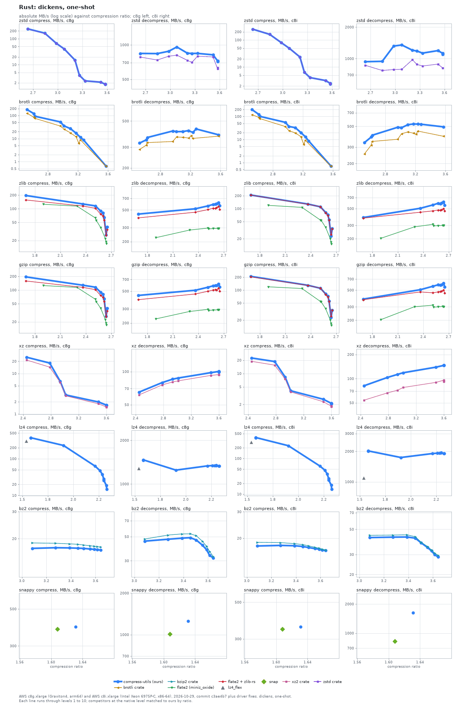
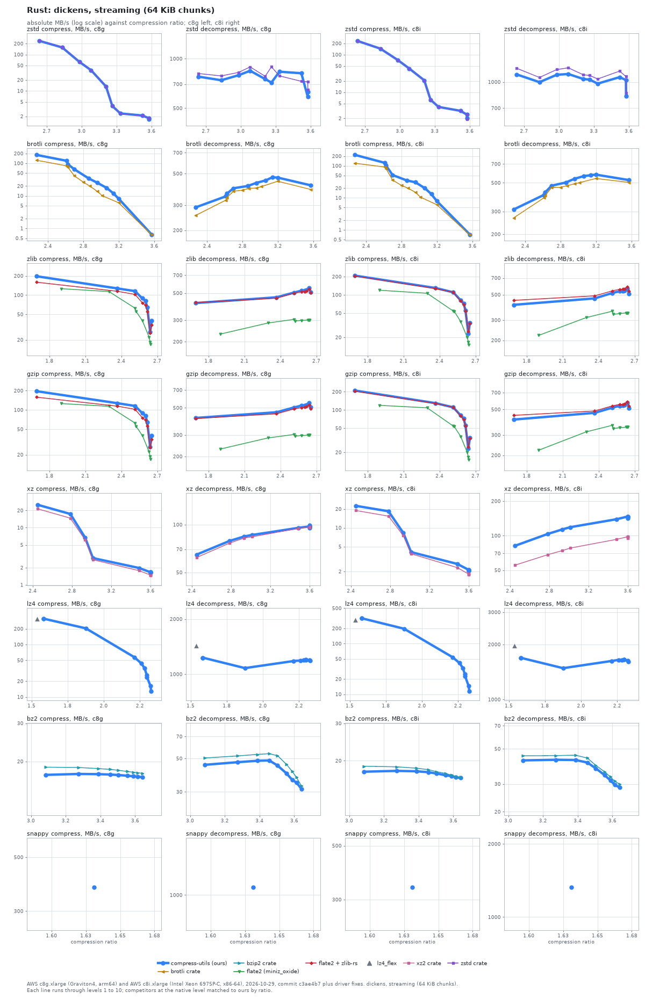
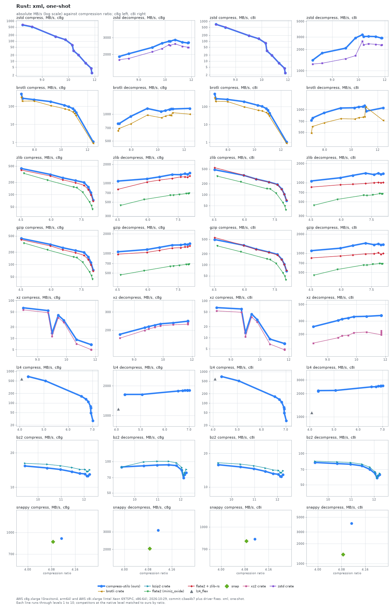
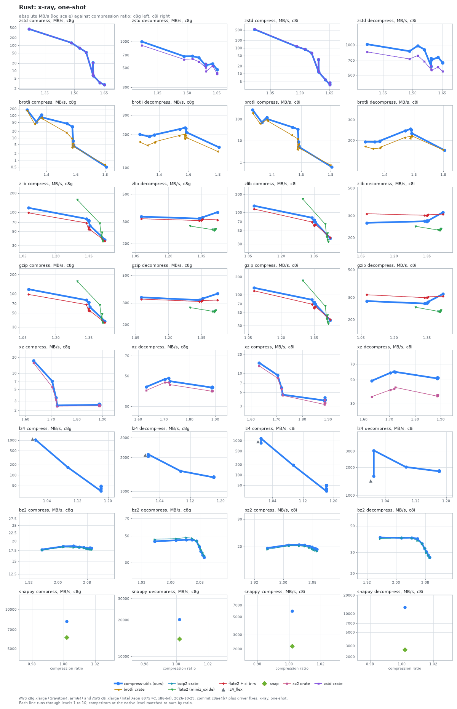
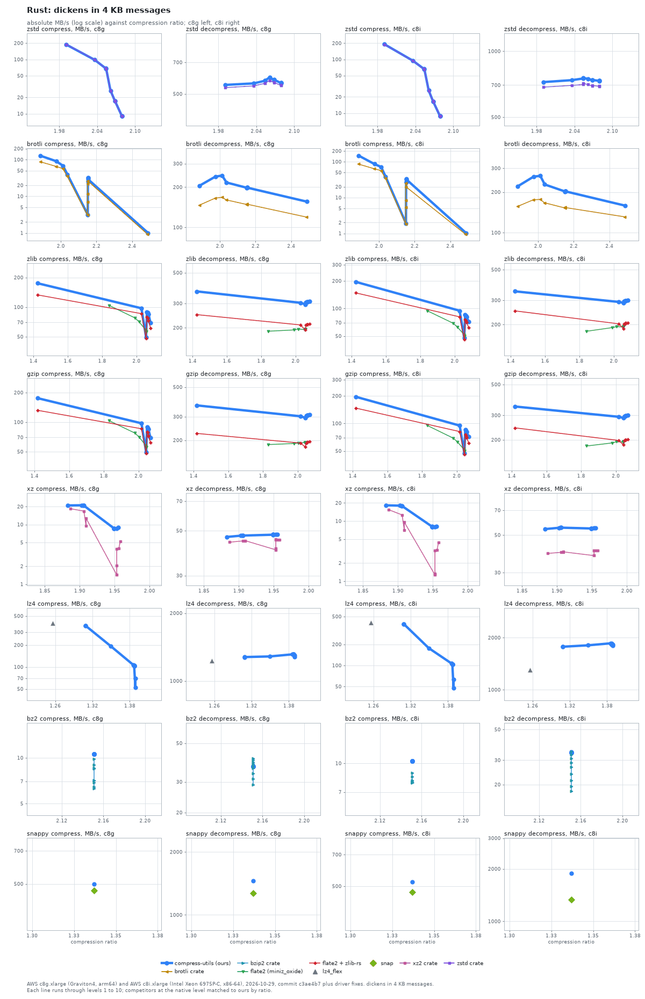

# The Rust binding against Rust crates

compress-utils through Rust against 8 libraries on five input sets, on two machines; at level 6 on dickens one-shot it is ahead of the fastest comparable peer in 11, level in 5 and behind in 0 of 16 format and direction cells on c8g.

The binding calls the C core through hand-written FFI, measured against flate2 (with the pure-Rust miniz_oxide backend and with zlib-rs), the zstd and xz2 crates (which bundle C libzstd and liblzma), the pure-Rust brotli, lz4_flex and snap crates and the bzip2 crate (libbz2-rs).

Libraries compared: brotli crate, bzip2 crate, flate2 (miniz_oxide), flate2 + zlib-rs, lz4_flex, snap, xz2 crate, zstd crate. The Rust zstd and xz2 crates run as separate binaries from compress-utils so that their bundled C symbols cannot clash with ours; results from before that fix are superseded.

How to read the charts: each line is one library, with a point per level (compress-utils levels 1 to 10; each competitor at the native level that matches ours by compression ratio, see [levels.json](../../benchmarks/levels.json)). A library with no levels is a single marker. The vertical axis is absolute throughput in MB/s on a log scale, the horizontal axis is compression ratio (input size over output size), so further right is smaller output and higher is faster. compress-utils is the bold blue line. Dashed lines are variants of a library in a second configuration. Where a competitor's levels cover a different ratio range than ours (klauspost zstd tops out at a lower ratio) the lines simply do not overlap; read speed at equal ratio.

In the tables, `Lx` is compress-utils level x (1 is fastest, 10 smallest), `comp` and `dec` are MB/s, and the multiple in brackets is the competitor's speed divided by ours at the same level: above 1.00x the competitor is faster, and **bold** marks more than 10% faster. Within 10% is a tie (one sample per cell). `-` means the library has no level matching that one. Libraries with no levels follow in a second table, compared with the compress-utils level closest in ratio.

## Dickens, one-shot

### dickens, one-shot: AWS c8g.xlarge (Graviton4, arm64)

| Format | Library | L1 ratio | L1 comp | L1 dec | L6 ratio | L6 comp | L6 dec | L10 ratio | L10 comp | L10 dec |
| :--- | :--- | ---: | ---: | ---: | ---: | ---: | ---: | ---: | ---: | ---: |
| **zstd** | **compress-utils** | **2.64** | **241** | **842** | **3.26** | **3.87** | **842** | **3.58** | **1.75** | **714** |
| zstd | zstd crate | 2.64 | 239 (0.99x) | 783 (0.93x) | 3.26 | 3.83 (0.99x) | 704 (0.84x) | 3.58 | 1.74 (1.00x) | 634 (0.89x) |
| **brotli** | **compress-utils** | **2.52** | **181** | **325** | **3.10** | **27.1** | **407** | **3.57** | **0.65** | **383** |
| brotli | brotli crate | 2.52 | 127 (0.70x) | 287 (0.88x) | 3.10 | 17.6 (0.65x) | 364 (0.89x) | 3.57 | 0.64 (0.98x) | 372 (0.97x) |
| **zlib** | **compress-utils** | **1.69** | **196** | **444** | **2.62** | **64.6** | **597** | **2.64** | **26.7** | **623** |
| zlib | flate2 (miniz_oxide) | 1.90 | 126 (0.64x) | 224 (0.50x) | 2.63 | 21.8 (0.34x) | 294 (0.49x) | 2.64 | 17.0 (0.64x) | 293 (0.47x) |
| zlib | flate2 + zlib-rs | 1.69 | 156 (0.80x) | 398 (0.90x) | 2.62 | 56.0 (0.87x) | 535 (0.90x) | 2.64 | 25.8 (0.97x) | 553 (0.89x) |
| **gzip** | **compress-utils** | **1.69** | **195** | **442** | **2.62** | **64.5** | **592** | **2.64** | **26.6** | **616** |
| gzip | flate2 (miniz_oxide) | 1.90 | 126 (0.64x) | 225 (0.51x) | 2.63 | 22.2 (0.34x) | 292 (0.49x) | 2.64 | 17.0 (0.64x) | 291 (0.47x) |
| gzip | flate2 + zlib-rs | 1.69 | 158 (0.81x) | 391 (0.89x) | 2.62 | 56.0 (0.87x) | 519 (0.88x) | 2.64 | 25.8 (0.97x) | 545 (0.89x) |
| **xz** | **compress-utils** | **2.45** | **25.2** | **65.0** | **3.60** | **1.66** | **98.9** | **3.60** | **1.64** | **99.7** |
| xz | xz2 crate | 2.45 | 21.5 (0.85x) | 61.4 (0.94x) | 3.60 | 1.50 (0.91x) | 93.5 (0.95x) | 3.60 | 1.47 (0.90x) | 93.6 (0.94x) |
| **lz4** | **compress-utils** | **1.58** | **372** | **1460** | **2.28** | **37.9** | **1339** | **2.33** | **14.8** | **1329** |
| **bz2** | **compress-utils** | **3.09** | **17.3** | **45.5** | **3.56** | **17.1** | **41.7** | **3.64** | **16.9** | **33.2** |
| bz2 | bzip2 crate | 3.09 | 18.8 (1.09x) | 47.6 (1.05x) | 3.56 | 18.0 (1.05x) | 45.3 (1.09x) | 3.64 | 17.6 (1.05x) | 35.7 (1.07x) |
| **snappy** | **compress-utils** | **1.63** | **390** | **1254** | **1.63** | **390** | **1248** | **1.63** | **389** | **1254** |

Libraries without levels, c8g:

| Format | Library | Ratio | Comp | Dec | Ours at | Ours ratio | Ours comp | Ours dec | Comp x | Dec x |
| :--- | :--- | ---: | ---: | ---: | :--- | ---: | ---: | ---: | ---: | ---: |
| lz4 | lz4_flex | 1.54 | 304 | 1281 | L2 | 1.58 | 373 | 1466 | 0.81x | 0.87x |
| snappy | snap | 1.61 | 379 | 1011 | L6 | 1.63 | 390 | 1248 | 0.97x | 0.81x |

### dickens, one-shot: AWS c8i.xlarge (Intel Xeon 6975P-C, x86-64)

| Format | Library | L1 ratio | L1 comp | L1 dec | L6 ratio | L6 comp | L6 dec | L10 ratio | L10 comp | L10 dec |
| :--- | :--- | ---: | ---: | ---: | ---: | ---: | ---: | ---: | ---: | ---: |
| **zstd** | **compress-utils** | **2.64** | **250** | **936** | **3.26** | **6.41** | **1183** | **3.58** | **2.34** | **1096** |
| zstd | zstd crate | 2.64 | 252 (1.01x) | 865 (0.92x) | 3.26 | 6.42 (1.00x) | 882 (0.75x) | 3.58 | 2.37 (1.01x) | 817 (0.75x) |
| **brotli** | **compress-utils** | **2.52** | **198** | **336** | **3.10** | **32.7** | **521** | **3.57** | **0.71** | **494** |
| brotli | brotli crate | 2.52 | 121 (0.61x) | 254 (0.76x) | 3.10 | 19.4 (0.59x) | 436 (0.84x) | 3.57 | 0.70 (0.98x) | 392 (0.79x) |
| **zlib** | **compress-utils** | **1.69** | **208** | **381** | **2.62** | **55.3** | **592** | **2.64** | **22.9** | **621** |
| zlib | flate2 (miniz_oxide) | 1.90 | 119 (0.58x) | 202 (0.53x) | 2.63 | 19.9 (0.36x) | 299 (0.50x) | 2.64 | 15.0 (0.66x) | 302 (0.49x) |
| zlib | flate2 + zlib-rs | 1.69 | 207 (1.00x) | 374 (0.98x) | 2.62 | 54.8 (0.99x) | 483 (0.82x) | 2.64 | 24.8 (1.08x) | 501 (0.81x) |
| **gzip** | **compress-utils** | **1.69** | **209** | **380** | **2.62** | **55.3** | **588** | **2.64** | **22.9** | **623** |
| gzip | flate2 (miniz_oxide) | 1.90 | 119 (0.57x) | 203 (0.54x) | 2.63 | 19.9 (0.36x) | 304 (0.52x) | 2.64 | 15.0 (0.66x) | 303 (0.49x) |
| gzip | flate2 + zlib-rs | 1.69 | 204 (0.97x) | 373 (0.98x) | 2.62 | 54.7 (0.99x) | 482 (0.82x) | 2.64 | 24.8 (1.08x) | 498 (0.80x) |
| **xz** | **compress-utils** | **2.45** | **22.4** | **81.4** | **3.60** | **2.11** | **146** | **3.60** | **2.09** | **146** |
| xz | xz2 crate | 2.45 | 18.9 (0.84x) | 53.9 (0.66x) | 3.60 | 1.85 (0.87x) | 95.2 (0.65x) | 3.60 | 1.79 (0.86x) | 91.4 (0.62x) |
| **lz4** | **compress-utils** | **1.58** | **378** | **2009** | **2.28** | **36.7** | **1925** | **2.33** | **13.6** | **1904** |
| **bz2** | **compress-utils** | **3.09** | **17.8** | **42.3** | **3.56** | **17.1** | **34.6** | **3.64** | **16.6** | **28.5** |
| bz2 | bzip2 crate | 3.09 | 18.8 (1.06x) | 44.2 (1.04x) | 3.56 | 17.4 (1.02x) | 35.3 (1.02x) | 3.64 | 16.7 (1.01x) | 29.6 (1.04x) |
| **snappy** | **compress-utils** | **1.63** | **349** | **1600** | **1.63** | **357** | **1639** | **1.63** | **356** | **1595** |

Libraries without levels, c8i:

| Format | Library | Ratio | Comp | Dec | Ours at | Ours ratio | Ours comp | Ours dec | Comp x | Dec x |
| :--- | :--- | ---: | ---: | ---: | :--- | ---: | ---: | ---: | ---: | ---: |
| lz4 | lz4_flex | 1.54 | 292 | 1095 | L2 | 1.58 | 387 | 2018 | 0.76x | 0.54x |
| snappy | snap | 1.61 | 343 | 824 | L6 | 1.63 | 357 | 1639 | 0.96x | 0.50x |

## Dickens, streaming (64 KiB chunks)

### dickens, streaming (64 KiB chunks): AWS c8g.xlarge (Graviton4, arm64)

| Format | Library | L1 ratio | L1 comp | L1 dec | L6 ratio | L6 comp | L6 dec | L10 ratio | L10 comp | L10 dec |
| :--- | :--- | ---: | ---: | ---: | ---: | ---: | ---: | ---: | ---: | ---: |
| **zstd** | **compress-utils** | **2.64** | **238** | **778** | **3.26** | **3.83** | **716** | **3.58** | **1.66** | **630** |
| zstd | zstd crate | 2.64 | 240 (1.01x) | 813 (1.04x) | 3.26 | 3.88 (1.01x) | 892 (**1.25x**) | 3.58 | 1.69 (1.02x) | 648 (1.03x) |
| **brotli** | **compress-utils** | **2.27** | **181** | **289** | **2.96** | **25.3** | **430** | **3.57** | **0.64** | **413** |
| brotli | brotli crate | 2.27 | 124 (0.69x) | 254 (0.88x) | 2.87 | 20.0 (0.79x) | 393 (0.91x) | 3.57 | 0.63 (0.98x) | 387 (0.94x) |
| **zlib** | **compress-utils** | **1.69** | **197** | **414** | **2.62** | **64.5** | **530** | **2.64** | **26.6** | **549** |
| zlib | flate2 (miniz_oxide) | 1.90 | 126 (0.64x) | 231 (0.56x) | 2.63 | 22.1 (0.34x) | 301 (0.57x) | 2.64 | 17.0 (0.64x) | 300 (0.55x) |
| zlib | flate2 + zlib-rs | 1.69 | 159 (0.81x) | 418 (1.01x) | 2.62 | 55.9 (0.87x) | 520 (0.98x) | 2.64 | 25.8 (0.97x) | 540 (0.98x) |
| **gzip** | **compress-utils** | **1.69** | **196** | **414** | **2.62** | **64.5** | **529** | **2.64** | **26.6** | **547** |
| gzip | flate2 (miniz_oxide) | 1.90 | 126 (0.64x) | 230 (0.56x) | 2.63 | 22.2 (0.34x) | 299 (0.57x) | 2.64 | 17.0 (0.64x) | 299 (0.55x) |
| gzip | flate2 + zlib-rs | 1.69 | 158 (0.81x) | 409 (0.99x) | 2.62 | 56.0 (0.87x) | 510 (0.96x) | 2.64 | 25.8 (0.97x) | 529 (0.97x) |
| **xz** | **compress-utils** | **2.45** | **25.2** | **64.8** | **3.60** | **1.67** | **99.0** | **3.60** | **1.65** | **95.5** |
| xz | xz2 crate | 2.45 | 21.4 (0.85x) | 62.1 (0.96x) | 3.60 | 1.49 (0.89x) | 96.1 (0.97x) | 3.60 | 1.47 (0.89x) | 96.0 (1.01x) |
| **lz4** | **compress-utils** | **1.58** | **311** | **1230** | **2.28** | **35.2** | **1193** | **2.33** | **12.9** | **1185** |
| **bz2** | **compress-utils** | **3.09** | **17.3** | **45.4** | **3.56** | **17.2** | **39.8** | **3.64** | **16.9** | **32.4** |
| bz2 | bzip2 crate | 3.09 | 18.8 (1.08x) | 50.4 (**1.11x**) | 3.56 | 18.0 (1.05x) | 45.7 (**1.15x**) | 3.64 | 17.6 (1.04x) | 35.0 (1.08x) |
| **snappy** | **compress-utils** | **1.63** | **375** | **1071** | **1.63** | **375** | **1075** | **1.63** | **375** | **1072** |

Libraries without levels, c8g:

| Format | Library | Ratio | Comp | Dec | Ours at | Ours ratio | Ours comp | Ours dec | Comp x | Dec x |
| :--- | :--- | ---: | ---: | ---: | :--- | ---: | ---: | ---: | ---: | ---: |
| lz4 | lz4_flex | 1.54 | 308 | 1436 | L2 | 1.58 | 312 | 1231 | 0.99x | **1.17x** |

### dickens, streaming (64 KiB chunks): AWS c8i.xlarge (Intel Xeon 6975P-C, x86-64)

| Format | Library | L1 ratio | L1 comp | L1 dec | L6 ratio | L6 comp | L6 dec | L10 ratio | L10 comp | L10 dec |
| :--- | :--- | ---: | ---: | ---: | ---: | ---: | ---: | ---: | ---: | ---: |
| **zstd** | **compress-utils** | **2.64** | **232** | **1108** | **3.26** | **6.27** | **1032** | **3.58** | **2.02** | **827** |
| zstd | zstd crate | 2.64 | 232 (1.00x) | 1205 (1.09x) | 3.26 | 6.25 (1.00x) | 1093 (1.06x) | 3.58 | 1.91 (0.95x) | 861 (1.04x) |
| **brotli** | **compress-utils** | **2.27** | **220** | **311** | **2.96** | **30.5** | **537** | **3.57** | **0.71** | **525** |
| brotli | brotli crate | 2.27 | 120 (0.55x) | 268 (0.86x) | 2.87 | 20.1 (0.66x) | 475 (0.88x) | 3.57 | 0.69 (0.98x) | 504 (0.96x) |
| **zlib** | **compress-utils** | **1.69** | **208** | **408** | **2.62** | **55.3** | **541** | **2.64** | **22.9** | **566** |
| zlib | flate2 (miniz_oxide) | 1.90 | 119 (0.57x) | 221 (0.54x) | 2.63 | 19.9 (0.36x) | 346 (0.64x) | 2.64 | 15.0 (0.66x) | 346 (0.61x) |
| zlib | flate2 + zlib-rs | 1.69 | 205 (0.99x) | 446 (1.09x) | 2.62 | 54.8 (0.99x) | 563 (1.04x) | 2.64 | 24.8 (1.08x) | 589 (1.04x) |
| **gzip** | **compress-utils** | **1.69** | **210** | **408** | **2.62** | **55.4** | **544** | **2.64** | **22.9** | **568** |
| gzip | flate2 (miniz_oxide) | 1.90 | 119 (0.57x) | 221 (0.54x) | 2.63 | 19.9 (0.36x) | 351 (0.64x) | 2.64 | 15.0 (0.66x) | 351 (0.62x) |
| gzip | flate2 + zlib-rs | 1.69 | 205 (0.97x) | 444 (1.09x) | 2.62 | 54.7 (0.99x) | 559 (1.03x) | 2.64 | 24.8 (1.08x) | 585 (1.03x) |
| **xz** | **compress-utils** | **2.45** | **22.5** | **81.5** | **3.60** | **2.13** | **146** | **3.60** | **2.05** | **142** |
| xz | xz2 crate | 2.45 | 18.9 (0.84x) | 55.2 (0.68x) | 3.60 | 1.85 (0.87x) | 97.8 (0.67x) | 3.60 | 1.79 (0.87x) | 95.5 (0.67x) |
| **lz4** | **compress-utils** | **1.58** | **316** | **1682** | **2.28** | **33.0** | **1646** | **2.33** | **11.4** | **1611** |
| **bz2** | **compress-utils** | **3.09** | **17.8** | **42.3** | **3.56** | **17.1** | **34.1** | **3.64** | **16.6** | **28.5** |
| bz2 | bzip2 crate | 3.09 | 18.8 (1.06x) | 45.1 (1.07x) | 3.56 | 17.4 (1.02x) | 35.8 (1.05x) | 3.64 | 16.7 (1.01x) | 29.9 (1.05x) |
| **snappy** | **compress-utils** | **1.63** | **335** | **1312** | **1.63** | **337** | **1328** | **1.63** | **337** | **1321** |

Libraries without levels, c8i:

| Format | Library | Ratio | Comp | Dec | Ours at | Ours ratio | Ours comp | Ours dec | Comp x | Dec x |
| :--- | :--- | ---: | ---: | ---: | :--- | ---: | ---: | ---: | ---: | ---: |
| lz4 | lz4_flex | 1.54 | 295 | 1977 | L2 | 1.58 | 316 | 1688 | 0.93x | **1.17x** |

## Xml, one-shot

### xml, one-shot: AWS c8g.xlarge (Graviton4, arm64)

| Format | Library | L1 ratio | L1 comp | L1 dec | L6 ratio | L6 comp | L6 dec | L10 ratio | L10 comp | L10 dec |
| :--- | :--- | ---: | ---: | ---: | ---: | ---: | ---: | ---: | ---: | ---: |
| **zstd** | **compress-utils** | **7.88** | **636** | **1901** | **10.79** | **33.5** | **2743** | **11.84** | **2.59** | **2665** |
| zstd | zstd crate | 7.88 | 677 (1.06x) | 1759 (0.93x) | 10.79 | 33.5 (1.00x) | 2486 (0.91x) | 11.84 | 2.57 (1.00x) | 2366 (0.89x) |
| **brotli** | **compress-utils** | **6.99** | **492** | **781** | **10.56** | **96.2** | **1094** | **12.42** | **1.09** | **1160** |
| brotli | brotli crate | 6.99 | 332 (0.67x) | 650 (0.83x) | 10.57 | 63.5 (0.66x) | 950 (0.87x) | 12.42 | 0.88 (0.81x) | 999 (0.86x) |
| **zlib** | **compress-utils** | **4.52** | **437** | **1079** | **7.84** | **153** | **1416** | **8.08** | **73.7** | **1448** |
| zlib | flate2 (miniz_oxide) | 4.66 | 331 (0.76x) | 442 (0.41x) | 7.90 | 65.2 (0.43x) | 681 (0.48x) | 8.05 | 43.5 (0.59x) | 685 (0.47x) |
| zlib | flate2 + zlib-rs | 4.52 | 399 (0.91x) | 797 (0.74x) | 7.84 | 133 (0.87x) | 1258 (0.89x) | 8.08 | 68.6 (0.93x) | 1305 (0.90x) |
| **gzip** | **compress-utils** | **4.52** | **434** | **1057** | **7.84** | **153** | **1378** | **8.08** | **73.6** | **1417** |
| gzip | flate2 (miniz_oxide) | 4.66 | 335 (0.77x) | 468 (0.44x) | 7.90 | 65.4 (0.43x) | 676 (0.49x) | 8.05 | 43.6 (0.59x) | 684 (0.48x) |
| gzip | flate2 + zlib-rs | 4.52 | 404 (0.93x) | 972 (0.92x) | 7.84 | 132 (0.86x) | 1254 (0.91x) | 8.08 | 68.7 (0.93x) | 1295 (0.91x) |
| **xz** | **compress-utils** | **8.26** | **64.3** | **182** | **11.03** | **9.20** | **235** | **11.79** | **6.81** | **244** |
| xz | xz2 crate | 8.26 | 56.8 (0.88x) | 167 (0.92x) | 11.03 | 7.14 (0.78x) | 225 (0.96x) | 11.79 | 4.98 (0.73x) | 228 (0.93x) |
| **lz4** | **compress-utils** | **4.35** | **683** | **1633** | **6.84** | **110** | **1794** | **7.03** | **27.4** | **1802** |
| **bz2** | **compress-utils** | **9.42** | **15.3** | **88.4** | **12.04** | **13.1** | **82.5** | **12.12** | **12.5** | **69.7** |
| bz2 | bzip2 crate | 9.42 | 16.2 (1.05x) | 88.2 (1.00x) | 12.04 | 14.3 (1.09x) | 87.8 (1.06x) | 12.12 | 13.8 (1.10x) | 73.9 (1.06x) |
| **snappy** | **compress-utils** | **4.11** | **906** | **3101** | **4.11** | **907** | **3107** | **4.11** | **907** | **3097** |

Libraries without levels, c8g:

| Format | Library | Ratio | Comp | Dec | Ours at | Ours ratio | Ours comp | Ours dec | Comp x | Dec x |
| :--- | :--- | ---: | ---: | ---: | :--- | ---: | ---: | ---: | ---: | ---: |
| lz4 | lz4_flex | 4.07 | 581 | 1167 | L2 | 4.35 | 683 | 1635 | 0.85x | 0.71x |
| snappy | snap | 4.08 | 859 | 2032 | L6 | 4.11 | 907 | 3107 | 0.95x | 0.65x |

### xml, one-shot: AWS c8i.xlarge (Intel Xeon 6975P-C, x86-64)

| Format | Library | L1 ratio | L1 comp | L1 dec | L6 ratio | L6 comp | L6 dec | L10 ratio | L10 comp | L10 dec |
| :--- | :--- | ---: | ---: | ---: | ---: | ---: | ---: | ---: | ---: | ---: |
| **zstd** | **compress-utils** | **7.88** | **705** | **1409** | **10.79** | **32.9** | **3045** | **11.84** | **2.50** | **2897** |
| zstd | zstd crate | 7.88 | 695 (0.99x) | 1242 (0.88x) | 10.79 | 33.4 (1.01x) | 2327 (0.76x) | 11.84 | 2.51 (1.00x) | 2330 (0.80x) |
| **brotli** | **compress-utils** | **6.99** | **526** | **720** | **10.56** | **106** | **1085** | **12.42** | **1.07** | **1054** |
| brotli | brotli crate | 6.99 | 319 (0.61x) | 487 (0.68x) | 10.57 | 58.1 (0.55x) | 780 (0.72x) | 12.42 | 0.88 (0.82x) | 719 (0.68x) |
| **zlib** | **compress-utils** | **4.52** | **478** | **1061** | **7.84** | **143** | **1403** | **8.08** | **68.1** | **1379** |
| zlib | flate2 (miniz_oxide) | 4.66 | 319 (0.67x) | 441 (0.42x) | 7.90 | 60.6 (0.43x) | 670 (0.48x) | 8.05 | 38.4 (0.56x) | 658 (0.48x) |
| zlib | flate2 + zlib-rs | 4.52 | 544 (**1.14x**) | 849 (0.80x) | 7.84 | 140 (0.98x) | 1009 (0.72x) | 8.08 | 70.9 (1.04x) | 999 (0.72x) |
| **gzip** | **compress-utils** | **4.52** | **493** | **1096** | **7.84** | **143** | **1397** | **8.08** | **68.2** | **1391** |
| gzip | flate2 (miniz_oxide) | 4.66 | 330 (0.67x) | 453 (0.41x) | 7.90 | 60.2 (0.42x) | 686 (0.49x) | 8.05 | 38.5 (0.56x) | 678 (0.49x) |
| gzip | flate2 + zlib-rs | 4.52 | 557 (**1.13x**) | 843 (0.77x) | 7.84 | 139 (0.97x) | 1015 (0.73x) | 8.08 | 70.6 (1.03x) | 984 (0.71x) |
| **xz** | **compress-utils** | **8.26** | **65.5** | **251** | **11.03** | **9.15** | **346** | **11.79** | **6.92** | **356** |
| xz | xz2 crate | 8.26 | 53.3 (0.81x) | 152 (0.60x) | 11.03 | 6.69 (0.73x) | 213 (0.62x) | 11.79 | 4.68 (0.68x) | 196 (0.55x) |
| **lz4** | **compress-utils** | **4.35** | **690** | **2151** | **6.84** | **107** | **2505** | **7.03** | **27.7** | **2525** |
| **bz2** | **compress-utils** | **9.42** | **15.8** | **81.9** | **12.04** | **13.0** | **64.1** | **12.12** | **12.5** | **58.1** |
| bz2 | bzip2 crate | 9.42 | 16.5 (1.04x) | 84.3 (1.03x) | 12.04 | 14.1 (1.08x) | 66.5 (1.04x) | 12.12 | 13.5 (1.08x) | 58.8 (1.01x) |
| **snappy** | **compress-utils** | **4.11** | **785** | **3880** | **4.11** | **831** | **4047** | **4.11** | **826** | **4089** |

Libraries without levels, c8i:

| Format | Library | Ratio | Comp | Dec | Ours at | Ours ratio | Ours comp | Ours dec | Comp x | Dec x |
| :--- | :--- | ---: | ---: | ---: | :--- | ---: | ---: | ---: | ---: | ---: |
| lz4 | lz4_flex | 4.07 | 596 | 1129 | L2 | 4.35 | 702 | 2184 | 0.85x | 0.52x |
| snappy | snap | 4.08 | 798 | 1372 | L6 | 4.11 | 831 | 4047 | 0.96x | 0.34x |

## X-ray, one-shot

### x-ray, one-shot: AWS c8g.xlarge (Graviton4, arm64)

| Format | Library | L1 ratio | L1 comp | L1 dec | L6 ratio | L6 comp | L6 dec | L10 ratio | L10 comp | L10 dec |
| :--- | :--- | ---: | ---: | ---: | ---: | ---: | ---: | ---: | ---: | ---: |
| **zstd** | **compress-utils** | **1.27** | **446** | **999** | **1.59** | **6.73** | **530** | **1.65** | **2.86** | **476** |
| zstd | zstd crate | 1.27 | 451 (1.01x) | 905 (0.91x) | 1.59 | 6.67 (0.99x) | 552 (1.04x) | 1.65 | 2.84 (1.00x) | 438 (0.92x) |
| **brotli** | **compress-utils** | **1.27** | **182** | **201** | **1.58** | **31.8** | **231** | **1.81** | **0.51** | **153** |
| brotli | brotli crate | 1.27 | 167 (0.92x) | 172 (0.85x) | 1.57 | 9.57 (0.30x) | 202 (0.87x) | 1.80 | 0.63 (**1.24x**) | 141 (0.92x) |
| **zlib** | **compress-utils** | **1.08** | **117** | **330** | **1.35** | **72.3** | **320** | **1.42** | **37.2** | **358** |
| zlib | flate2 (miniz_oxide) | 1.30 | 157 (**1.34x**) | 277 (0.84x) | 1.41 | 35.2 (0.49x) | 263 (0.82x) | 1.41 | 35.1 (0.95x) | 262 (0.73x) |
| zlib | flate2 + zlib-rs | 1.08 | 97.8 (0.83x) | 317 (0.96x) | 1.35 | 54.1 (0.75x) | 308 (0.96x) | 1.42 | 35.6 (0.96x) | 312 (0.87x) |
| **gzip** | **compress-utils** | **1.08** | **118** | **332** | **1.35** | **73.1** | **319** | **1.42** | **37.1** | **357** |
| gzip | flate2 (miniz_oxide) | 1.30 | 157 (**1.33x**) | 275 (0.83x) | 1.41 | 35.2 (0.48x) | 259 (0.81x) | 1.41 | 35.1 (0.95x) | 260 (0.73x) |
| gzip | flate2 + zlib-rs | 1.08 | 97.7 (0.83x) | 322 (0.97x) | 1.35 | 54.3 (0.74x) | 310 (0.97x) | 1.42 | 35.5 (0.96x) | 315 (0.88x) |
| **xz** | **compress-utils** | **1.63** | **17.2** | **41.6** | **1.89** | **2.54** | **41.3** | **1.89** | **2.60** | **41.2** |
| xz | xz2 crate | 1.63 | 15.6 (0.91x) | 39.3 (0.94x) | 1.89 | 2.43 (0.96x) | 38.8 (0.94x) | 1.89 | 2.48 (0.95x) | 38.7 (0.94x) |
| **lz4** | **compress-utils** | **1.01** | **1028** | **2055** | **1.18** | **47.8** | **1341** | **1.18** | **35.1** | **1332** |
| **bz2** | **compress-utils** | **1.96** | **17.7** | **45.0** | **2.08** | **18.1** | **40.8** | **2.09** | **18.1** | **32.9** |
| bz2 | bzip2 crate | 1.96 | 17.6 (0.99x) | 46.9 (1.04x) | 2.08 | 18.0 (0.99x) | 42.0 (1.03x) | 2.09 | 17.7 (0.98x) | 34.5 (1.05x) |
| **snappy** | **compress-utils** | **1.00** | **7505** | **13210** | **1.00** | **8185** | **21800** | **1.00** | **8169** | **21800** |

Libraries without levels, c8g:

| Format | Library | Ratio | Comp | Dec | Ours at | Ours ratio | Ours comp | Ours dec | Comp x | Dec x |
| :--- | :--- | ---: | ---: | ---: | :--- | ---: | ---: | ---: | ---: | ---: |
| lz4 | lz4_flex | 1.00 | 1111 | 2121 | L2 | 1.01 | 1023 | 2133 | 1.09x | 0.99x |
| snappy | snap | 1.00 | 6124 | 13960 | L6 | 1.00 | 8185 | 21800 | 0.75x | 0.64x |

### x-ray, one-shot: AWS c8i.xlarge (Intel Xeon 6975P-C, x86-64)

| Format | Library | L1 ratio | L1 comp | L1 dec | L6 ratio | L6 comp | L6 dec | L10 ratio | L10 comp | L10 dec |
| :--- | :--- | ---: | ---: | ---: | ---: | ---: | ---: | ---: | ---: | ---: |
| **zstd** | **compress-utils** | **1.27** | **536** | **1015** | **1.59** | **12.3** | **612** | **1.65** | **3.76** | **666** |
| zstd | zstd crate | 1.27 | 552 (1.03x) | 852 (0.84x) | 1.59 | 12.6 (1.03x) | 569 (0.93x) | 1.65 | 3.82 (1.02x) | 547 (0.82x) |
| **brotli** | **compress-utils** | **1.27** | **274** | **195** | **1.58** | **34.4** | **250** | **1.81** | **0.60** | **164** |
| brotli | brotli crate | 1.27 | 192 (0.70x) | 177 (0.91x) | 1.57 | 12.4 (0.36x) | 217 (0.87x) | 1.80 | 0.75 (**1.25x**) | 166 (1.01x) |
| **zlib** | **compress-utils** | **1.08** | **129** | **263** | **1.35** | **71.2** | **270** | **1.42** | **37.1** | **319** |
| zlib | flate2 (miniz_oxide) | 1.30 | 167 (**1.29x**) | 247 (0.94x) | 1.41 | 32.8 (0.46x) | 235 (0.87x) | 1.41 | 32.6 (0.88x) | 236 (0.74x) |
| zlib | flate2 + zlib-rs | 1.08 | 114 (0.88x) | 311 (**1.18x**) | 1.35 | 60.1 (0.84x) | 301 (**1.12x**) | 1.42 | 38.3 (1.03x) | 310 (0.97x) |
| **gzip** | **compress-utils** | **1.08** | **131** | **281** | **1.35** | **71.3** | **272** | **1.42** | **37.2** | **320** |
| gzip | flate2 (miniz_oxide) | 1.30 | 174 (**1.33x**) | 251 (0.89x) | 1.41 | 32.8 (0.46x) | 237 (0.87x) | 1.41 | 32.7 (0.88x) | 237 (0.74x) |
| gzip | flate2 + zlib-rs | 1.08 | 117 (0.89x) | 316 (**1.12x**) | 1.35 | 60.0 (0.84x) | 300 (**1.10x**) | 1.42 | 38.2 (1.03x) | 307 (0.96x) |
| **xz** | **compress-utils** | **1.63** | **14.8** | **49.0** | **1.89** | **3.75** | **52.1** | **1.89** | **3.68** | **52.3** |
| xz | xz2 crate | 1.63 | 13.2 (0.89x) | 34.8 (0.71x) | 1.89 | 3.38 (0.90x) | 36.0 (0.69x) | 1.89 | 3.18 (0.86x) | 35.2 (0.67x) |
| **lz4** | **compress-utils** | **1.01** | **856** | **1615** | **1.18** | **49.7** | **1826** | **1.18** | **33.8** | **1817** |
| **bz2** | **compress-utils** | **1.96** | **19.6** | **40.0** | **2.08** | **19.8** | **32.4** | **2.09** | **19.2** | **27.3** |
| bz2 | bzip2 crate | 1.96 | 19.2 (0.98x) | 39.2 (0.98x) | 2.08 | 19.3 (0.97x) | 32.5 (1.00x) | 2.09 | 18.6 (0.97x) | 27.1 (0.99x) |
| **snappy** | **compress-utils** | **1.00** | **3594** | **9559** | **1.00** | **6221** | **13160** | **1.00** | **6231** | **13310** |

Libraries without levels, c8i:

| Format | Library | Ratio | Comp | Dec | Ours at | Ours ratio | Ours comp | Ours dec | Comp x | Dec x |
| :--- | :--- | ---: | ---: | ---: | :--- | ---: | ---: | ---: | ---: | ---: |
| lz4 | lz4_flex | 1.00 | 951 | 1436 | L2 | 1.01 | 1161 | 3052 | 0.82x | 0.47x |
| snappy | snap | 1.00 | 2175 | 2636 | L6 | 1.00 | 6221 | 13160 | 0.35x | 0.20x |

## Dickens in 4 KB messages

### dickens in 4 KB messages: AWS c8g.xlarge (Graviton4, arm64)

| Format | Library | L1 ratio | L1 comp | L1 dec | L6 ratio | L6 comp | L6 dec | L10 ratio | L10 comp | L10 dec |
| :--- | :--- | ---: | ---: | ---: | ---: | ---: | ---: | ---: | ---: | ---: |
| **zstd** | **compress-utils** | **1.99** | **188** | **550** | **2.07** | **17.3** | **582** | **2.08** | **9.11** | **563** |
| zstd | zstd crate | 1.99 | 189 (1.01x) | 535 (0.97x) | 2.07 | 17.2 (0.99x) | 566 (0.97x) | 2.08 | 9.04 (0.99x) | 549 (0.98x) |
| **brotli** | **compress-utils** | **1.89** | **128** | **205** | **2.15** | **29.0** | **198** | **2.49** | **1.01** | **156** |
| brotli | brotli crate | 1.88 | 87.5 (0.69x) | 146 (0.71x) | 2.15 | 26.2 (0.90x) | 149 (0.75x) | 2.49 | 0.93 (0.92x) | 119 (0.77x) |
| **zlib** | **compress-utils** | **1.42** | **175** | **366** | **2.07** | **84.8** | **309** | **2.06** | **49.4** | **296** |
| zlib | flate2 (miniz_oxide) | 1.84 | 104 (0.60x) | 189 (0.52x) | 2.06 | 55.8 (0.66x) | 196 (0.63x) | 2.06 | 55.8 (**1.13x**) | 196 (0.66x) |
| zlib | flate2 + zlib-rs | 1.42 | 133 (0.76x) | 249 (0.68x) | 2.07 | 72.4 (0.85x) | 212 (0.69x) | 2.06 | 48.3 (0.98x) | 192 (0.65x) |
| **gzip** | **compress-utils** | **1.42** | **175** | **364** | **2.06** | **84.8** | **307** | **2.04** | **49.4** | **294** |
| gzip | flate2 (miniz_oxide) | 1.83 | 103 (0.59x) | 185 (0.51x) | 2.04 | 55.6 (0.66x) | 192 (0.62x) | 2.04 | 55.5 (**1.12x**) | 192 (0.65x) |
| gzip | flate2 + zlib-rs | 1.42 | 132 (0.75x) | 225 (0.62x) | 2.06 | 72.4 (0.85x) | 194 (0.63x) | 2.04 | 48.3 (0.98x) | 178 (0.60x) |
| **xz** | **compress-utils** | **1.88** | **20.9** | **46.5** | **1.95** | **8.66** | **48.0** | **1.95** | **8.64** | **47.7** |
| xz | xz2 crate | 1.89 | 18.4 (0.88x) | 43.9 (0.94x) | 1.96 | 3.97 (0.46x) | 45.1 (0.94x) | 1.95 | 1.43 (0.17x) | 40.8 (0.85x) |
| **lz4** | **compress-utils** | **1.31** | **365** | **1269** | **1.39** | **103** | **1313** | **1.39** | **52.2** | **1275** |
| **bz2** | **compress-utils** | **2.15** | **10.6** | **36.8** | **2.15** | **10.6** | **36.8** | **2.15** | **10.6** | **36.8** |
| bz2 | bzip2 crate | 2.15 | 9.81 (0.93x) | 40.8 (**1.11x**) | 2.15 | 6.87 (0.65x) | 36.1 (0.98x) | 2.15 | 6.53 (0.62x) | 29.3 (0.80x) |
| **snappy** | **compress-utils** | **1.34** | **501** | **1453** | **1.34** | **499** | **1460** | **1.34** | **498** | **1464** |

Libraries without levels, c8g:

| Format | Library | Ratio | Comp | Dec | Ours at | Ours ratio | Ours comp | Ours dec | Comp x | Dec x |
| :--- | :--- | ---: | ---: | ---: | :--- | ---: | ---: | ---: | ---: | ---: |
| lz4 | lz4_flex | 1.26 | 402 | 1229 | L2 | 1.31 | 367 | 1276 | 1.10x | 0.96x |
| snappy | snap | 1.34 | 467 | 1267 | L6 | 1.34 | 499 | 1460 | 0.94x | 0.87x |

### dickens in 4 KB messages: AWS c8i.xlarge (Intel Xeon 6975P-C, x86-64)

| Format | Library | L1 ratio | L1 comp | L1 dec | L6 ratio | L6 comp | L6 dec | L10 ratio | L10 comp | L10 dec |
| :--- | :--- | ---: | ---: | ---: | ---: | ---: | ---: | ---: | ---: | ---: |
| **zstd** | **compress-utils** | **1.99** | **191** | **723** | **2.07** | **16.5** | **739** | **2.08** | **8.76** | **733** |
| zstd | zstd crate | 1.99 | 190 (0.99x) | 686 (0.95x) | 2.07 | 16.7 (1.01x) | 698 (0.94x) | 2.08 | 8.83 (1.01x) | 694 (0.95x) |
| **brotli** | **compress-utils** | **1.89** | **149** | **220** | **2.15** | **32.1** | **202** | **2.49** | **1.02** | **158** |
| brotli | brotli crate | 1.88 | 86.0 (0.58x) | 156 (0.71x) | 2.15 | 20.0 (0.62x) | 154 (0.76x) | 2.49 | 0.94 (0.92x) | 131 (0.83x) |
| **zlib** | **compress-utils** | **1.42** | **195** | **348** | **2.07** | **80.7** | **297** | **2.06** | **47.5** | **288** |
| zlib | flate2 (miniz_oxide) | 1.84 | 94.2 (0.48x) | 179 (0.51x) | 2.06 | 49.6 (0.61x) | 194 (0.65x) | 2.06 | 49.6 (1.05x) | 193 (0.67x) |
| zlib | flate2 + zlib-rs | 1.42 | 148 (0.76x) | 251 (0.72x) | 2.07 | 70.5 (0.87x) | 205 (0.69x) | 2.06 | 45.9 (0.97x) | 188 (0.65x) |
| **gzip** | **compress-utils** | **1.42** | **195** | **347** | **2.06** | **80.7** | **298** | **2.04** | **47.3** | **288** |
| gzip | flate2 (miniz_oxide) | 1.83 | 94.8 (0.49x) | 180 (0.52x) | 2.04 | 49.7 (0.62x) | 195 (0.65x) | 2.04 | 49.7 (1.05x) | 195 (0.68x) |
| gzip | flate2 + zlib-rs | 1.42 | 147 (0.75x) | 244 (0.70x) | 2.06 | 70.1 (0.87x) | 199 (0.67x) | 2.04 | 45.9 (0.97x) | 184 (0.64x) |
| **xz** | **compress-utils** | **1.88** | **18.2** | **54.2** | **1.95** | **8.07** | **54.9** | **1.95** | **8.07** | **54.6** |
| xz | xz2 crate | 1.89 | 15.4 (0.84x) | 38.9 (0.72x) | 1.96 | 3.28 (0.41x) | 40.5 (0.74x) | 1.95 | 1.27 (0.16x) | 37.8 (0.69x) |
| **lz4** | **compress-utils** | **1.31** | **387** | **1773** | **1.39** | **103** | **1833** | **1.39** | **47.5** | **1800** |
| **bz2** | **compress-utils** | **2.15** | **10.3** | **33.9** | **2.15** | **10.3** | **34.0** | **2.15** | **10.3** | **34.2** |
| bz2 | bzip2 crate | 2.15 | 8.89 (0.86x) | 34.8 (1.03x) | 2.15 | 7.87 (0.76x) | 23.8 (0.70x) | 2.15 | 7.87 (0.76x) | 18.0 (0.53x) |
| **snappy** | **compress-utils** | **1.34** | **510** | **1883** | **1.34** | **525** | **1890** | **1.34** | **522** | **1878** |

Libraries without levels, c8i:

| Format | Library | Ratio | Comp | Dec | Ours at | Ours ratio | Ours comp | Ours dec | Comp x | Dec x |
| :--- | :--- | ---: | ---: | ---: | :--- | ---: | ---: | ---: | ---: | ---: |
| lz4 | lz4_flex | 1.26 | 413 | 1302 | L2 | 1.31 | 390 | 1769 | 1.06x | 0.74x |
| snappy | snap | 1.34 | 469 | 1333 | L6 | 1.34 | 525 | 1890 | 0.89x | 0.71x |

---

Generated by benchmarks/publish.py from run 2026-10-29, commit c3ae4b7 plus driver fixes; do not edit by hand.
