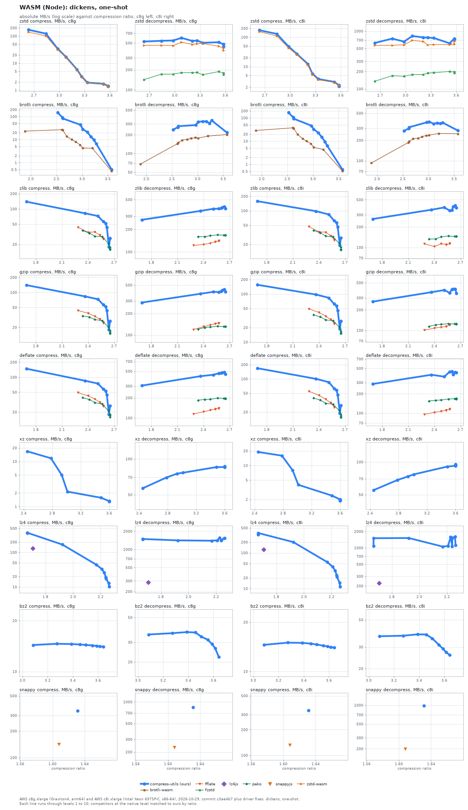
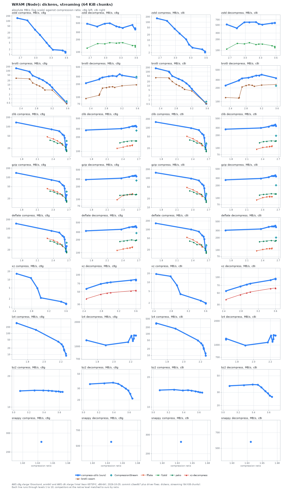
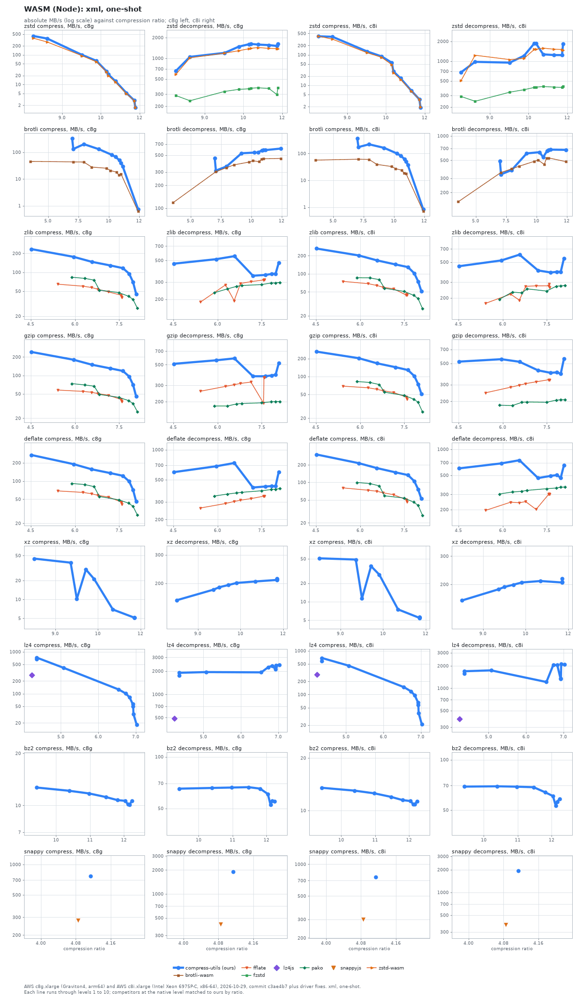
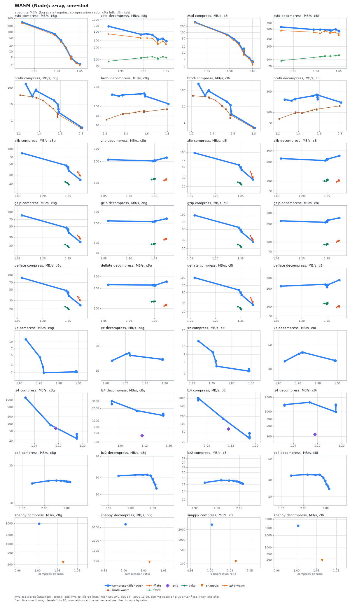
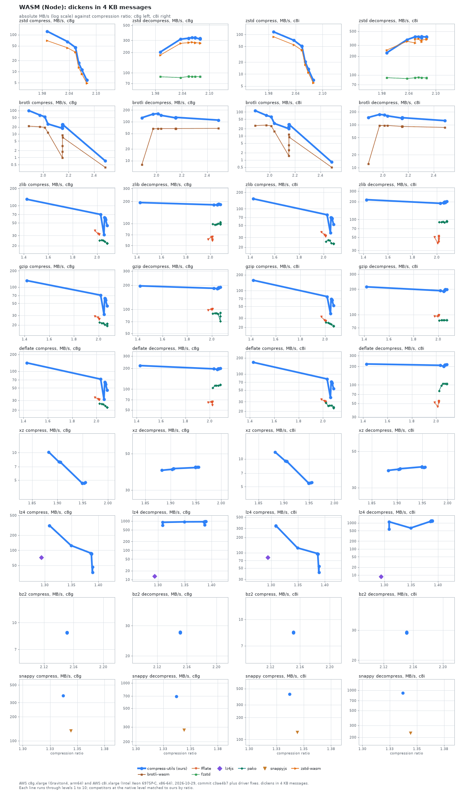
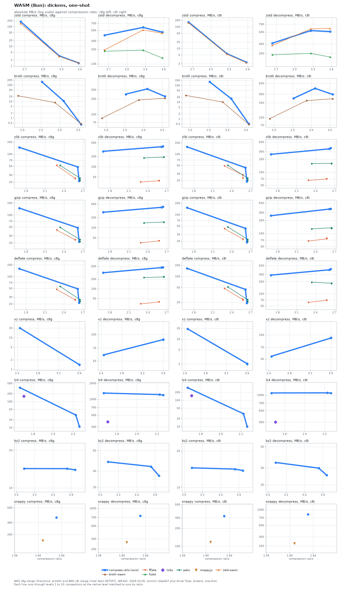
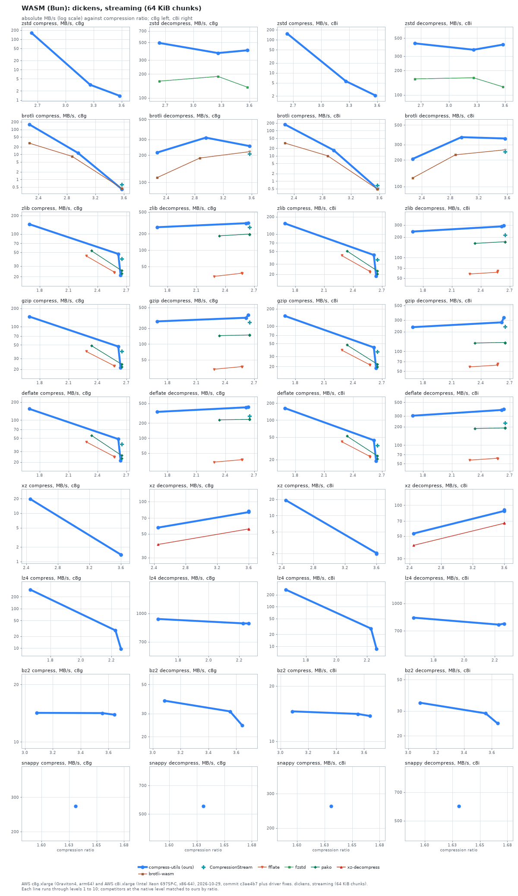
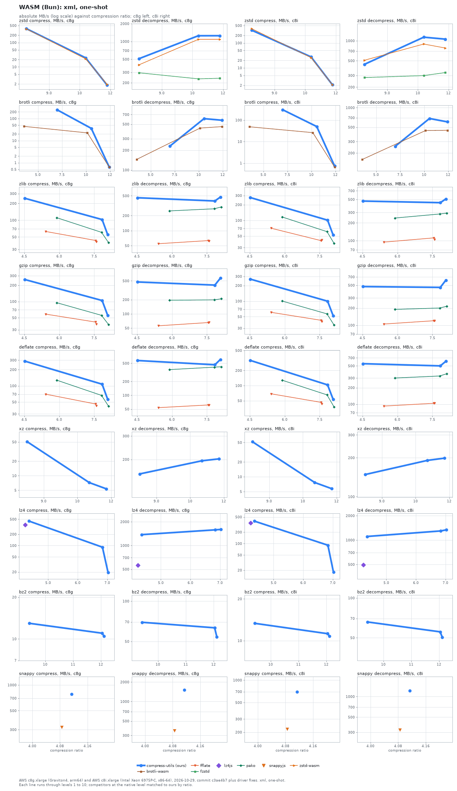
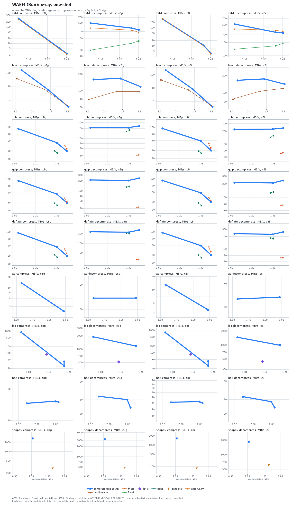
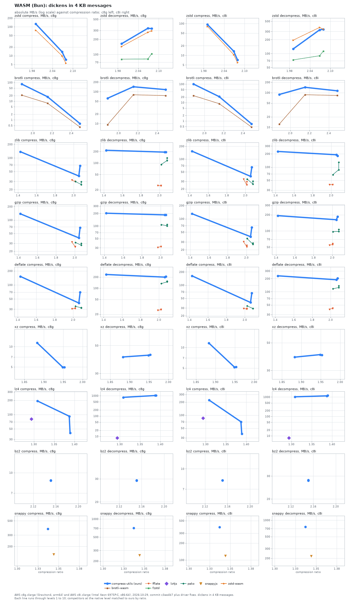

# WASM binding against JavaScript libraries

compress-utils' WASM binding on Node and on Bun against 9 JavaScript libraries on five input sets, on two machines; at level 6 on dickens one-shot on c8g it is ahead of the fastest comparable peer in 11, level in 1 and behind in 0 of 12 format and direction cells on Node (11, 1 and 0 of 12 on Bun).

The binding is the C core compiled to WebAssembly, so it is compared here with pure JavaScript libraries (fflate, pako, fzstd, lz4js, snappyjs), WASM builds of native codecs (brotli-wasm, zstd-wasm) and the runtime's own `CompressionStream`. The native-C and WASM gap is on the [bindings page](bindings.md). Two caveats: `xz-decompress` only decompresses (streaming input on dickens only), and lz4js output is invalid on three inputs in an earlier check, so its compress numbers describe work other decoders cannot read. `CompressionStream` only appears in the streaming cell. Bun runs levels 1, 6 and 10 only.

Libraries compared on Node: CompressionStream, brotli-wasm, fflate, fzstd, lz4js, pako, snappyjs, xz-decompress, zstd-wasm.

How to read the charts and tables: see the [C page](c.md) (same grammar: absolute MB/s on a log axis against compression ratio, one line per library through its levels, a single marker for a library with no levels).

## WASM (Node)

### Dickens, one-shot (WASM (Node))

#### dickens, one-shot, WASM (Node): AWS c8g.xlarge (Graviton4, arm64)

| Format | Library | L1 ratio | L1 comp | L1 dec | L6 ratio | L6 comp | L6 dec | L10 ratio | L10 comp | L10 dec |
| :--- | :--- | ---: | ---: | ---: | ---: | ---: | ---: | ---: | ---: | ---: |
| **zstd** | **compress-utils** | **2.64** | **171** | **528** | **3.26** | **3.25** | **546** | **3.58** | **1.42** | **443** |
| zstd | fzstd | 2.64 | - | 143 (0.27x) | 3.26 | - | 182 (0.33x) | 3.58 | - | 170 (0.38x) |
| zstd | zstd-wasm | 2.64 | 140 (0.82x) | 464 (0.88x) | 3.26 | 3.06 (0.94x) | 489 (0.89x) | 3.58 | 1.37 (0.97x) | 390 (0.88x) |
| **brotli** | **compress-utils** | **2.52** | **150** | **241** | **3.10** | **21.3** | **329** | **3.57** | **0.51** | **218** |
| brotli | brotli-wasm | 1.89 | 23.3 (0.16x) | 67.6 (0.28x) | 2.87 | 8.17 (0.38x) | 175 (0.53x) | 3.57 | 0.44 (0.86x) | 202 (0.93x) |
| **zlib** | **compress-utils** | **1.69** | **139** | **268** | **2.62** | **43.5** | **395** | **2.64** | **17.9** | **405** |
| zlib | fflate | 2.28 | 43.6 (0.31x) | 122 (0.46x) | 2.58 | 26.1 (0.60x) | 139 (0.35x) | 2.58 | 25.3 (**1.42x**) | 141 (0.35x) |
| zlib | pako | 2.34 | 37.5 (0.27x) | 161 (0.60x) | 2.65 | 17.6 (0.40x) | 168 (0.43x) | 2.65 | 15.7 (0.88x) | 168 (0.42x) |
| **gzip** | **compress-utils** | **1.69** | **140** | **285** | **2.62** | **43.5** | **424** | **2.64** | **17.8** | **435** |
| gzip | fflate | 2.28 | 43.5 (0.31x) | 119 (0.42x) | 2.58 | 25.1 (0.58x) | 147 (0.35x) | 2.58 | 24.5 (**1.37x**) | 145 (0.33x) |
| gzip | pako | 2.34 | 34.0 (0.24x) | 121 (0.42x) | 2.65 | 16.9 (0.39x) | 132 (0.31x) | 2.65 | 15.1 (0.85x) | 132 (0.30x) |
| **deflate** | **compress-utils** | **1.69** | **148** | **305** | **2.62** | **44.2** | **474** | **2.64** | **18.0** | **483** |
| deflate | fflate | 2.28 | 49.0 (0.33x) | 115 (0.38x) | 2.58 | 26.9 (0.61x) | 138 (0.29x) | 2.58 | 26.1 (**1.45x**) | 140 (0.29x) |
| deflate | pako | 2.34 | 38.9 (0.26x) | 184 (0.60x) | 2.65 | 17.9 (0.41x) | 198 (0.42x) | 2.65 | 16.0 (0.89x) | 198 (0.41x) |
| **xz** | **compress-utils** | **2.45** | **16.8** | **56.6** | **3.60** | **1.31** | **86.2** | **3.60** | **1.33** | **85.6** |
| **lz4** | **compress-utils** | **1.58** | **362** | **1467** | **2.28** | **25.9** | **1548** | **2.33** | **10.1** | **1532** |
| **bz2** | **compress-utils** | **3.09** | **14.4** | **35.2** | **3.56** | **14.3** | **31.6** | **3.64** | **14.0** | **22.4** |
| **snappy** | **compress-utils** | **1.63** | **333** | **850** | **1.63** | **337** | **849** | **1.63** | **340** | **848** |

Libraries without levels, c8g:

| Format | Library | Ratio | Comp | Dec | Ours at | Ours ratio | Ours comp | Ours dec | Comp x | Dec x |
| :--- | :--- | ---: | ---: | ---: | :--- | ---: | ---: | ---: | ---: | ---: |
| lz4 | lz4js | 1.64 | 130 | 285 | L2 | 1.58 | 374 | 1490 | 0.35x | 0.19x |
| snappy | snappyjs | 1.61 | 141 | 232 | L6 | 1.63 | 337 | 849 | 0.42x | 0.27x |

#### dickens, one-shot, WASM (Node): AWS c8i.xlarge (Intel Xeon 6975P-C, x86-64)

| Format | Library | L1 ratio | L1 comp | L1 dec | L6 ratio | L6 comp | L6 dec | L10 ratio | L10 comp | L10 dec |
| :--- | :--- | ---: | ---: | ---: | ---: | ---: | ---: | ---: | ---: | ---: |
| **zstd** | **compress-utils** | **2.64** | **173** | **625** | **3.26** | **5.78** | **772** | **3.58** | **2.16** | **719** |
| zstd | fzstd | 2.64 | - | 136 (0.22x) | 3.26 | - | 188 (0.24x) | 3.58 | - | 187 (0.26x) |
| zstd | zstd-wasm | 2.64 | 154 (0.89x) | 564 (0.90x) | 3.26 | 5.39 (0.93x) | 578 (0.75x) | 3.58 | 2.24 (1.04x) | 664 (0.92x) |
| **brotli** | **compress-utils** | **2.52** | **171** | **274** | **3.10** | **23.4** | **350** | **3.57** | **0.60** | **278** |
| brotli | brotli-wasm | 1.89 | 28.9 (0.17x) | 92.8 (0.34x) | 2.87 | 10.1 (0.43x) | 226 (0.65x) | 3.57 | 0.53 (0.87x) | 249 (0.89x) |
| **zlib** | **compress-utils** | **1.69** | **158** | **261** | **2.62** | **45.8** | **399** | **2.64** | **19.0** | **416** |
| zlib | fflate | 2.28 | 47.1 (0.30x) | 113 (0.43x) | 2.58 | 25.3 (0.55x) | 114 (0.28x) | 2.58 | 24.5 (**1.29x**) | 114 (0.27x) |
| zlib | pako | 2.34 | 39.1 (0.25x) | 132 (0.51x) | 2.65 | 17.4 (0.38x) | 145 (0.36x) | 2.65 | 15.2 (0.80x) | 146 (0.35x) |
| **gzip** | **compress-utils** | **1.69** | **156** | **264** | **2.62** | **45.7** | **404** | **2.64** | **19.0** | **423** |
| gzip | fflate | 2.28 | 49.3 (0.32x) | 101 (0.38x) | 2.58 | 24.7 (0.54x) | 120 (0.30x) | 2.58 | 23.9 (**1.26x**) | 122 (0.29x) |
| gzip | pako | 2.34 | 37.0 (0.24x) | 114 (0.43x) | 2.65 | 17.0 (0.37x) | 124 (0.31x) | 2.65 | 14.9 (0.79x) | 125 (0.30x) |
| **deflate** | **compress-utils** | **1.69** | **168** | **285** | **2.62** | **46.3** | **399** | **2.64** | **19.1** | **418** |
| deflate | fflate | 2.28 | 55.1 (0.33x) | 95.4 (0.33x) | 2.58 | 25.9 (0.56x) | 114 (0.29x) | 2.58 | 25.0 (**1.31x**) | 116 (0.28x) |
| deflate | pako | 2.34 | 39.6 (0.24x) | 154 (0.54x) | 2.65 | 17.7 (0.38x) | 169 (0.42x) | 2.65 | 15.5 (0.81x) | 169 (0.40x) |
| **xz** | **compress-utils** | **2.45** | **19.0** | **55.0** | **3.60** | **1.91** | **94.6** | **3.60** | **1.87** | **95.2** |
| **lz4** | **compress-utils** | **1.58** | **322** | **1506** | **2.28** | **31.8** | **1581** | **2.33** | **11.4** | **1124** |
| **bz2** | **compress-utils** | **3.09** | **14.6** | **36.7** | **3.56** | **14.4** | **31.4** | **3.64** | **14.0** | **26.1** |
| **snappy** | **compress-utils** | **1.63** | **322** | **1012** | **1.63** | **343** | **1004** | **1.63** | **342** | **1003** |

Libraries without levels, c8i:

| Format | Library | Ratio | Comp | Dec | Ours at | Ours ratio | Ours comp | Ours dec | Comp x | Dec x |
| :--- | :--- | ---: | ---: | ---: | :--- | ---: | ---: | ---: | ---: | ---: |
| lz4 | lz4js | 1.64 | 124 | 224 | L2 | 1.58 | 361 | 1076 | 0.34x | 0.21x |
| snappy | snappyjs | 1.61 | 132 | 198 | L6 | 1.63 | 343 | 1004 | 0.39x | 0.20x |

### Dickens, streaming (64 KiB chunks) (WASM (Node))

#### dickens, streaming (64 KiB chunks), WASM (Node): AWS c8g.xlarge (Graviton4, arm64)

| Format | Library | L1 ratio | L1 comp | L1 dec | L6 ratio | L6 comp | L6 dec | L10 ratio | L10 comp | L10 dec |
| :--- | :--- | ---: | ---: | ---: | ---: | ---: | ---: | ---: | ---: | ---: |
| **zstd** | **compress-utils** | **2.64** | **149** | **484** | **3.26** | **3.14** | **400** | **3.58** | **1.30** | **375** |
| zstd | fzstd | 2.64 | - | 124 (0.26x) | 3.26 | - | 167 (0.42x) | 3.58 | - | 133 (0.36x) |
| **brotli** | **compress-utils** | **2.27** | **154** | **211** | **2.96** | **21.6** | **312** | **3.57** | **0.51** | **283** |
| brotli | brotli-wasm | 2.27 | 29.7 (0.19x) | 93.2 (0.44x) | 2.87 | 8.03 (0.37x) | 172 (0.55x) | 3.57 | 0.44 (0.86x) | 193 (0.68x) |
| **zlib** | **compress-utils** | **1.69** | **138** | **281** | **2.62** | **43.2** | **344** | **2.64** | **17.8** | **351** |
| zlib | fflate | 2.28 | 46.2 (0.34x) | 114 (0.41x) | 2.57 | 25.7 (0.60x) | 132 (0.38x) | 2.58 | 25.0 (**1.40x**) | 133 (0.38x) |
| zlib | pako | 2.34 | 36.5 (0.26x) | 151 (0.54x) | 2.65 | 17.7 (0.41x) | 166 (0.48x) | 2.65 | 15.8 (0.88x) | 166 (0.47x) |
| **gzip** | **compress-utils** | **1.69** | **140** | **292** | **2.62** | **43.2** | **361** | **2.64** | **17.8** | **368** |
| gzip | fflate | 2.28 | 42.0 (0.30x) | 96.8 (0.33x) | 2.57 | 24.6 (0.57x) | 131 (0.36x) | 2.58 | 24.0 (**1.35x**) | 130 (0.35x) |
| gzip | pako | 2.34 | 35.2 (0.25x) | 124 (0.43x) | 2.65 | 17.2 (0.40x) | 131 (0.36x) | 2.65 | 15.2 (0.86x) | 131 (0.35x) |
| **deflate** | **compress-utils** | **1.69** | **147** | **320** | **2.62** | **44.0** | **402** | **2.64** | **17.9** | **412** |
| deflate | fflate | 2.28 | 47.4 (0.32x) | 113 (0.35x) | 2.57 | 26.3 (0.60x) | 133 (0.33x) | 2.58 | 25.6 (**1.43x**) | 130 (0.32x) |
| deflate | pako | 2.34 | 39.0 (0.27x) | 182 (0.57x) | 2.65 | 17.9 (0.41x) | 196 (0.49x) | 2.65 | 15.9 (0.89x) | 197 (0.48x) |
| **xz** | **compress-utils** | **2.45** | **16.5** | **56.5** | **3.60** | **1.31** | **80.2** | **3.60** | **1.30** | **81.3** |
| xz | xz-decompress | 2.45 | - | 37.6 (0.67x) | 3.60 | - | 52.5 (0.66x) | 3.60 | - | 52.7 (0.65x) |
| **lz4** | **compress-utils** | **1.58** | **306** | **1193** | **2.28** | **23.8** | **1165** | **2.33** | **8.70** | **1361** |
| **bz2** | **compress-utils** | **3.09** | **14.3** | **35.0** | **3.56** | **14.2** | **29.8** | **3.64** | **14.0** | **19.8** |
| **snappy** | **compress-utils** | **1.63** | **250** | **535** | **1.63** | **250** | **543** | **1.63** | **248** | **561** |

Libraries without levels, c8g:

| Format | Library | Ratio | Comp | Dec | Ours at | Ours ratio | Ours comp | Ours dec | Comp x | Dec x |
| :--- | :--- | ---: | ---: | ---: | :--- | ---: | ---: | ---: | ---: | ---: |
| brotli | CompressionStream | 3.57 | 0.66 | 296 | L10 | 3.57 | 0.51 | 283 | **1.29x** | 1.05x |
| zlib | CompressionStream | 2.65 | 34.5 | 275 | L7 | 2.65 | 26.5 | 332 | **1.30x** | 0.83x |
| gzip | CompressionStream | 2.65 | 34.2 | 278 | L7 | 2.65 | 26.6 | 349 | **1.29x** | 0.80x |
| deflate | CompressionStream | 2.65 | 34.4 | 287 | L7 | 2.65 | 26.8 | 386 | **1.29x** | 0.74x |

#### dickens, streaming (64 KiB chunks), WASM (Node): AWS c8i.xlarge (Intel Xeon 6975P-C, x86-64)

| Format | Library | L1 ratio | L1 comp | L1 dec | L6 ratio | L6 comp | L6 dec | L10 ratio | L10 comp | L10 dec |
| :--- | :--- | ---: | ---: | ---: | ---: | ---: | ---: | ---: | ---: | ---: |
| **zstd** | **compress-utils** | **2.64** | **163** | **516** | **3.26** | **5.69** | **534** | **3.58** | **2.08** | **578** |
| zstd | fzstd | 2.64 | - | 108 (0.21x) | 3.26 | - | 148 (0.28x) | 3.58 | - | 119 (0.21x) |
| **brotli** | **compress-utils** | **2.27** | **178** | **225** | **2.96** | **23.8** | **352** | **3.57** | **0.53** | **329** |
| brotli | brotli-wasm | 2.27 | 37.8 (0.21x) | 123 (0.54x) | 2.87 | 10.2 (0.43x) | 233 (0.66x) | 3.57 | 0.54 (1.02x) | 237 (0.72x) |
| **zlib** | **compress-utils** | **1.69** | **157** | **278** | **2.62** | **45.5** | **345** | **2.64** | **19.0** | **357** |
| zlib | fflate | 2.28 | 50.8 (0.32x) | 93.2 (0.34x) | 2.57 | 24.9 (0.55x) | 109 (0.31x) | 2.58 | 24.3 (**1.28x**) | 110 (0.31x) |
| zlib | pako | 2.34 | 38.6 (0.25x) | 133 (0.48x) | 2.65 | 17.4 (0.38x) | 147 (0.43x) | 2.65 | 15.3 (0.81x) | 147 (0.41x) |
| **gzip** | **compress-utils** | **1.69** | **153** | **272** | **2.62** | **45.4** | **341** | **2.64** | **18.9** | **353** |
| gzip | fflate | 2.28 | 47.5 (0.31x) | 89.4 (0.33x) | 2.57 | 24.1 (0.53x) | 108 (0.32x) | 2.58 | 23.4 (**1.24x**) | 108 (0.31x) |
| gzip | pako | 2.34 | 37.0 (0.24x) | 118 (0.43x) | 2.65 | 17.0 (0.37x) | 126 (0.37x) | 2.65 | 15.0 (0.79x) | 126 (0.36x) |
| **deflate** | **compress-utils** | **1.69** | **164** | **305** | **2.62** | **46.1** | **382** | **2.64** | **19.0** | **396** |
| deflate | fflate | 2.28 | 53.4 (0.32x) | 95.2 (0.31x) | 2.57 | 25.4 (0.55x) | 107 (0.28x) | 2.58 | 24.6 (**1.29x**) | 109 (0.27x) |
| deflate | pako | 2.34 | 39.8 (0.24x) | 159 (0.52x) | 2.65 | 17.6 (0.38x) | 171 (0.45x) | 2.65 | 15.3 (0.81x) | 170 (0.43x) |
| **xz** | **compress-utils** | **2.45** | **19.0** | **54.6** | **3.60** | **1.98** | **91.9** | **3.60** | **1.91** | **93.2** |
| xz | xz-decompress | 2.45 | - | 37.5 (0.69x) | 3.60 | - | 62.0 (0.67x) | 3.60 | - | 61.1 (0.66x) |
| **lz4** | **compress-utils** | **1.58** | **296** | **1201** | **2.28** | **29.5** | **1098** | **2.33** | **9.67** | **1316** |
| **bz2** | **compress-utils** | **3.09** | **14.8** | **36.5** | **3.56** | **14.4** | **30.9** | **3.64** | **14.0** | **26.1** |
| **snappy** | **compress-utils** | **1.63** | **250** | **612** | **1.63** | **258** | **586** | **1.63** | **257** | **584** |

Libraries without levels, c8i:

| Format | Library | Ratio | Comp | Dec | Ours at | Ours ratio | Ours comp | Ours dec | Comp x | Dec x |
| :--- | :--- | ---: | ---: | ---: | :--- | ---: | ---: | ---: | ---: | ---: |
| brotli | CompressionStream | 3.57 | 0.74 | 223 | L10 | 3.57 | 0.53 | 329 | **1.39x** | 0.68x |
| zlib | CompressionStream | 2.65 | 29.4 | 195 | L7 | 2.65 | 27.4 | 334 | 1.07x | 0.58x |
| gzip | CompressionStream | 2.65 | 29.5 | 205 | L7 | 2.65 | 27.4 | 331 | 1.08x | 0.62x |
| deflate | CompressionStream | 2.65 | 29.2 | 203 | L7 | 2.65 | 27.6 | 366 | 1.06x | 0.56x |

### Xml, one-shot (WASM (Node))

#### xml, one-shot, WASM (Node): AWS c8g.xlarge (Graviton4, arm64)

| Format | Library | L1 ratio | L1 comp | L1 dec | L6 ratio | L6 comp | L6 dec | L10 ratio | L10 comp | L10 dec |
| :--- | :--- | ---: | ---: | ---: | ---: | ---: | ---: | ---: | ---: | ---: |
| **zstd** | **compress-utils** | **7.88** | **430** | **651** | **10.79** | **21.8** | **1618** | **11.84** | **1.67** | **1610** |
| zstd | fzstd | 7.88 | - | 286 (0.44x) | 10.79 | - | 366 (0.23x) | 11.84 | - | 369 (0.23x) |
| zstd | zstd-wasm | 7.88 | 363 (0.84x) | 580 (0.89x) | 10.79 | 19.9 (0.91x) | 1396 (0.86x) | 11.84 | 1.66 (0.99x) | 1373 (0.85x) |
| **brotli** | **compress-utils** | **6.99** | **323** | **458** | **10.56** | **67.2** | **543** | **12.42** | **0.75** | **609** |
| brotli | brotli-wasm | 3.57 | 45.3 (0.14x) | 118 (0.26x) | 10.15 | 20.7 (0.31x) | 421 (0.78x) | 12.42 | 0.62 (0.83x) | 452 (0.74x) |
| **zlib** | **compress-utils** | **4.52** | **234** | **462** | **7.84** | **94.8** | **363** | **8.08** | **45.0** | **472** |
| zlib | fflate | 5.42 | 64.5 (0.28x) | 187 (0.40x) | 7.56 | 43.2 (0.46x) | 315 (0.87x) | 7.59 | 39.2 (0.87x) | 316 (0.67x) |
| zlib | pako | 5.89 | 83.4 (0.36x) | 233 (0.50x) | 7.81 | 41.6 (0.44x) | 293 (0.81x) | 8.12 | 26.9 (0.60x) | 297 (0.63x) |
| **gzip** | **compress-utils** | **4.52** | **242** | **511** | **7.84** | **96.1** | **383** | **8.08** | **45.2** | **520** |
| gzip | fflate | 5.42 | 57.7 (0.24x) | 259 (0.51x) | 7.56 | 40.5 (0.42x) | 192 (0.50x) | 7.59 | 37.3 (0.83x) | 363 (0.70x) |
| gzip | pako | 5.89 | 73.6 (0.30x) | 180 (0.35x) | 7.81 | 38.9 (0.41x) | 199 (0.52x) | 8.12 | 25.7 (0.57x) | 201 (0.39x) |
| **deflate** | **compress-utils** | **4.52** | **270** | **596** | **7.84** | **98.7** | **432** | **8.08** | **45.8** | **600** |
| deflate | fflate | 5.42 | 68.6 (0.25x) | 261 (0.44x) | 7.56 | 45.1 (0.46x) | 342 (0.79x) | 7.59 | 41.0 (0.90x) | 343 (0.57x) |
| deflate | pako | 5.89 | 91.1 (0.34x) | 344 (0.58x) | 7.81 | 43.1 (0.44x) | 399 (0.92x) | 8.12 | 27.6 (0.60x) | 408 (0.68x) |
| **xz** | **compress-utils** | **8.26** | **44.7** | **157** | **11.03** | **6.89** | **205** | **11.79** | **5.13** | **213** |
| **lz4** | **compress-utils** | **4.35** | **660** | **1896** | **6.84** | **81.8** | **2340** | **7.03** | **18.3** | **2409** |
| **bz2** | **compress-utils** | **9.42** | **12.7** | **65.1** | **12.04** | **10.6** | **60.6** | **12.12** | **10.1** | **52.5** |
| **snappy** | **compress-utils** | **4.11** | **705** | **2041** | **4.11** | **776** | **1747** | **4.11** | **775** | **1861** |

Libraries without levels, c8g:

| Format | Library | Ratio | Comp | Dec | Ours at | Ours ratio | Ours comp | Ours dec | Comp x | Dec x |
| :--- | :--- | ---: | ---: | ---: | :--- | ---: | ---: | ---: | ---: | ---: |
| lz4 | lz4js | 4.23 | 276 | 491 | L2 | 4.35 | 728 | 1748 | 0.38x | 0.28x |
| snappy | snappyjs | 4.08 | 279 | 414 | L6 | 4.11 | 776 | 1747 | 0.36x | 0.24x |

#### xml, one-shot, WASM (Node): AWS c8i.xlarge (Intel Xeon 6975P-C, x86-64)

| Format | Library | L1 ratio | L1 comp | L1 dec | L6 ratio | L6 comp | L6 dec | L10 ratio | L10 comp | L10 dec |
| :--- | :--- | ---: | ---: | ---: | ---: | ---: | ---: | ---: | ---: | ---: |
| **zstd** | **compress-utils** | **7.88** | **402** | **673** | **10.79** | **28.5** | **1861** | **11.84** | **1.88** | **1817** |
| zstd | fzstd | 7.88 | - | 289 (0.43x) | 10.79 | - | 400 (0.22x) | 11.84 | - | 410 (0.23x) |
| zstd | zstd-wasm | 7.88 | 407 (1.01x) | 502 (0.75x) | 10.79 | 25.8 (0.91x) | 1514 (0.81x) | 11.84 | 1.96 (1.04x) | 1477 (0.81x) |
| **brotli** | **compress-utils** | **6.99** | **360** | **490** | **10.56** | **82.9** | **546** | **12.42** | **0.84** | **672** |
| brotli | brotli-wasm | 3.57 | 56.7 (0.16x) | 154 (0.31x) | 10.15 | 27.3 (0.33x) | 504 (0.92x) | 12.42 | 0.70 (0.83x) | 481 (0.72x) |
| **zlib** | **compress-utils** | **4.52** | **263** | **450** | **7.84** | **102** | **389** | **8.08** | **51.4** | **549** |
| zlib | fflate | 5.42 | 74.7 (0.28x) | 174 (0.39x) | 7.56 | 44.4 (0.44x) | 273 (0.70x) | 7.59 | 43.9 (0.85x) | 213 (0.39x) |
| zlib | pako | 5.89 | 86.1 (0.33x) | 193 (0.43x) | 7.81 | 44.0 (0.43x) | 269 (0.69x) | 8.12 | 26.4 (0.51x) | 274 (0.50x) |
| **gzip** | **compress-utils** | **4.52** | **262** | **521** | **7.84** | **102** | **403** | **8.08** | **51.5** | **556** |
| gzip | fflate | 5.42 | 68.9 (0.26x) | 246 (0.47x) | 7.56 | 45.2 (0.44x) | 337 (0.84x) | 7.59 | 41.6 (0.81x) | 336 (0.60x) |
| gzip | pako | 5.89 | 82.4 (0.32x) | 182 (0.35x) | 7.81 | 41.9 (0.41x) | 206 (0.51x) | 8.12 | 25.5 (0.50x) | 206 (0.37x) |
| **deflate** | **compress-utils** | **4.52** | **302** | **600** | **7.84** | **105** | **502** | **8.08** | **52.1** | **641** |
| deflate | fflate | 5.42 | 80.1 (0.27x) | 196 (0.33x) | 7.56 | 50.2 (0.48x) | 301 (0.60x) | 7.59 | 45.8 (0.88x) | 305 (0.48x) |
| deflate | pako | 5.89 | 99.5 (0.33x) | 303 (0.50x) | 7.81 | 45.7 (0.44x) | 355 (0.71x) | 8.12 | 27.0 (0.52x) | 362 (0.56x) |
| **xz** | **compress-utils** | **8.26** | **50.9** | **159** | **11.03** | **7.48** | **210** | **11.79** | **5.43** | **218** |
| **lz4** | **compress-utils** | **4.35** | **589** | **1692** | **6.84** | **96.5** | **2045** | **7.03** | **20.9** | **2075** |
| **bz2** | **compress-utils** | **9.42** | **13.5** | **69.0** | **12.04** | **11.3** | **60.6** | **12.12** | **10.9** | **53.3** |
| **snappy** | **compress-utils** | **4.11** | **651** | **2213** | **4.11** | **747** | **1309** | **4.11** | **789** | **2023** |

Libraries without levels, c8i:

| Format | Library | Ratio | Comp | Dec | Ours at | Ours ratio | Ours comp | Ours dec | Comp x | Dec x |
| :--- | :--- | ---: | ---: | ---: | :--- | ---: | ---: | ---: | ---: | ---: |
| lz4 | lz4js | 4.23 | 287 | 388 | L2 | 4.35 | 686 | 1584 | 0.42x | 0.25x |
| snappy | snappyjs | 4.08 | 298 | 370 | L6 | 4.11 | 747 | 1309 | 0.40x | 0.28x |

### X-ray, one-shot (WASM (Node))

#### x-ray, one-shot, WASM (Node): AWS c8g.xlarge (Graviton4, arm64)

| Format | Library | L1 ratio | L1 comp | L1 dec | L6 ratio | L6 comp | L6 dec | L10 ratio | L10 comp | L10 dec |
| :--- | :--- | ---: | ---: | ---: | ---: | ---: | ---: | ---: | ---: | ---: |
| **zstd** | **compress-utils** | **1.27** | **321** | **683** | **1.59** | **4.55** | **328** | **1.65** | **2.25** | **288** |
| zstd | fzstd | 1.27 | - | 90.7 (0.13x) | 1.59 | - | 108 (0.33x) | 1.65 | - | 112 (0.39x) |
| zstd | zstd-wasm | 1.27 | 290 (0.90x) | 439 (0.64x) | 1.59 | 4.19 (0.92x) | 284 (0.86x) | 1.65 | 2.08 (0.93x) | 244 (0.85x) |
| **brotli** | **compress-utils** | **1.27** | **170** | **153** | **1.58** | **9.70** | **158** | **1.81** | **0.39** | **109** |
| brotli | brotli-wasm | 1.22 | 35.4 (0.21x) | 61.7 (0.40x) | 1.53 | 5.40 (0.56x) | 82.9 (0.52x) | 1.80 | 0.37 (0.95x) | 90.3 (0.83x) |
| **zlib** | **compress-utils** | **1.08** | **83.4** | **212** | **1.35** | **40.9** | **206** | **1.42** | **23.9** | **229** |
| zlib | fflate | 1.41 | 34.2 (0.41x) | 108 (0.51x) | 1.42 | 28.7 (0.70x) | 113 (0.55x) | 1.42 | 28.9 (**1.21x**) | 113 (0.49x) |
| zlib | pako | 1.33 | 21.8 (0.26x) | 112 (0.53x) | 1.35 | 19.3 (0.47x) | 115 (0.56x) | 1.35 | 19.3 (0.81x) | 115 (0.50x) |
| **gzip** | **compress-utils** | **1.08** | **85.3** | **218** | **1.35** | **41.1** | **213** | **1.42** | **23.9** | **239** |
| gzip | fflate | 1.41 | 32.8 (0.38x) | 110 (0.51x) | 1.42 | 27.6 (0.67x) | 116 (0.54x) | 1.42 | 27.7 (**1.16x**) | 116 (0.49x) |
| gzip | pako | 1.33 | 21.1 (0.25x) | 95.4 (0.44x) | 1.35 | 18.7 (0.46x) | 97.0 (0.45x) | 1.35 | 18.8 (0.79x) | 96.7 (0.40x) |
| **deflate** | **compress-utils** | **1.08** | **87.1** | **226** | **1.35** | **41.6** | **225** | **1.42** | **24.2** | **253** |
| deflate | fflate | 1.41 | 35.9 (0.41x) | 108 (0.48x) | 1.42 | 29.8 (0.72x) | 113 (0.50x) | 1.42 | 29.8 (**1.23x**) | 113 (0.45x) |
| deflate | pako | 1.33 | 22.4 (0.26x) | 126 (0.56x) | 1.35 | 19.7 (0.47x) | 128 (0.57x) | 1.35 | 19.7 (0.81x) | 128 (0.51x) |
| **xz** | **compress-utils** | **1.63** | **11.4** | **36.9** | **1.89** | **2.05** | **37.8** | **1.89** | **2.10** | **37.9** |
| **lz4** | **compress-utils** | **1.01** | **1239** | **3016** | **1.18** | **37.3** | **1407** | **1.18** | **24.3** | **1405** |
| **bz2** | **compress-utils** | **1.96** | **14.4** | **31.2** | **2.08** | **14.9** | **29.0** | **2.09** | **14.8** | **23.3** |
| **snappy** | **compress-utils** | **1.00** | **5004** | **7808** | **1.00** | **4507** | **4531** | **1.00** | **4659** | **4831** |

Libraries without levels, c8g:

| Format | Library | Ratio | Comp | Dec | Ours at | Ours ratio | Ours comp | Ours dec | Comp x | Dec x |
| :--- | :--- | ---: | ---: | ---: | :--- | ---: | ---: | ---: | ---: | ---: |
| lz4 | lz4js | 1.11 | 65.4 | 430 | L3 | 1.09 | 89.1 | 1756 | 0.73x | 0.24x |
| snappy | snappyjs | 1.03 | 234 | 471 | L6 | 1.00 | 4507 | 4531 | 0.05x | 0.10x |

#### x-ray, one-shot, WASM (Node): AWS c8i.xlarge (Intel Xeon 6975P-C, x86-64)

| Format | Library | L1 ratio | L1 comp | L1 dec | L6 ratio | L6 comp | L6 dec | L10 ratio | L10 comp | L10 dec |
| :--- | :--- | ---: | ---: | ---: | ---: | ---: | ---: | ---: | ---: | ---: |
| **zstd** | **compress-utils** | **1.27** | **312** | **564** | **1.59** | **11.2** | **479** | **1.65** | **3.46** | **453** |
| zstd | fzstd | 1.27 | - | 94.2 (0.17x) | 1.59 | - | 120 (0.25x) | 1.65 | - | 126 (0.28x) |
| zstd | zstd-wasm | 1.27 | 308 (0.99x) | 464 (0.82x) | 1.59 | 8.63 (0.77x) | 417 (0.87x) | 1.65 | 2.60 (0.75x) | 365 (0.81x) |
| **brotli** | **compress-utils** | **1.27** | **247** | **153** | **1.58** | **12.4** | **181** | **1.81** | **0.49** | **139** |
| brotli | brotli-wasm | 1.22 | 46.6 (0.19x) | 80.8 (0.53x) | 1.53 | 6.89 (0.55x) | 107 (0.59x) | 1.80 | 0.49 (1.00x) | 123 (0.89x) |
| **zlib** | **compress-utils** | **1.08** | **96.6** | **225** | **1.35** | **48.6** | **221** | **1.42** | **27.7** | **260** |
| zlib | fflate | 1.41 | 40.2 (0.42x) | 96.2 (0.43x) | 1.42 | 30.0 (0.62x) | 99.4 (0.45x) | 1.42 | 30.3 (1.09x) | 102 (0.39x) |
| zlib | pako | 1.33 | 24.7 (0.26x) | 100 (0.45x) | 1.35 | 21.9 (0.45x) | 105 (0.47x) | 1.35 | 21.9 (0.79x) | 105 (0.40x) |
| **gzip** | **compress-utils** | **1.08** | **97.3** | **224** | **1.35** | **48.1** | **217** | **1.42** | **27.7** | **261** |
| gzip | fflate | 1.41 | 36.4 (0.37x) | 100 (0.45x) | 1.42 | 30.2 (0.63x) | 106 (0.49x) | 1.42 | 29.1 (1.05x) | 106 (0.41x) |
| gzip | pako | 1.33 | 24.0 (0.25x) | 91.5 (0.41x) | 1.35 | 21.3 (0.44x) | 93.7 (0.43x) | 1.35 | 21.4 (0.77x) | 93.5 (0.36x) |
| **deflate** | **compress-utils** | **1.08** | **101** | **220** | **1.35** | **48.8** | **234** | **1.42** | **27.9** | **278** |
| deflate | fflate | 1.41 | 39.3 (0.39x) | 97.0 (0.44x) | 1.42 | 31.0 (0.63x) | 98.2 (0.42x) | 1.42 | 31.1 (**1.11x**) | 102 (0.37x) |
| deflate | pako | 1.33 | 25.3 (0.25x) | 113 (0.51x) | 1.35 | 22.3 (0.46x) | 112 (0.48x) | 1.35 | 22.2 (0.79x) | 116 (0.42x) |
| **xz** | **compress-utils** | **1.63** | **12.5** | **35.3** | **1.89** | **3.43** | **35.9** | **1.89** | **3.37** | **35.9** |
| **lz4** | **compress-utils** | **1.01** | **1020** | **1397** | **1.18** | **43.3** | **1353** | **1.18** | **27.8** | **1343** |
| **bz2** | **compress-utils** | **1.96** | **16.5** | **33.3** | **2.08** | **16.7** | **29.3** | **2.09** | **16.2** | **24.3** |
| **snappy** | **compress-utils** | **1.00** | **3166** | **2022** | **1.00** | **3081** | **4386** | **1.00** | **3577** | **4642** |

Libraries without levels, c8i:

| Format | Library | Ratio | Comp | Dec | Ours at | Ours ratio | Ours comp | Ours dec | Comp x | Dec x |
| :--- | :--- | ---: | ---: | ---: | :--- | ---: | ---: | ---: | ---: | ---: |
| lz4 | lz4js | 1.11 | 65.1 | 330 | L3 | 1.09 | 159 | 1563 | 0.41x | 0.21x |
| snappy | snappyjs | 1.03 | 227 | 477 | L6 | 1.00 | 3081 | 4386 | 0.07x | 0.11x |

### Dickens in 4 KB messages (WASM (Node))

#### dickens in 4 KB messages, WASM (Node): AWS c8g.xlarge (Graviton4, arm64)

| Format | Library | L1 ratio | L1 comp | L1 dec | L6 ratio | L6 comp | L6 dec | L10 ratio | L10 comp | L10 dec |
| :--- | :--- | ---: | ---: | ---: | ---: | ---: | ---: | ---: | ---: | ---: |
| **zstd** | **compress-utils** | **1.99** | **124** | **202** | **2.07** | **11.2** | **327** | **2.08** | **5.89** | **324** |
| zstd | fzstd | 1.99 | - | 87.6 (0.43x) | 2.07 | - | 88.1 (0.27x) | 2.08 | - | 87.9 (0.27x) |
| zstd | zstd-wasm | 1.99 | 68.7 (0.56x) | 183 (0.90x) | 2.07 | 8.68 (0.77x) | 275 (0.84x) | 2.08 | 4.86 (0.82x) | 274 (0.85x) |
| **brotli** | **compress-utils** | **1.89** | **100** | **126** | **2.15** | **25.4** | **129** | **2.49** | **0.72** | **110** |
| brotli | brotli-wasm | 1.89 | 21.6 (0.22x) | 7.86 (0.06x) | 2.15 | 7.21 (0.28x) | 66.8 (0.52x) | 2.49 | 0.38 (0.53x) | 67.4 (0.61x) |
| **zlib** | **compress-utils** | **1.42** | **129** | **193** | **2.07** | **56.6** | **184** | **2.06** | **31.1** | **180** |
| zlib | fflate | 1.98 | 36.6 (0.28x) | 60.9 (0.32x) | 2.02 | 31.4 (0.56x) | 65.5 (0.36x) | 2.02 | 31.7 (1.02x) | 59.2 (0.33x) |
| zlib | pako | 2.02 | 24.7 (0.19x) | 98.6 (0.51x) | 2.08 | 22.0 (0.39x) | 97.6 (0.53x) | 2.08 | 22.0 (0.71x) | 106 (0.59x) |
| **gzip** | **compress-utils** | **1.42** | **132** | **196** | **2.06** | **57.0** | **186** | **2.04** | **31.2** | **183** |
| gzip | fflate | 1.97 | 29.1 (0.22x) | 98.1 (0.50x) | 2.00 | 25.6 (0.45x) | 101 (0.54x) | 2.00 | 25.9 (0.83x) | 101 (0.55x) |
| gzip | pako | 2.01 | 22.1 (0.17x) | 88.8 (0.45x) | 2.07 | 19.2 (0.34x) | 90.1 (0.49x) | 2.07 | 21.2 (0.68x) | 88.7 (0.48x) |
| **deflate** | **compress-utils** | **1.43** | **142** | **219** | **2.08** | **58.3** | **198** | **2.06** | **31.5** | **192** |
| deflate | fflate | 1.99 | 34.0 (0.24x) | 64.3 (0.29x) | 2.02 | 31.0 (0.53x) | 65.2 (0.33x) | 2.02 | 30.9 (0.98x) | 58.9 (0.31x) |
| deflate | pako | 2.02 | 26.4 (0.19x) | 104 (0.48x) | 2.09 | 22.4 (0.38x) | 116 (0.58x) | 2.09 | 22.5 (0.71x) | 117 (0.61x) |
| **xz** | **compress-utils** | **1.88** | **10.1** | **39.6** | **1.95** | **4.65** | **41.4** | **1.95** | **4.64** | **41.5** |
| **lz4** | **compress-utils** | **1.31** | **309** | **726** | **1.39** | **85.2** | **948** | **1.39** | **36.2** | **986** |
| **bz2** | **compress-utils** | **2.15** | **8.75** | **27.2** | **2.15** | **8.78** | **27.4** | **2.15** | **8.78** | **27.5** |
| **snappy** | **compress-utils** | **1.34** | **369** | **659** | **1.34** | **370** | **713** | **1.34** | **372** | **721** |

Libraries without levels, c8g:

| Format | Library | Ratio | Comp | Dec | Ours at | Ours ratio | Ours comp | Ours dec | Comp x | Dec x |
| :--- | :--- | ---: | ---: | ---: | :--- | ---: | ---: | ---: | ---: | ---: |
| lz4 | lz4js | 1.29 | 71.8 | 13.2 | L2 | 1.31 | 313 | 908 | 0.23x | 0.01x |
| snappy | snappyjs | 1.34 | 133 | 274 | L6 | 1.34 | 370 | 713 | 0.36x | 0.38x |

#### dickens in 4 KB messages, WASM (Node): AWS c8i.xlarge (Intel Xeon 6975P-C, x86-64)

| Format | Library | L1 ratio | L1 comp | L1 dec | L6 ratio | L6 comp | L6 dec | L10 ratio | L10 comp | L10 dec |
| :--- | :--- | ---: | ---: | ---: | ---: | ---: | ---: | ---: | ---: | ---: |
| **zstd** | **compress-utils** | **1.99** | **117** | **226** | **2.07** | **13.3** | **393** | **2.08** | **7.07** | **406** |
| zstd | fzstd | 1.99 | - | 90.2 (0.40x) | 2.07 | - | 90.7 (0.23x) | 2.08 | - | 90.0 (0.22x) |
| zstd | zstd-wasm | 1.99 | 87.5 (0.75x) | 250 (**1.10x**) | 2.07 | 11.0 (0.82x) | 361 (0.92x) | 2.08 | 6.08 (0.86x) | 371 (0.91x) |
| **brotli** | **compress-utils** | **1.89** | **115** | **148** | **2.15** | **30.2** | **146** | **2.49** | **0.81** | **124** |
| brotli | brotli-wasm | 1.89 | 27.1 (0.24x) | 12.2 (0.08x) | 2.15 | 8.95 (0.30x) | 91.0 (0.63x) | 2.49 | 0.49 (0.61x) | 86.5 (0.70x) |
| **zlib** | **compress-utils** | **1.42** | **153** | **216** | **2.07** | **65.9** | **193** | **2.06** | **36.6** | **190** |
| zlib | fflate | 1.98 | 38.1 (0.25x) | 50.2 (0.23x) | 2.02 | 31.9 (0.48x) | 50.4 (0.26x) | 2.02 | 32.3 (0.88x) | 49.9 (0.26x) |
| zlib | pako | 2.02 | 25.4 (0.17x) | 89.9 (0.42x) | 2.08 | 23.2 (0.35x) | 91.4 (0.47x) | 2.08 | 23.2 (0.63x) | 96.1 (0.50x) |
| **gzip** | **compress-utils** | **1.42** | **158** | **213** | **2.06** | **65.8** | **198** | **2.04** | **36.7** | **191** |
| gzip | fflate | 1.97 | 31.7 (0.20x) | 95.5 (0.45x) | 2.00 | 26.2 (0.40x) | 99.0 (0.50x) | 2.00 | 26.1 (0.71x) | 98.1 (0.51x) |
| gzip | pako | 2.01 | 24.9 (0.16x) | 85.5 (0.40x) | 2.07 | 21.0 (0.32x) | 86.7 (0.44x) | 2.07 | 21.0 (0.57x) | 86.8 (0.45x) |
| **deflate** | **compress-utils** | **1.43** | **166** | **219** | **2.08** | **67.4** | **211** | **2.06** | **36.4** | **203** |
| deflate | fflate | 1.99 | 33.1 (0.20x) | 52.0 (0.24x) | 2.02 | 29.2 (0.43x) | 53.1 (0.25x) | 2.02 | 29.1 (0.80x) | 54.7 (0.27x) |
| deflate | pako | 2.02 | 28.9 (0.17x) | 80.4 (0.37x) | 2.09 | 23.4 (0.35x) | 104 (0.50x) | 2.09 | 22.3 (0.61x) | 103 (0.51x) |
| **xz** | **compress-utils** | **1.88** | **11.8** | **38.2** | **1.95** | **5.48** | **39.9** | **1.95** | **5.46** | **40.2** |
| **lz4** | **compress-utils** | **1.31** | **336** | **572** | **1.39** | **93.8** | **1168** | **1.39** | **41.4** | **1206** |
| **bz2** | **compress-utils** | **2.15** | **8.33** | **28.9** | **2.15** | **8.40** | **29.1** | **2.15** | **8.42** | **29.2** |
| **snappy** | **compress-utils** | **1.34** | **416** | **575** | **1.34** | **428** | **991** | **1.34** | **425** | **808** |

Libraries without levels, c8i:

| Format | Library | Ratio | Comp | Dec | Ours at | Ours ratio | Ours comp | Ours dec | Comp x | Dec x |
| :--- | :--- | ---: | ---: | ---: | :--- | ---: | ---: | ---: | ---: | ---: |
| lz4 | lz4js | 1.29 | 80.7 | 8.78 | L2 | 1.31 | 339 | 1101 | 0.24x | 0.01x |
| snappy | snappyjs | 1.34 | 126 | 230 | L6 | 1.34 | 428 | 991 | 0.29x | 0.23x |

## WASM (Bun)

### Dickens, one-shot (WASM (Bun))

#### dickens, one-shot, WASM (Bun): AWS c8g.xlarge (Graviton4, arm64)

| Format | Library | L1 ratio | L1 comp | L1 dec | L6 ratio | L6 comp | L6 dec | L10 ratio | L10 comp | L10 dec |
| :--- | :--- | ---: | ---: | ---: | ---: | ---: | ---: | ---: | ---: | ---: |
| **zstd** | **compress-utils** | **2.64** | **178** | **394** | **3.26** | **3.24** | **574** | **3.58** | **1.43** | **456** |
| zstd | fzstd | 2.64 | - | 183 (0.46x) | 3.26 | - | 192 (0.33x) | 3.58 | - | 132 (0.29x) |
| zstd | zstd-wasm | 2.64 | 140 (0.79x) | 195 (0.49x) | 3.26 | 3.02 (0.93x) | 507 (0.88x) | 3.58 | 1.41 (0.99x) | 433 (0.95x) |
| **brotli** | **compress-utils** | **2.52** | **156** | **246** | **3.10** | **11.0** | **310** | **3.57** | **0.41** | **222** |
| brotli | brotli-wasm | 1.89 | 22.0 (0.14x) | 84.4 (0.34x) | 2.87 | 8.60 (0.78x) | 190 (0.61x) | 3.57 | 0.44 (1.08x) | 205 (0.92x) |
| **zlib** | **compress-utils** | **1.69** | **148** | **280** | **2.62** | **47.7** | **382** | **2.64** | **21.2** | **396** |
| zlib | fflate | 2.28 | 52.0 (0.35x) | 35.9 (0.13x) | 2.58 | 24.8 (0.52x) | 38.8 (0.10x) | 2.58 | 24.3 (**1.14x**) | 39.1 (0.10x) |
| zlib | pako | 2.34 | 52.5 (0.36x) | 180 (0.65x) | 2.65 | 25.2 (0.53x) | 189 (0.50x) | 2.65 | 22.6 (1.06x) | 190 (0.48x) |
| **gzip** | **compress-utils** | **1.69** | **149** | **286** | **2.62** | **47.8** | **399** | **2.64** | **21.2** | **413** |
| gzip | fflate | 2.28 | 41.9 (0.28x) | 35.4 (0.12x) | 2.58 | 23.9 (0.50x) | 40.3 (0.10x) | 2.58 | 23.4 (**1.10x**) | 40.4 (0.10x) |
| gzip | pako | 2.34 | 49.1 (0.33x) | 138 (0.48x) | 2.65 | 24.2 (0.51x) | 146 (0.37x) | 2.65 | 21.7 (1.02x) | 145 (0.35x) |
| **deflate** | **compress-utils** | **1.69** | **159** | **314** | **2.62** | **48.6** | **454** | **2.64** | **21.5** | **464** |
| deflate | fflate | 2.28 | 47.0 (0.30x) | 33.8 (0.11x) | 2.58 | 25.5 (0.53x) | 38.7 (0.09x) | 2.58 | 24.8 (**1.16x**) | 38.7 (0.08x) |
| deflate | pako | 2.34 | 56.5 (0.36x) | 223 (0.71x) | 2.65 | 25.8 (0.53x) | 233 (0.51x) | 2.65 | 23.2 (1.08x) | 236 (0.51x) |
| **xz** | **compress-utils** | **2.45** | **20.0** | **58.4** | **3.60** | **1.40** | **87.3** | **3.60** | **1.39** | **87.8** |
| **lz4** | **compress-utils** | **1.58** | **340** | **1304** | **2.28** | **30.3** | **1221** | **2.33** | **11.0** | **1196** |
| **bz2** | **compress-utils** | **3.09** | **14.3** | **37.6** | **3.56** | **14.2** | **33.5** | **3.64** | **13.9** | **26.7** |
| **snappy** | **compress-utils** | **1.63** | **352** | **759** | **1.63** | **361** | **747** | **1.63** | **358** | **734** |

Libraries without levels, c8g:

| Format | Library | Ratio | Comp | Dec | Ours at | Ours ratio | Ours comp | Ours dec | Comp x | Dec x |
| :--- | :--- | ---: | ---: | ---: | :--- | ---: | ---: | ---: | ---: | ---: |
| lz4 | lz4js | 1.64 | 160 | 374 | L1 | 1.58 | 340 | 1304 | 0.47x | 0.29x |
| snappy | snappyjs | 1.61 | 161 | 261 | L6 | 1.63 | 361 | 747 | 0.45x | 0.35x |

#### dickens, one-shot, WASM (Bun): AWS c8i.xlarge (Intel Xeon 6975P-C, x86-64)

| Format | Library | L1 ratio | L1 comp | L1 dec | L6 ratio | L6 comp | L6 dec | L10 ratio | L10 comp | L10 dec |
| :--- | :--- | ---: | ---: | ---: | ---: | ---: | ---: | ---: | ---: | ---: |
| **zstd** | **compress-utils** | **2.64** | **165** | **310** | **3.26** | **5.68** | **531** | **3.58** | **2.34** | **509** |
| zstd | fzstd | 2.64 | - | 188 (0.61x) | 3.26 | - | 200 (0.38x) | 3.58 | - | 171 (0.34x) |
| zstd | zstd-wasm | 2.64 | 151 (0.91x) | 280 (0.91x) | 3.26 | 5.38 (0.95x) | 572 (1.08x) | 3.58 | 2.21 (0.94x) | 579 (**1.14x**) |
| **brotli** | **compress-utils** | **2.52** | **162** | **246** | **3.10** | **16.1** | **394** | **3.57** | **0.50** | **296** |
| brotli | brotli-wasm | 1.89 | 25.1 (0.15x) | 94.8 (0.39x) | 2.87 | 10.0 (0.62x) | 221 (0.56x) | 3.57 | 0.47 (0.93x) | 242 (0.82x) |
| **zlib** | **compress-utils** | **1.69** | **156** | **258** | **2.62** | **43.6** | **346** | **2.64** | **18.8** | **363** |
| zlib | fflate | 2.28 | 48.2 (0.31x) | 64.3 (0.25x) | 2.58 | 27.8 (0.64x) | 69.1 (0.20x) | 2.58 | 22.6 (**1.20x**) | 69.8 (0.19x) |
| zlib | pako | 2.34 | 50.2 (0.32x) | 158 (0.61x) | 2.65 | 23.0 (0.53x) | 159 (0.46x) | 2.65 | 20.3 (1.08x) | 158 (0.43x) |
| **gzip** | **compress-utils** | **1.69** | **152** | **255** | **2.62** | **43.2** | **361** | **2.64** | **18.7** | **366** |
| gzip | fflate | 2.28 | 42.5 (0.28x) | 66.4 (0.26x) | 2.58 | 22.6 (0.52x) | 74.8 (0.21x) | 2.58 | 22.0 (**1.17x**) | 77.1 (0.21x) |
| gzip | pako | 2.34 | 47.2 (0.31x) | 128 (0.50x) | 2.65 | 22.2 (0.51x) | 134 (0.37x) | 2.65 | 19.7 (1.05x) | 131 (0.36x) |
| **deflate** | **compress-utils** | **1.69** | **166** | **289** | **2.62** | **44.3** | **392** | **2.64** | **19.0** | **412** |
| deflate | fflate | 2.28 | 47.1 (0.28x) | 60.7 (0.21x) | 2.58 | 23.7 (0.54x) | 69.1 (0.18x) | 2.58 | 22.7 (**1.19x**) | 69.6 (0.17x) |
| deflate | pako | 2.34 | 52.1 (0.31x) | 193 (0.67x) | 2.65 | 23.4 (0.53x) | 182 (0.46x) | 2.65 | 20.7 (1.09x) | 180 (0.44x) |
| **xz** | **compress-utils** | **2.45** | **19.4** | **54.0** | **3.60** | **2.04** | **91.4** | **3.60** | **1.98** | **92.1** |
| **lz4** | **compress-utils** | **1.58** | **299** | **1095** | **2.28** | **30.4** | **1100** | **2.33** | **10.0** | **1088** |
| **bz2** | **compress-utils** | **3.09** | **14.5** | **34.1** | **3.56** | **14.2** | **29.8** | **3.64** | **13.8** | **25.2** |
| **snappy** | **compress-utils** | **1.63** | **312** | **811** | **1.63** | **326** | **808** | **1.63** | **326** | **810** |

Libraries without levels, c8i:

| Format | Library | Ratio | Comp | Dec | Ours at | Ours ratio | Ours comp | Ours dec | Comp x | Dec x |
| :--- | :--- | ---: | ---: | ---: | :--- | ---: | ---: | ---: | ---: | ---: |
| lz4 | lz4js | 1.64 | 150 | 302 | L1 | 1.58 | 299 | 1095 | 0.50x | 0.28x |
| snappy | snappyjs | 1.61 | 117 | 222 | L6 | 1.63 | 326 | 808 | 0.36x | 0.27x |

### Dickens, streaming (64 KiB chunks) (WASM (Bun))

#### dickens, streaming (64 KiB chunks), WASM (Bun): AWS c8g.xlarge (Graviton4, arm64)

| Format | Library | L1 ratio | L1 comp | L1 dec | L6 ratio | L6 comp | L6 dec | L10 ratio | L10 comp | L10 dec |
| :--- | :--- | ---: | ---: | ---: | ---: | ---: | ---: | ---: | ---: | ---: |
| **zstd** | **compress-utils** | **2.64** | **162** | **493** | **3.26** | **3.18** | **368** | **3.58** | **1.39** | **398** |
| zstd | fzstd | 2.64 | - | 163 (0.33x) | 3.26 | - | 186 (0.51x) | 3.58 | - | 137 (0.34x) |
| **brotli** | **compress-utils** | **2.27** | **159** | **214** | **2.96** | **11.4** | **313** | **3.57** | **0.41** | **252** |
| brotli | brotli-wasm | 2.27 | 28.2 (0.18x) | 113 (0.53x) | 2.87 | 8.39 (0.73x) | 186 (0.59x) | 3.57 | 0.44 (1.08x) | 219 (0.87x) |
| **zlib** | **compress-utils** | **1.69** | **144** | **263** | **2.62** | **47.1** | **311** | **2.64** | **21.1** | **317** |
| zlib | fflate | 2.28 | 43.8 (0.30x) | 33.0 (0.13x) | 2.57 | 23.9 (0.51x) | 37.7 (0.12x) | 2.58 | 23.3 (**1.10x**) | 37.2 (0.12x) |
| zlib | pako | 2.34 | 53.1 (0.37x) | 183 (0.70x) | 2.65 | 25.2 (0.54x) | 197 (0.63x) | 2.65 | 22.5 (1.07x) | 194 (0.61x) |
| **gzip** | **compress-utils** | **1.69** | **146** | **271** | **2.62** | **47.2** | **318** | **2.64** | **21.1** | **362** |
| gzip | fflate | 2.28 | 39.2 (0.27x) | 33.0 (0.12x) | 2.57 | 22.8 (0.48x) | 37.0 (0.12x) | 2.58 | 22.5 (1.06x) | 36.5 (0.10x) |
| gzip | pako | 2.34 | 48.8 (0.33x) | 145 (0.54x) | 2.65 | 24.1 (0.51x) | 149 (0.47x) | 2.65 | 21.7 (1.03x) | 148 (0.41x) |
| **deflate** | **compress-utils** | **1.69** | **154** | **336** | **2.62** | **48.3** | **414** | **2.64** | **21.4** | **426** |
| deflate | fflate | 2.28 | 43.5 (0.28x) | 33.0 (0.10x) | 2.57 | 24.7 (0.51x) | 37.0 (0.09x) | 2.58 | 24.0 (**1.12x**) | 37.0 (0.09x) |
| deflate | pako | 2.34 | 55.9 (0.36x) | 233 (0.69x) | 2.65 | 25.7 (0.53x) | 237 (0.57x) | 2.65 | 23.0 (1.08x) | 242 (0.57x) |
| **xz** | **compress-utils** | **2.45** | **19.7** | **57.1** | **3.60** | **1.39** | **79.7** | **3.60** | **1.38** | **81.8** |
| xz | xz-decompress | 2.45 | - | 39.8 (0.70x) | 3.60 | - | 55.5 (0.70x) | 3.60 | - | 55.4 (0.68x) |
| **lz4** | **compress-utils** | **1.58** | **305** | **932** | **2.28** | **28.1** | **882** | **2.33** | **9.60** | **881** |
| **bz2** | **compress-utils** | **3.09** | **14.2** | **37.6** | **3.56** | **14.2** | **31.1** | **3.64** | **13.9** | **24.5** |
| **snappy** | **compress-utils** | **1.63** | **269** | **553** | **1.63** | **273** | **529** | **1.63** | **267** | **561** |

Libraries without levels, c8g:

| Format | Library | Ratio | Comp | Dec | Ours at | Ours ratio | Ours comp | Ours dec | Comp x | Dec x |
| :--- | :--- | ---: | ---: | ---: | :--- | ---: | ---: | ---: | ---: | ---: |
| brotli | CompressionStream | 3.57 | 0.62 | 206 | L10 | 3.57 | 0.41 | 252 | **1.51x** | 0.82x |
| zlib | CompressionStream | 2.65 | 39.1 | 262 | L10 | 2.64 | 21.1 | 317 | **1.85x** | 0.83x |
| gzip | CompressionStream | 2.65 | 39.4 | 260 | L10 | 2.64 | 21.1 | 362 | **1.86x** | 0.72x |
| deflate | CompressionStream | 2.65 | 39.7 | 277 | L10 | 2.64 | 21.4 | 426 | **1.86x** | 0.65x |

#### dickens, streaming (64 KiB chunks), WASM (Bun): AWS c8i.xlarge (Intel Xeon 6975P-C, x86-64)

| Format | Library | L1 ratio | L1 comp | L1 dec | L6 ratio | L6 comp | L6 dec | L10 ratio | L10 comp | L10 dec |
| :--- | :--- | ---: | ---: | ---: | ---: | ---: | ---: | ---: | ---: | ---: |
| **zstd** | **compress-utils** | **2.64** | **154** | **431** | **3.26** | **5.62** | **360** | **3.58** | **2.10** | **416** |
| zstd | fzstd | 2.64 | - | 158 (0.37x) | 3.26 | - | 163 (0.45x) | 3.58 | - | 126 (0.30x) |
| **brotli** | **compress-utils** | **2.27** | **177** | **206** | **2.96** | **16.8** | **364** | **3.57** | **0.50** | **351** |
| brotli | brotli-wasm | 2.27 | 32.2 (0.18x) | 124 (0.61x) | 2.87 | 10.1 (0.60x) | 229 (0.63x) | 3.57 | 0.48 (0.95x) | 261 (0.74x) |
| **zlib** | **compress-utils** | **1.69** | **153** | **240** | **2.62** | **43.1** | **286** | **2.64** | **18.7** | **294** |
| zlib | fflate | 2.28 | 42.2 (0.28x) | 57.5 (0.24x) | 2.57 | 22.5 (0.52x) | 60.9 (0.21x) | 2.58 | 21.6 (**1.15x**) | 64.2 (0.22x) |
| zlib | pako | 2.34 | 50.7 (0.33x) | 161 (0.67x) | 2.65 | 23.0 (0.53x) | 171 (0.60x) | 2.65 | 20.3 (1.08x) | 169 (0.58x) |
| **gzip** | **compress-utils** | **1.69** | **150** | **234** | **2.62** | **42.9** | **277** | **2.64** | **18.6** | **328** |
| gzip | fflate | 2.28 | 38.5 (0.26x) | 58.2 (0.25x) | 2.57 | 21.5 (0.50x) | 61.9 (0.22x) | 2.58 | 21.2 (**1.14x**) | 65.1 (0.20x) |
| gzip | pako | 2.34 | 47.3 (0.31x) | 134 (0.57x) | 2.65 | 22.1 (0.52x) | 137 (0.49x) | 2.65 | 19.7 (1.06x) | 134 (0.41x) |
| **deflate** | **compress-utils** | **1.69** | **163** | **302** | **2.62** | **44.0** | **375** | **2.64** | **18.9** | **388** |
| deflate | fflate | 2.28 | 41.5 (0.25x) | 57.1 (0.19x) | 2.57 | 22.9 (0.52x) | 61.1 (0.16x) | 2.58 | 22.3 (**1.18x**) | 60.4 (0.16x) |
| deflate | pako | 2.34 | 52.2 (0.32x) | 187 (0.62x) | 2.65 | 23.4 (0.53x) | 191 (0.51x) | 2.65 | 20.7 (1.09x) | 194 (0.50x) |
| **xz** | **compress-utils** | **2.45** | **19.3** | **52.8** | **3.60** | **2.03** | **87.9** | **3.60** | **1.97** | **90.0** |
| xz | xz-decompress | 2.45 | - | 40.5 (0.77x) | 3.60 | - | 66.6 (0.76x) | 3.60 | - | 67.4 (0.75x) |
| **lz4** | **compress-utils** | **1.58** | **270** | **830** | **2.28** | **28.1** | **758** | **2.33** | **8.66** | **768** |
| **bz2** | **compress-utils** | **3.09** | **14.6** | **34.3** | **3.56** | **14.1** | **28.8** | **3.64** | **13.7** | **24.5** |
| **snappy** | **compress-utils** | **1.63** | **252** | **607** | **1.63** | **267** | **568** | **1.63** | **256** | **603** |

Libraries without levels, c8i:

| Format | Library | Ratio | Comp | Dec | Ours at | Ours ratio | Ours comp | Ours dec | Comp x | Dec x |
| :--- | :--- | ---: | ---: | ---: | :--- | ---: | ---: | ---: | ---: | ---: |
| brotli | CompressionStream | 3.57 | 0.68 | 249 | L10 | 3.57 | 0.50 | 351 | **1.36x** | 0.71x |
| zlib | CompressionStream | 2.65 | 35.9 | 214 | L10 | 2.64 | 18.7 | 294 | **1.92x** | 0.73x |
| gzip | CompressionStream | 2.65 | 35.9 | 238 | L10 | 2.64 | 18.6 | 328 | **1.93x** | 0.73x |
| deflate | CompressionStream | 2.65 | 35.8 | 231 | L10 | 2.64 | 18.9 | 388 | **1.89x** | 0.60x |

### Xml, one-shot (WASM (Bun))

#### xml, one-shot, WASM (Bun): AWS c8g.xlarge (Graviton4, arm64)

| Format | Library | L1 ratio | L1 comp | L1 dec | L6 ratio | L6 comp | L6 dec | L10 ratio | L10 comp | L10 dec |
| :--- | :--- | ---: | ---: | ---: | ---: | ---: | ---: | ---: | ---: | ---: |
| **zstd** | **compress-utils** | **7.88** | **374** | **511** | **10.79** | **23.7** | **1250** | **11.84** | **1.82** | **1252** |
| zstd | fzstd | 7.88 | - | 295 (0.58x) | 10.79 | - | 233 (0.19x) | 11.84 | - | 238 (0.19x) |
| zstd | zstd-wasm | 7.88 | 366 (0.98x) | 402 (0.79x) | 10.79 | 21.6 (0.91x) | 1086 (0.87x) | 11.84 | 1.95 (1.07x) | 1086 (0.87x) |
| **brotli** | **compress-utils** | **6.99** | **251** | **231** | **10.56** | **36.0** | **606** | **12.42** | **0.65** | **574** |
| brotli | brotli-wasm | 3.57 | 44.3 (0.18x) | 146 (0.63x) | 10.15 | 22.5 (0.62x) | 436 (0.72x) | 12.42 | 0.64 (0.99x) | 458 (0.80x) |
| **zlib** | **compress-utils** | **4.52** | **247** | **458** | **7.84** | **103** | **394** | **8.08** | **55.0** | **472** |
| zlib | fflate | 5.42 | 62.8 (0.25x) | 54.7 (0.12x) | 7.56 | 43.3 (0.42x) | 63.2 (0.16x) | 7.59 | 41.1 (0.75x) | 62.3 (0.13x) |
| zlib | pako | 5.89 | 111 (0.45x) | 249 (0.54x) | 7.81 | 60.6 (0.59x) | 275 (0.70x) | 8.12 | 39.6 (0.72x) | 300 (0.63x) |
| **gzip** | **compress-utils** | **4.52** | **256** | **474** | **7.84** | **104** | **407** | **8.08** | **55.4** | **572** |
| gzip | fflate | 5.42 | 58.3 (0.23x) | 56.0 (0.12x) | 7.56 | 41.6 (0.40x) | 65.5 (0.16x) | 7.59 | 38.1 (0.69x) | 65.8 (0.12x) |
| gzip | pako | 5.89 | 95.2 (0.37x) | 195 (0.41x) | 7.81 | 55.4 (0.53x) | 198 (0.49x) | 8.12 | 37.3 (0.67x) | 209 (0.36x) |
| **deflate** | **compress-utils** | **4.52** | **288** | **574** | **7.84** | **107** | **463** | **8.08** | **56.5** | **605** |
| deflate | fflate | 5.42 | 69.9 (0.24x) | 53.8 (0.09x) | 7.56 | 46.0 (0.43x) | 61.5 (0.13x) | 7.59 | 42.2 (0.75x) | 61.7 (0.10x) |
| deflate | pako | 5.89 | 128 (0.44x) | 363 (0.63x) | 7.81 | 66.4 (0.62x) | 411 (0.89x) | 8.12 | 41.8 (0.74x) | 420 (0.69x) |
| **xz** | **compress-utils** | **8.26** | **51.0** | **156** | **11.03** | **7.21** | **195** | **11.79** | **5.35** | **202** |
| **lz4** | **compress-utils** | **4.35** | **447** | **1373** | **6.84** | **90.6** | **1579** | **7.03** | **19.6** | **1598** |
| **bz2** | **compress-utils** | **9.42** | **13.0** | **69.5** | **12.04** | **11.0** | **63.2** | **12.12** | **10.5** | **54.0** |
| **snappy** | **compress-utils** | **4.11** | **731** | **1523** | **4.11** | **809** | **1516** | **4.11** | **815** | **1508** |

Libraries without levels, c8g:

| Format | Library | Ratio | Comp | Dec | Ours at | Ours ratio | Ours comp | Ours dec | Comp x | Dec x |
| :--- | :--- | ---: | ---: | ---: | :--- | ---: | ---: | ---: | ---: | ---: |
| lz4 | lz4js | 4.23 | 353 | 565 | L1 | 4.35 | 447 | 1373 | 0.79x | 0.41x |
| snappy | snappyjs | 4.08 | 321 | 354 | L6 | 4.11 | 809 | 1516 | 0.40x | 0.23x |

#### xml, one-shot, WASM (Bun): AWS c8i.xlarge (Intel Xeon 6975P-C, x86-64)

| Format | Library | L1 ratio | L1 comp | L1 dec | L6 ratio | L6 comp | L6 dec | L10 ratio | L10 comp | L10 dec |
| :--- | :--- | ---: | ---: | ---: | ---: | ---: | ---: | ---: | ---: | ---: |
| **zstd** | **compress-utils** | **7.88** | **325** | **441** | **10.79** | **27.6** | **1133** | **11.84** | **2.09** | **1059** |
| zstd | fzstd | 7.88 | - | 279 (0.63x) | 10.79 | - | 299 (0.26x) | 11.84 | - | 331 (0.31x) |
| zstd | zstd-wasm | 7.88 | 373 (**1.15x**) | 509 (**1.15x**) | 10.79 | 25.9 (0.94x) | 893 (0.79x) | 11.84 | 2.10 (1.01x) | 778 (0.73x) |
| **brotli** | **compress-utils** | **6.99** | **306** | **254** | **10.56** | **50.2** | **681** | **12.42** | **0.73** | **605** |
| brotli | brotli-wasm | 3.57 | 48.9 (0.16x) | 159 (0.63x) | 10.15 | 26.1 (0.52x) | 444 (0.65x) | 12.42 | 0.65 (0.89x) | 448 (0.74x) |
| **zlib** | **compress-utils** | **4.52** | **275** | **469** | **7.84** | **101** | **440** | **8.08** | **52.5** | **510** |
| zlib | fflate | 5.42 | 70.7 (0.26x) | 94.5 (0.20x) | 7.56 | 40.9 (0.40x) | 111 (0.25x) | 7.59 | 42.0 (0.80x) | 104 (0.20x) |
| zlib | pako | 5.89 | 117 (0.42x) | 242 (0.52x) | 7.81 | 60.8 (0.60x) | 283 (0.64x) | 8.12 | 36.4 (0.69x) | 293 (0.58x) |
| **gzip** | **compress-utils** | **4.52** | **266** | **474** | **7.84** | **99.6** | **459** | **8.08** | **52.4** | **614** |
| gzip | fflate | 5.42 | 60.6 (0.23x) | 105 (0.22x) | 7.56 | 42.6 (0.43x) | 120 (0.26x) | 7.59 | 40.1 (0.76x) | 119 (0.19x) |
| gzip | pako | 5.89 | 100 (0.38x) | 189 (0.40x) | 7.81 | 56.7 (0.57x) | 200 (0.44x) | 8.12 | 34.6 (0.66x) | 215 (0.35x) |
| **deflate** | **compress-utils** | **4.52** | **318** | **548** | **7.84** | **103** | **500** | **8.08** | **53.5** | **606** |
| deflate | fflate | 5.42 | 68.6 (0.22x) | 92.4 (0.17x) | 7.56 | 46.4 (0.45x) | 104 (0.21x) | 7.59 | 43.5 (0.81x) | 105 (0.17x) |
| deflate | pako | 5.89 | 128 (0.40x) | 300 (0.55x) | 7.81 | 65.5 (0.63x) | 327 (0.65x) | 8.12 | 37.8 (0.71x) | 360 (0.59x) |
| **xz** | **compress-utils** | **8.26** | **51.8** | **148** | **11.03** | **7.66** | **191** | **11.79** | **5.72** | **199** |
| **lz4** | **compress-utils** | **4.35** | **389** | **1108** | **6.84** | **90.5** | **1296** | **7.03** | **17.6** | **1336** |
| **bz2** | **compress-utils** | **9.42** | **13.3** | **65.9** | **12.04** | **11.2** | **55.5** | **12.12** | **10.8** | **50.4** |
| **snappy** | **compress-utils** | **4.11** | **627** | **899** | **4.11** | **737** | **1428** | **4.11** | **734** | **1439** |

Libraries without levels, c8i:

| Format | Library | Ratio | Comp | Dec | Ours at | Ours ratio | Ours comp | Ours dec | Comp x | Dec x |
| :--- | :--- | ---: | ---: | ---: | :--- | ---: | ---: | ---: | ---: | ---: |
| lz4 | lz4js | 4.23 | 349 | 497 | L1 | 4.35 | 389 | 1108 | 0.90x | 0.45x |
| snappy | snappyjs | 4.08 | 220 | 322 | L6 | 4.11 | 737 | 1428 | 0.30x | 0.23x |

### X-ray, one-shot (WASM (Bun))

#### x-ray, one-shot, WASM (Bun): AWS c8g.xlarge (Graviton4, arm64)

| Format | Library | L1 ratio | L1 comp | L1 dec | L6 ratio | L6 comp | L6 dec | L10 ratio | L10 comp | L10 dec |
| :--- | :--- | ---: | ---: | ---: | ---: | ---: | ---: | ---: | ---: | ---: |
| **zstd** | **compress-utils** | **1.27** | **318** | **496** | **1.59** | **5.02** | **367** | **1.65** | **2.39** | **332** |
| zstd | fzstd | 1.27 | - | 99.4 (0.20x) | 1.59 | - | 149 (0.41x) | 1.65 | - | 171 (0.52x) |
| zstd | zstd-wasm | 1.27 | 286 (0.90x) | 371 (0.75x) | 1.59 | 4.57 (0.91x) | 324 (0.88x) | 1.65 | 2.21 (0.93x) | 288 (0.87x) |
| **brotli** | **compress-utils** | **1.27** | **168** | **159** | **1.58** | **5.46** | **167** | **1.81** | **0.29** | **118** |
| brotli | brotli-wasm | 1.22 | 36.8 (0.22x) | 69.3 (0.43x) | 1.53 | 5.96 (1.09x) | 96.5 (0.58x) | 1.80 | 0.36 (**1.24x**) | 96.5 (0.81x) |
| **zlib** | **compress-utils** | **1.08** | **91.8** | **209** | **1.35** | **45.6** | **212** | **1.42** | **29.5** | **234** |
| zlib | fflate | 1.41 | 39.8 (0.43x) | 30.5 (0.15x) | 1.42 | 33.1 (0.73x) | 31.1 (0.15x) | 1.42 | 33.1 (**1.12x**) | 31.3 (0.13x) |
| zlib | pako | 1.33 | 30.4 (0.33x) | 161 (0.77x) | 1.35 | 26.9 (0.59x) | 180 (0.85x) | 1.35 | 27.1 (0.92x) | 171 (0.73x) |
| **gzip** | **compress-utils** | **1.08** | **92.4** | **213** | **1.35** | **46.7** | **206** | **1.42** | **29.6** | **240** |
| gzip | fflate | 1.41 | 37.6 (0.41x) | 31.9 (0.15x) | 1.42 | 31.2 (0.67x) | 32.7 (0.16x) | 1.42 | 30.3 (1.02x) | 32.6 (0.14x) |
| gzip | pako | 1.33 | 29.3 (0.32x) | 131 (0.62x) | 1.35 | 26.0 (0.56x) | 136 (0.66x) | 1.35 | 26.1 (0.88x) | 137 (0.57x) |
| **deflate** | **compress-utils** | **1.08** | **95.1** | **229** | **1.35** | **47.2** | **222** | **1.42** | **29.8** | **259** |
| deflate | fflate | 1.41 | 42.3 (0.44x) | 30.5 (0.13x) | 1.42 | 33.7 (0.71x) | 31.2 (0.14x) | 1.42 | 33.8 (**1.13x**) | 31.2 (0.12x) |
| deflate | pako | 1.33 | 31.7 (0.33x) | 210 (0.92x) | 1.35 | 27.8 (0.59x) | 206 (0.93x) | 1.35 | 28.0 (0.94x) | 202 (0.78x) |
| **xz** | **compress-utils** | **1.63** | **13.7** | **37.8** | **1.89** | **2.17** | **37.8** | **1.89** | **2.22** | **37.8** |
| **lz4** | **compress-utils** | **1.01** | **890** | **1907** | **1.18** | **41.3** | **1171** | **1.18** | **26.2** | **1191** |
| **bz2** | **compress-utils** | **1.96** | **14.6** | **33.0** | **2.08** | **15.3** | **30.1** | **2.09** | **15.0** | **24.0** |
| **snappy** | **compress-utils** | **1.00** | **2728** | **3202** | **1.00** | **2644** | **3207** | **1.00** | **2788** | **3344** |

Libraries without levels, c8g:

| Format | Library | Ratio | Comp | Dec | Ours at | Ours ratio | Ours comp | Ours dec | Comp x | Dec x |
| :--- | :--- | ---: | ---: | ---: | :--- | ---: | ---: | ---: | ---: | ---: |
| lz4 | lz4js | 1.11 | 90.0 | 515 | L6 | 1.18 | 41.3 | 1171 | **2.18x** | 0.44x |
| snappy | snappyjs | 1.03 | 281 | 476 | L6 | 1.00 | 2644 | 3207 | 0.11x | 0.15x |

#### x-ray, one-shot, WASM (Bun): AWS c8i.xlarge (Intel Xeon 6975P-C, x86-64)

| Format | Library | L1 ratio | L1 comp | L1 dec | L6 ratio | L6 comp | L6 dec | L10 ratio | L10 comp | L10 dec |
| :--- | :--- | ---: | ---: | ---: | ---: | ---: | ---: | ---: | ---: | ---: |
| **zstd** | **compress-utils** | **1.27** | **301** | **521** | **1.59** | **10.8** | **339** | **1.65** | **3.88** | **329** |
| zstd | fzstd | 1.27 | - | 139 (0.27x) | 1.59 | - | 166 (0.49x) | 1.65 | - | 189 (0.58x) |
| zstd | zstd-wasm | 1.27 | 308 (1.03x) | 401 (0.77x) | 1.59 | 10.0 (0.93x) | 376 (**1.11x**) | 1.65 | 3.62 (0.93x) | 354 (1.08x) |
| **brotli** | **compress-utils** | **1.27** | **232** | **166** | **1.58** | **8.73** | **176** | **1.81** | **0.38** | **142** |
| brotli | brotli-wasm | 1.22 | 40.3 (0.17x) | 78.3 (0.47x) | 1.53 | 7.11 (0.81x) | 108 (0.61x) | 1.80 | 0.45 (**1.19x**) | 120 (0.84x) |
| **zlib** | **compress-utils** | **1.08** | **94.0** | **220** | **1.35** | **49.1** | **222** | **1.42** | **29.9** | **235** |
| zlib | fflate | 1.41 | 41.9 (0.45x) | 59.9 (0.27x) | 1.42 | 34.4 (0.70x) | 61.9 (0.28x) | 1.42 | 33.2 (**1.11x**) | 61.9 (0.26x) |
| zlib | pako | 1.33 | 29.3 (0.31x) | 143 (0.65x) | 1.35 | 25.7 (0.52x) | 159 (0.71x) | 1.35 | 25.9 (0.87x) | 157 (0.67x) |
| **gzip** | **compress-utils** | **1.08** | **92.4** | **214** | **1.35** | **48.4** | **210** | **1.42** | **29.7** | **239** |
| gzip | fflate | 1.41 | 37.9 (0.41x) | 64.8 (0.30x) | 1.42 | 32.0 (0.66x) | 66.0 (0.31x) | 1.42 | 32.5 (1.09x) | 66.0 (0.28x) |
| gzip | pako | 1.33 | 28.5 (0.31x) | 126 (0.59x) | 1.35 | 24.8 (0.51x) | 132 (0.63x) | 1.35 | 24.9 (0.84x) | 131 (0.55x) |
| **deflate** | **compress-utils** | **1.08** | **96.5** | **234** | **1.35** | **49.1** | **226** | **1.42** | **30.1** | **257** |
| deflate | fflate | 1.41 | 44.9 (0.47x) | 60.1 (0.26x) | 1.42 | 35.4 (0.72x) | 60.9 (0.27x) | 1.42 | 35.2 (**1.17x**) | 61.2 (0.24x) |
| deflate | pako | 1.33 | 30.0 (0.31x) | 184 (0.79x) | 1.35 | 26.3 (0.53x) | 178 (0.79x) | 1.35 | 26.2 (0.87x) | 182 (0.71x) |
| **xz** | **compress-utils** | **1.63** | **13.1** | **35.7** | **1.89** | **3.49** | **37.0** | **1.89** | **3.56** | **37.1** |
| **lz4** | **compress-utils** | **1.01** | **800** | **1466** | **1.18** | **42.4** | **982** | **1.18** | **26.7** | **1008** |
| **bz2** | **compress-utils** | **1.96** | **16.2** | **32.4** | **2.08** | **16.4** | **28.1** | **2.09** | **15.9** | **24.0** |
| **snappy** | **compress-utils** | **1.00** | **1677** | **1857** | **1.00** | **1616** | **1778** | **1.00** | **1698** | **1889** |

Libraries without levels, c8i:

| Format | Library | Ratio | Comp | Dec | Ours at | Ours ratio | Ours comp | Ours dec | Comp x | Dec x |
| :--- | :--- | ---: | ---: | ---: | :--- | ---: | ---: | ---: | ---: | ---: |
| lz4 | lz4js | 1.11 | 88.5 | 442 | L6 | 1.18 | 42.4 | 982 | **2.09x** | 0.45x |
| snappy | snappyjs | 1.03 | 170 | 598 | L6 | 1.00 | 1616 | 1778 | 0.11x | 0.34x |

### Dickens in 4 KB messages (WASM (Bun))

#### dickens in 4 KB messages, WASM (Bun): AWS c8g.xlarge (Graviton4, arm64)

| Format | Library | L1 ratio | L1 comp | L1 dec | L6 ratio | L6 comp | L6 dec | L10 ratio | L10 comp | L10 dec |
| :--- | :--- | ---: | ---: | ---: | ---: | ---: | ---: | ---: | ---: | ---: |
| **zstd** | **compress-utils** | **1.99** | **126** | **163** | **2.07** | **13.8** | **331** | **2.08** | **7.33** | **326** |
| zstd | fzstd | 1.99 | - | 80.7 (0.49x) | 2.07 | - | 81.3 (0.25x) | 2.08 | - | 102 (0.31x) |
| zstd | zstd-wasm | 1.99 | 76.7 (0.61x) | 144 (0.88x) | 2.07 | 9.96 (0.72x) | 276 (0.84x) | 2.08 | 5.62 (0.77x) | 294 (0.90x) |
| **brotli** | **compress-utils** | **1.89** | **82.4** | **62.1** | **2.15** | **17.3** | **142** | **2.49** | **0.64** | **116** |
| brotli | brotli-wasm | 1.89 | 21.0 (0.26x) | 9.28 (0.15x) | 2.15 | 7.80 (0.45x) | 79.9 (0.56x) | 2.49 | 0.42 (0.65x) | 75.5 (0.65x) |
| **zlib** | **compress-utils** | **1.42** | **138** | **215** | **2.07** | **67.4** | **193** | **2.06** | **39.8** | **192** |
| zlib | fflate | 1.98 | 32.2 (0.23x) | 25.6 (0.12x) | 2.02 | 30.2 (0.45x) | 25.8 (0.13x) | 2.02 | 29.9 (0.75x) | 25.5 (0.13x) |
| zlib | pako | 2.02 | 30.0 (0.22x) | 91.5 (0.43x) | 2.08 | 25.7 (0.38x) | 116 (0.60x) | 2.08 | 29.7 (0.75x) | 137 (0.71x) |
| **gzip** | **compress-utils** | **1.42** | **138** | **202** | **2.06** | **67.3** | **186** | **2.04** | **39.7** | **184** |
| gzip | fflate | 1.97 | 32.1 (0.23x) | 30.8 (0.15x) | 2.00 | 25.1 (0.37x) | 32.2 (0.17x) | 2.00 | 25.3 (0.64x) | 32.4 (0.18x) |
| gzip | pako | 2.01 | 31.5 (0.23x) | 108 (0.53x) | 2.07 | 30.0 (0.44x) | 101 (0.54x) | 2.07 | 27.3 (0.69x) | 109 (0.59x) |
| **deflate** | **compress-utils** | **1.43** | **153** | **234** | **2.08** | **69.5** | **207** | **2.06** | **40.7** | **199** |
| deflate | fflate | 1.99 | 30.7 (0.20x) | 25.3 (0.11x) | 2.02 | 31.5 (0.45x) | 27.1 (0.13x) | 2.02 | 31.1 (0.76x) | 26.4 (0.13x) |
| deflate | pako | 2.02 | 34.7 (0.23x) | 133 (0.57x) | 2.09 | 32.1 (0.46x) | 148 (0.72x) | 2.09 | 32.5 (0.80x) | 156 (0.78x) |
| **xz** | **compress-utils** | **1.88** | **11.3** | **40.5** | **1.95** | **4.97** | **42.2** | **1.95** | **4.96** | **41.9** |
| **lz4** | **compress-utils** | **1.31** | **193** | **832** | **1.39** | **92.0** | **1022** | **1.39** | **40.7** | **1027** |
| **bz2** | **compress-utils** | **2.15** | **8.73** | **29.2** | **2.15** | **8.75** | **29.2** | **2.15** | **8.74** | **29.1** |
| **snappy** | **compress-utils** | **1.34** | **353** | **598** | **1.34** | **372** | **765** | **1.34** | **399** | **771** |

Libraries without levels, c8g:

| Format | Library | Ratio | Comp | Dec | Ours at | Ours ratio | Ours comp | Ours dec | Comp x | Dec x |
| :--- | :--- | ---: | ---: | ---: | :--- | ---: | ---: | ---: | ---: | ---: |
| lz4 | lz4js | 1.29 | 80.3 | 8.51 | L1 | 1.31 | 193 | 832 | 0.42x | 0.01x |
| snappy | snappyjs | 1.34 | 150 | 250 | L6 | 1.34 | 372 | 765 | 0.40x | 0.33x |

#### dickens in 4 KB messages, WASM (Bun): AWS c8i.xlarge (Intel Xeon 6975P-C, x86-64)

| Format | Library | L1 ratio | L1 comp | L1 dec | L6 ratio | L6 comp | L6 dec | L10 ratio | L10 comp | L10 dec |
| :--- | :--- | ---: | ---: | ---: | ---: | ---: | ---: | ---: | ---: | ---: |
| **zstd** | **compress-utils** | **1.99** | **93.4** | **126** | **2.07** | **13.6** | **325** | **2.08** | **7.26** | **336** |
| zstd | fzstd | 1.99 | - | 73.0 (0.58x) | 2.07 | - | 89.7 (0.28x) | 2.08 | - | 113 (0.34x) |
| zstd | zstd-wasm | 1.99 | 81.8 (0.88x) | 195 (**1.54x**) | 2.07 | 10.6 (0.78x) | 367 (**1.13x**) | 2.08 | 5.99 (0.82x) | 338 (1.01x) |
| **brotli** | **compress-utils** | **1.89** | **101** | **88.5** | **2.15** | **20.9** | **143** | **2.49** | **0.69** | **113** |
| brotli | brotli-wasm | 1.89 | 23.8 (0.23x) | 12.3 (0.14x) | 2.15 | 8.68 (0.41x) | 87.2 (0.61x) | 2.49 | 0.47 (0.67x) | 83.1 (0.74x) |
| **zlib** | **compress-utils** | **1.42** | **153** | **226** | **2.07** | **64.3** | **178** | **2.06** | **39.4** | **190** |
| zlib | fflate | 1.98 | 33.7 (0.22x) | 39.6 (0.18x) | 2.02 | 24.7 (0.38x) | 39.9 (0.22x) | 2.02 | 29.2 (0.74x) | 40.0 (0.21x) |
| zlib | pako | 2.02 | 34.1 (0.22x) | 67.2 (0.30x) | 2.08 | 25.9 (0.40x) | 87.2 (0.49x) | 2.08 | 30.1 (0.77x) | 128 (0.67x) |
| **gzip** | **compress-utils** | **1.42** | **130** | **192** | **2.06** | **64.0** | **184** | **2.04** | **39.5** | **161** |
| gzip | fflate | 1.97 | 30.3 (0.23x) | 54.1 (0.28x) | 2.00 | 23.2 (0.36x) | 56.0 (0.30x) | 2.00 | 24.9 (0.63x) | 57.8 (0.36x) |
| gzip | pako | 2.01 | 35.8 (0.28x) | 97.0 (0.50x) | 2.07 | 26.7 (0.42x) | 97.8 (0.53x) | 2.07 | 28.1 (0.71x) | 107 (0.66x) |
| **deflate** | **compress-utils** | **1.43** | **163** | **232** | **2.08** | **65.3** | **206** | **2.06** | **40.1** | **188** |
| deflate | fflate | 1.99 | 29.5 (0.18x) | 39.7 (0.17x) | 2.02 | 28.2 (0.43x) | 41.6 (0.20x) | 2.02 | 29.4 (0.73x) | 42.2 (0.22x) |
| deflate | pako | 2.02 | 33.7 (0.21x) | 117 (0.50x) | 2.09 | 29.5 (0.45x) | 125 (0.61x) | 2.09 | 29.2 (0.73x) | 136 (0.72x) |
| **xz** | **compress-utils** | **1.88** | **11.6** | **38.3** | **1.95** | **5.18** | **39.9** | **1.95** | **5.16** | **40.2** |
| **lz4** | **compress-utils** | **1.31** | **221** | **1025** | **1.39** | **70.3** | **1146** | **1.39** | **37.2** | **1223** |
| **bz2** | **compress-utils** | **2.15** | **8.16** | **27.6** | **2.15** | **8.16** | **27.9** | **2.15** | **8.16** | **27.8** |
| **snappy** | **compress-utils** | **1.34** | **346** | **465** | **1.34** | **390** | **966** | **1.34** | **415** | **949** |

Libraries without levels, c8i:

| Format | Library | Ratio | Comp | Dec | Ours at | Ours ratio | Ours comp | Ours dec | Comp x | Dec x |
| :--- | :--- | ---: | ---: | ---: | :--- | ---: | ---: | ---: | ---: | ---: |
| lz4 | lz4js | 1.29 | 85.8 | 7.81 | L1 | 1.31 | 221 | 1025 | 0.39x | 0.01x |
| snappy | snappyjs | 1.34 | 118 | 218 | L6 | 1.34 | 390 | 966 | 0.30x | 0.23x |

---

Generated by benchmarks/publish.py from run 2026-10-29, commit c3ae4b7 plus driver fixes; do not edit by hand.
